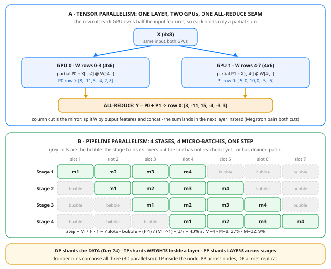

# Day 75 — Tensor & Pipeline Parallelism: Splitting the Model Itself

**Tonight you'll be able to:** explain the two ways to split a model that no longer fits on one GPU — **tensor parallelism** cuts one layer's weight matrix across GPUs and pays an all-reduce *inside* the layer, **pipeline parallelism** cuts the layers into stages and pays a fill/drain *bubble* — and price both before you ever launch a run.

## The one idea

Day 74 replicated: every GPU held the whole model and took a shard of the data. That works only while one copy fits — and Day 73 priced a copy at roughly 16 bytes per parameter once gradients and Adam state are counted, so a 70B model wants about 1.1 TB before activations. When the model itself is the thing that doesn't fit, there are exactly two places left to cut: **inside a layer**, or **between layers**. Those are tonight's two moves, and every big training run you will ever read about is some composition of them with Day 74.


**Tensor parallelism (TP) cuts inside a layer.** A layer is mostly one matmul, `Y = X · W`, and a matmul has two seams. Cut `W` by *columns* and each GPU owns some output features outright: it computes its slice of `Y` completely, and the slices are concatenated — no sums owed. Cut `W` by *rows* and each GPU owns some input features: it multiplies its slice of `X` by its slice of `W` and gets a *partial sum* — a number that is not the answer until every GPU's partial is added in. That addition is an **all-reduce** (Day 74's collective), and it sits *inside* the layer: the layer's output does not exist until the seam completes, in the forward pass and again in the backward pass. The framework you will meet by name, Megatron-LM, pairs the two cuts across a transformer's two matmuls (up-projection column-cut, down-projection row-cut) so exactly one all-reduce lands per layer. The win: each GPU stores only its slice of the weights, gradients, and optimizer state — 1/T of the layer at TP degree T. The cost: an activation-sized message on the critical path of *every* layer, so TP stays at small degree (2, 4, 8) inside one node, where the interconnect (NVLink) is an order of magnitude faster than anything between nodes. Contrast Day 74: DP's all-reduce happens once per step, on gradients, off the forward path. TP's happens per layer, mid-forward — same collective, completely different blast radius.


**Pipeline parallelism (PP) cuts between layers.** Stage 1 holds layers 1–8 on GPU 1, stage 2 holds layers 9–16 on GPU 2, and so on. The only traffic is the activation tensor crossing each stage boundary — one point-to-point message per boundary per micro-batch, tiny next to TP's per-layer all-reduce — so PP is the cut that can span nodes. Each GPU stores 1/P of the layers. The price is the **bubble**: feed one micro-batch through and only one stage is working at any moment, the rest idle. The fix is to chop the batch into `M` micro-batches and keep them all flowing (this schedule is called GPipe). A step then takes `M + P − 1` stage-slots — `M` of real work plus `P − 1` of fill and drain — so the bubble fraction is `(P−1) / (M+P−1)`. At P = 4: M = 1 wastes 75% of every GPU, M = 4 wastes 43%, M = 32 wastes 9%. Micro-batches buy the bubble down, but not for free: every in-flight micro-batch's activations must be kept until its backward pass arrives, so memory grows with M — and each micro-batch is a smaller matmul, which underuses the GPU a little. (Real schedulers also interleave backward passes earlier — you will meet the name 1F1B — but the bubble arithmetic above is the floor every schedule negotiates with.)


**Composing.** The three cuts are orthogonal because they shard three different things: DP shards the *data*, TP shards the *weights inside a layer*, PP shards the *layers*. A frontier run multiplies them — say TP = 8 inside each node, PP = 8 across nodes, DP = 64 replicas of that whole apparatus — which is why the combination is called **3D parallelism**. The decision order follows the physics: spend TP first on the fast fabric until the layer slices are thin enough, span nodes with PP, then replicate with DP as far as your data and your all-reduce budget allow.

## Analogy

**Tensor parallelism is a column-sharded table where every query ends in a join.** Split one wide row across nodes and storage is solved — but every read now pays a coordination round-trip mid-query, on the latency path, forever. You do that only on the fastest fabric you own, at small shard counts, and you never let it cross a slow link. The all-reduce seam inside the layer is exactly that round-trip: unavoidable once the row doesn't fit on one node, priced per layer instead of per step.


**Pipeline parallelism is an assembly line.** Four stations build a car. The first finished car takes four beats to appear — but after that, a car rolls off every beat. The bubble is the line filling at shift start and draining at shift end: real, bounded, and amortized by running more cars per shift. Micro-batches are the cars; `(P−1)/(M+P−1)` is just "fill + drain beats, divided by total beats," the same arithmetic you'd do for any staged stream processor.

## See it



Top: the row cut of one matmul. Each GPU multiplies the input features it owns and holds a partial sum — neither partial is the answer; the orange seam is the all-reduce that makes the layer's output exist. Bottom: a 4-stage pipeline on 4 micro-batches. Every stage does 4 slots of work and idles 3 — the grey corner triangles are the bubble, and micro-batches are how you shrink them.

## Code it (~30 min)

One file, two halves, no GPU required — this is arithmetic about clusters, run on one laptop. **Part 1** is Panel A made real: the exact matmul from the diagram, computed whole, then column-cut, then row-cut with its all-reduce. The matrices are integer-valued by formula, so the float sums are exact in any order and both cuts must match the one-GPU answer to `0.0` — if they don't, the code is wrong, not the rounding. **Part 2** prints Panel B as a text Gantt and prices the bubble for M = 1, 4, 8, 32. numpy only, in your `~/ai-lab` venv; no downloads, no APIs.

```python
"""Day 75 - Tensor & Pipeline Parallelism: Splitting the Model Itself.

Day 74 split the data: every GPU held the whole model and
trained on a shard of the rows. But Day 73's wall said the
model itself - weights + grads + Adam state - can exceed one
GPU. When the model doesn't fit, you split the MODEL. Two
cuts, at two different granularities:

  Tensor parallelism (TP) cuts INSIDE one layer. A layer is
  mostly one matmul, Y = X @ W, and a matmul can be cut two
  ways: by columns of W (each GPU owns some output features
  outright) or by rows of W (each GPU holds some input
  features and produces a PARTIAL sum - the partials must be
  added together, an all-reduce, before the layer's output
  exists). Megatron-style TP pairs the two cuts across a
  transformer's two matmuls, so the all-reduce lands once per
  layer - in the forward pass and again in the backward. That
  seam is on the critical path of every layer, so TP lives
  inside one node, on fast interconnect (NVLink), at small
  degree (2/4/8).

  Pipeline parallelism (PP) cuts ACROSS layers. Stage 1 holds
  layers 1-8, stage 2 layers 9-16, and activations flow
  stage to stage like cars on an assembly line. The messages
  are tiny (one activation tensor per boundary), so PP can
  span nodes - but the line takes time to fill: with P stages
  and M micro-batches, a step takes M + P - 1 slots and the
  idle "bubble" fraction is (P-1)/(M+P-1). Micro-batches are
  how you buy the bubble down.

  Part 1  One matmul, both TP cuts. X (4x8) @ W (8x6) with
          integer values built by formula, so float sums are
          exact in any order. Column cut: concat the shards.
          Row cut: all-reduce the partials. Both match the
          one-GPU answer with max diff 0.0 - TP changes where
          the numbers live, never what they are. Each GPU
          holds 24 of W's 48 numbers.
  Part 2  The pipeline bubble, priced. For P = 4 stages,
          print the schedule as a Gantt (M = 4) and the bubble
          table for M = 1, 4, 8, 32: 75.0% idle at M = 1,
          8.6% at M = 32. GPipe's trade in one line: more
          micro-batches shrink the bubble but keep more
          activations in flight.

Runs on the ~/ai-lab venv: numpy only (free), CPU on purpose,
no CUDA, no paid APIs, no downloads. No RNG - every matrix
entry comes from a formula, so every digit is exact.

Expected output:

  Part 1 - tensor parallelism: one matmul, two GPUs, two cuts
    X (4, 8) @ W (8, 6) -> Y (4, 6), W holds 48 numbers
    column cut: GPU0 W[:, :3] + GPU1 W[:, 3:], concat -> max diff vs one GPU: 0.0
    row cut:    GPU0 rows 0-3, GPU1 rows 4-7, partial sums all-reduced -> max diff: 0.0
    Y row 0, one GPU:  [3, -11, 15, -4, -3, 3]
    Y row 0, partials: [8, -11, 5, -4, 2, 8] + [-5, 0, 10, 0, -5, -5]  (neither is the answer alone)
    memory: each GPU stores 24 of W's 48 numbers - TP halves the layer per GPU
  Part 2 - pipeline parallelism: P stages, M micro-batches
    schedule for M = 4 (each token = one slot, . = bubble):
      stage 1: m1 m2 m3 m4  .  .  .
      stage 2:  . m1 m2 m3 m4  .  .
      stage 3:  .  . m1 m2 m3 m4  .
      stage 4:  .  .  . m1 m2 m3 m4
    M =  1: step =  4 slots, bubble = 3 slots (75.0%) per stage
    M =  4: step =  7 slots, bubble = 3 slots (42.9%) per stage
    M =  8: step = 11 slots, bubble = 3 slots (27.3%) per stage
    M = 32: step = 35 slots, bubble = 3 slots (8.6%) per stage
    verdict: micro-batches buy the bubble down - the cost is activations kept in flight
    TP shards weights inside a layer, PP shards layers, DP (Day 74) shards data - clusters compose all three
"""
import numpy as np

# ---------- Part 1: tensor parallelism - cut the matmul ----------
print("Part 1 - tensor parallelism: one matmul, two GPUs, two cuts")
# X: 4 rows (tokens) x 8 features.  W: 8 inputs -> 6 outputs.
# Integer values from formulas: products and sums are exact in
# float64 no matter what order they are added in.
X = np.array([[((i * 3 + j * 5) % 7) - 3 for j in range(8)]
              for i in range(4)], dtype=np.float64)
W = np.array([[((i * 2 + j * 3) % 5) - 2 for j in range(6)]
              for i in range(8)], dtype=np.float64)
Y = X @ W                                    # the one-GPU answer
print(f"  X {X.shape} @ W {W.shape} -> Y {Y.shape}, "
      f"W holds {W.size} numbers")

# Cut 1 - by columns: GPU 0 owns output features 0-2, GPU 1 owns 3-5.
Y_left = X @ W[:, :3]
Y_right = X @ W[:, 3:]
Y_cols = np.concatenate([Y_left, Y_right], axis=1)
d_cols = np.abs(Y_cols - Y).max()
print(f"  column cut: GPU0 W[:, :3] + GPU1 W[:, 3:], concat -> "
      f"max diff vs one GPU: {d_cols:.1f}")

# Cut 2 - by rows: GPU 0 owns input features 0-3, GPU 1 owns 4-7.
# Each computes a PARTIAL sum; neither holds the answer alone.
P0 = X[:, :4] @ W[:4, :]
P1 = X[:, 4:] @ W[4:, :]
Y_rows = P0 + P1                             # <-- the all-reduce
d_rows = np.abs(Y_rows - Y).max()
print(f"  row cut:    GPU0 rows 0-3, GPU1 rows 4-7, partial sums "
      f"all-reduced -> max diff: {d_rows:.1f}")
print(f"  Y row 0, one GPU:  {Y[0].astype(int).tolist()}")
print(f"  Y row 0, partials: {P0[0].astype(int).tolist()} + "
      f"{P1[0].astype(int).tolist()}  (neither is the answer alone)")
print(f"  memory: each GPU stores {W.size // 2} of W's {W.size} "
      f"numbers - TP halves the layer per GPU")

# ---------- Part 2: pipeline parallelism - price the bubble ----------
print("Part 2 - pipeline parallelism: P stages, M micro-batches")
P = 4

def bubble(P, M):
    """Step slots, idle slots per stage, bubble fraction."""
    slots = M + P - 1                        # fill + steady + drain
    return slots, P - 1, (P - 1) / slots

print("  schedule for M = 4 (each token = one slot, . = bubble):")
for s in range(P):
    cells = []
    for t in range(bubble(P, 4)[0]):
        m = t - s                            # stage s sees mb m at t
        cells.append(f"m{m + 1}" if 0 <= m < 4 else " .")
    print(f"    stage {s + 1}: " + " ".join(cells))
for M in (1, 4, 8, 32):
    slots, idle, frac = bubble(P, M)
    print(f"  M = {M:>2}: step = {slots:>2} slots, bubble = {idle} "
          f"slots ({frac:.1%}) per stage")
print("  verdict: micro-batches buy the bubble down - the cost is "
      "activations kept in flight")
print("  TP shards weights inside a layer, PP shards layers, "
      "DP (Day 74) shards data - clusters compose all three")
```

**Expected output:**

```
Part 1 - tensor parallelism: one matmul, two GPUs, two cuts
  X (4, 8) @ W (8, 6) -> Y (4, 6), W holds 48 numbers
  column cut: GPU0 W[:, :3] + GPU1 W[:, 3:], concat -> max diff vs one GPU: 0.0
  row cut:    GPU0 rows 0-3, GPU1 rows 4-7, partial sums all-reduced -> max diff: 0.0
  Y row 0, one GPU:  [3, -11, 15, -4, -3, 3]
  Y row 0, partials: [8, -11, 5, -4, 2, 8] + [-5, 0, 10, 0, -5, -5]  (neither is the answer alone)
  memory: each GPU stores 24 of W's 48 numbers - TP halves the layer per GPU
Part 2 - pipeline parallelism: P stages, M micro-batches
  schedule for M = 4 (each token = one slot, . = bubble):
    stage 1: m1 m2 m3 m4  .  .  .
    stage 2:  . m1 m2 m3 m4  .  .
    stage 3:  .  . m1 m2 m3 m4  .
    stage 4:  .  .  . m1 m2 m3 m4
  M =  1: step =  4 slots, bubble = 3 slots (75.0%) per stage
  M =  4: step =  7 slots, bubble = 3 slots (42.9%) per stage
  M =  8: step = 11 slots, bubble = 3 slots (27.3%) per stage
  M = 32: step = 35 slots, bubble = 3 slots (8.6%) per stage
  verdict: micro-batches buy the bubble down - the cost is activations kept in flight
  TP shards weights inside a layer, PP shards layers, DP (Day 74) shards data - clusters compose all three
```

## Today's win

Done when Part 1 prints `max diff: 0.0` for *both* cuts and you can say out loud why the row cut owes an all-reduce and the column cut doesn't. The keeper test, no notes: someone says "8 pipeline stages, 16 micro-batches" and you answer "bubble is 7/23, about 30% — shrink it with more micro-batches or fewer stages"; someone says "why is tensor parallel only 8-way and never across the datacenter?" and you answer "because its all-reduce sits inside every layer's forward pass — that seam only survives on NVLink."

## Short on time? 20-minute version

Read "The one idea", study the diagram's Gantt until the diagonal makes sense — the bubble is just the two grey triangles at the corners — then run only Part 2 and check the 75% → 9% ladder. Part 1's two cuts are the victory lap: come back to them when you have the full 30 minutes.

## Tomorrow's teaser

Tomorrow: you've now split training all three ways by hand — data, tensors, pipeline. Next, the frameworks that do the splitting for you, FSDP and DeepSpeed, and how to choose between them.

Streak: 75 day(s) · Never miss twice.
