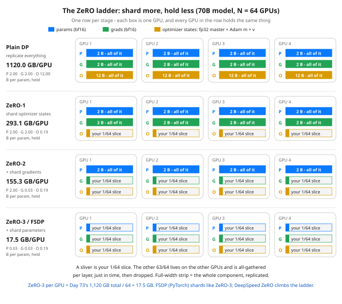

# Day 76 — FSDP & DeepSpeed: Shard the State, Gather Just in Time

**Tonight you'll be able to:** read any FSDP or DeepSpeed ZeRO setup and say exactly what is sharded at each stage, what one GPU actually holds for a 7B and a 70B model, and what the sharding costs on the wire — in numbers you computed yourself.

## The one idea

Three days of problem, one day of product. Day 73 priced the wall: training state runs about 16 bytes per parameter, so a 70B model owes 1,120 GB before a single activation. Day 74's data parallelism (DP) scaled the compute but not the bill — every GPU holds a full replica of the model, so every GPU owes the full 16 bytes per parameter, and adding GPUs does not move the per-GPU debt. Day 75 split the model itself across devices. Tonight is the third answer, and the one you will actually meet in job descriptions: keep data parallelism's simple shape — every worker trains on its own shard of the data, all workers step in lockstep — but **shard the training state instead of replicating it**. Two frameworks automate it: **FSDP** (Fully Sharded Data Parallel, built into PyTorch) and **DeepSpeed** (Microsoft's training library), whose **ZeRO** — Zero Redundancy Optimizer — stages are the ladder in tonight's diagram. Same core trick, two addresses.

**The one idea:** of the 16 bytes per parameter, almost none of it is needed by a given GPU at a given moment. To compute one layer, a GPU needs *that layer's* parameters — all of them, briefly — and nothing else. So each GPU permanently owns 1/N of everything: 1/N of the parameter shards, 1/N of the gradients, 1/N of the optimizer states. When a layer's turn comes in the forward pass, the fleet **all-gathers** that layer's full parameters from their owners (the collective where everyone ends up holding everyone's pieces — Day 74's vocabulary), the layer computes, and the gathered copy is dropped. The backward pass gathers it again, and the layer's gradients are **reduce-scattered** — summed across the fleet and left as shards with their owners — so each GPU's optimizer step updates only the shard it owns. The full model exists on any one GPU only one layer at a time: a working set, not a residence. Per-GPU memory falls toward 16/N bytes per parameter; what grows is traffic on the wire. That trade — memory for bandwidth — is the entire lesson, and Part 3 prices it.

One bookkeeping note before the ladder. Day 73 sliced the 16 as fp32 master (4) + fp32 grads (4) + Adam m (4) + v (4), and warned that frameworks mix dtypes differently. ZeRO's own slicing — tonight's, because the stages are defined over it — is bf16 params, the compute copy (2) + bf16 grads (2) + optimizer states (12) = fp32 master (4) + m (4) + v (4). Same 16 total. What matters is what the stages shard, and optimizer states are 12 of the 16 bytes — which is why they go first.

**The ladder.** **ZeRO-1** shards only the optimizer states: params and grads stay whole on every GPU (2 + 2), the states divide by N — 4 + 12/N bytes per parameter. **ZeRO-2** shards the gradients too: 2 + 14/N. **ZeRO-3** shards the parameters themselves: 16/N, nothing replicated. That stage is FSDP's default full sharding, which is why the two names share a row in every table tonight. Read Part 1's table by its shape, not its digits: stage 1 takes the biggest single bite, each further stage buys less at N=8 and more at N=64, and only stage 3 makes residency fall without limit as the fleet grows. And notice what is *not* in these numbers: activations (Day 73) remain a per-GPU bill on top — sharding the state does not shard your micro-batch.

**The honest cost is communication**, and it lands in two places. First, volume: stages 1 and 2 sync the same gradient bytes plain DP does (the ZeRO paper's own accounting — a reduce-scatter moves what an all-reduce moves), but stage 3 must also move the parameters themselves: a full all-gather in the forward pass and another in the backward, plus the gradient reduce-scatter — 1.5× DP's total traffic per step, priced in Part 3 at Day 74's 50 GB/s. Second, latency: a layer cannot start until its gather lands, so the frameworks **prefetch** — gather layer k+1 while layer k computes — overlapping the wire with the math. When the overlap works you pay mostly volume; when the interconnect is slow (no NVLink inside the node, thin Ethernet between nodes), the gathers sit exposed and sharding can train *slower* than a smaller model on plain DP. Sharding is not free memory. It is memory bought with bandwidth, at an exchange rate your interconnect sets.

**When each applies.** If model + states fit per GPU with room for activations, plain DDP (PyTorch's DistributedDataParallel) is the right answer and sharding is pure overhead. If the optimizer states are the overflow — the classic 7B–13B fine-tune that almost fits — ZeRO-1 or ZeRO-2 is the sweet spot: most of the memory win, none of the extra wire traffic. If even the parameters don't fit, or you are pretraining at 70B+, it is ZeRO-3 / FSDP, on hardware with the interconnect to feed it. Between the frameworks: FSDP lives inside PyTorch and wraps your model module by module (the sharding unit is a wrapped block, usually one transformer layer), so it composes with the rest of the PyTorch stack; DeepSpeed is a separate library driven by a JSON config, climbs the same ladder by stage number, and adds ZeRO-Offload / ZeRO-Infinity — spilling shards to CPU RAM or NVMe when even 16/N is too much. The two usages, as sketches:

**Sketch — not run today** (a multi-GPU job; the MacBook has one GPU). PyTorch FSDP:

```python
import torch
from torch.distributed.fsdp import FullyShardedDataParallel as FSDP
from torch.distributed.fsdp.wrap import transformer_auto_wrap_policy

model = FSDP(model, auto_wrap_policy=transformer_auto_wrap_policy)
# training loop unchanged: each wrapped block's params are
# all-gathered for its forward/backward, then freed again
```

**Sketch — not run today** (same reason). DeepSpeed ZeRO, where the config carries the decision:

```python
# ds_config.json: { "zero_optimization": { "stage": 3 } }
import deepspeed

model, optimizer, _, _ = deepspeed.initialize(
    model=model, model_parameters=model.parameters(),
    config="ds_config.json")
# same loop either way - the stage number climbs the ladder
```

## Analogy

You have run this design for years — it is replication vs sharding, the storage trade in a new uniform. Plain DP is full replication: every node stores every object, reads never leave the node, and the capacity bill is the dataset times the fleet. ZeRO is sharding with fetch-on-read: each node owns a shard, a read materializes the object locally, uses it, and evicts it — the gathered layer is a cache entry whose lifetime is one layer's compute, and prefetch is readahead. You would never replicate 1.12 TB to 64 nodes just to avoid fetches; the frameworks simply refuse to do the GPU version of it. And the failure mode is the familiar one too: shard over a slow link and the fetches — not the disks, here not the FLOPs — become the system.

## See it



The ladder at 70B on 64 GPUs. Each row is one stage; the four boxes are four of the 64 GPUs, all holding the same thing. Inside a GPU: P = params (bf16, 2 B/param unsharded), G = grads (2 B), O = optimizer states (12 B) — a full-width strip means the component is replicated whole, a sliver means this GPU keeps only its 1/64 shard and the rest is all-gathered per layer, just in time. Watch the amber strip: it holds 12 of the 16 bytes, so ZeRO-1's single move does most of the work; by ZeRO-3 / FSDP nothing is replicated and one GPU's 1,120 GB bill is 17.5 GB.

## Code it (~30 min)

No GPUs tonight — the runnable artifact is the accounting itself, pure standard library. **Part 1** prints the ladder as a table: per-GPU static memory for 7B and 70B under plain DP vs ZeRO-1/2/3 at N=8 and N=64. **Part 2** cashes Day 73's check: ZeRO-3's per-GPU number is exactly the perfect split Day 73 could only divide on paper. **Part 3** moves the bill to the wire and prices stage 3's extra traffic at Day 74's 50 GB/s. The FSDP and DeepSpeed snippets above are labeled sketches for multi-GPU jobs — but every number below runs, here and on the MacBook.

```python
"""Day 76 - FSDP & DeepSpeed: Shard the State, Gather Just in Time.

Days 73-75 priced the problem three ways. Day 73: training
state costs ~16 bytes per parameter, and plain data parallel
(Day 74) makes EVERY GPU pay all 16 - replicate the model,
replicate the bill. Day 75 split the model itself. Tonight
is the third answer, and it is the one the frameworks -
PyTorch FSDP and Microsoft's DeepSpeed ZeRO - automate:

    Shard the state across the data-parallel workers, and
    all-gather each layer's parameters just in time to
    compute with them, then drop the gathered copy.

THE RECIPE (ZeRO slicing - same 16 total as Day 73, cut
differently; frameworks shuffle which copy wears which
dtype, the 16 and the sharding structure are what matter):
  bf16 params (compute copy) ... 2 bytes  replicated in DP,
                                 ZeRO-1, ZeRO-2; sharded in 3
  bf16 gradients ............... 2 bytes  replicated in DP and
                                 ZeRO-1; sharded from ZeRO-2 on
  optimizer states ............ 12 bytes  fp32 master weights 4
                                 + Adam m 4 + v 4; replicated
                                 only in plain DP, sharded from
                                 ZeRO-1 on
  TOTAL ........................ 16 bytes per parameter

THE LADDER (DeepSpeed ZeRO stages; FSDP's default full
sharding is ZeRO-3's twin):
  ZeRO-1  shard optimizer states:  per GPU 4 + 12/N B/param
  ZeRO-2  + shard gradients:       per GPU 2 + 14/N B/param
  ZeRO-3  + shard parameters:      per GPU 16/N   B/param

  Part 1  Per-GPU static memory for 7B and 70B under plain
          DP vs ZeRO-1/2/3 at N=8 and N=64 - the ladder as
          a table. Activations are NOT in these numbers:
          they are Day 73's separate, per-GPU bill.
  Part 2  The stand-still test, revisited: ZeRO-3 per-GPU
          memory is Day 73's total divided by N - the
          perfect split Day 73 could only hypothesize.
  Part 3  The honest cost, on the wire. Stages 1-2 sync the
          same gradient bytes as DP (the ZeRO paper's own
          accounting). Stage 3 adds two all-gathers of the
          full params per step - forward and backward - for
          1.5x DP's traffic, priced at Day 74's 50 GB/s.

Runs anywhere: pure standard library, no torch, no GPU,
no downloads, no APIs. The whole lesson is counting bytes
and bytes-on-wires, so it runs on the MacBook ~/ai-lab
venv in milliseconds.

Expected output:

  Part 1 - per-GPU static memory: one 16 B/param bill, four holders
    recipe (ZeRO slicing): bf16 params 2 + bf16 grads 2 + states 12
    states = fp32 master 4 + Adam m 4 + v 4; total 16 B/param -
    Day 73's same 16, re-sliced (frameworks shuffle the dtypes)
    7B model - GB resident per GPU (no activations):
      stage          B/param     @ N=8  B/param    @ N=64
      plain DP         16.00     112.0    16.00     112.0
      ZeRO-1            5.50      38.5     4.19      29.3
      ZeRO-2            3.75      26.2     2.22      15.5
      ZeRO-3 / FSDP     2.00      14.0     0.25       1.8
    70B model - GB resident per GPU (no activations):
      stage          B/param     @ N=8  B/param    @ N=64
      plain DP         16.00    1120.0    16.00    1120.0
      ZeRO-1            5.50     385.0     4.19     293.1
      ZeRO-2            3.75     262.5     2.22     155.3
      ZeRO-3 / FSDP     2.00     140.0     0.25      17.5
  Part 2 - the stand-still test (Day 73), answered
    Day 73: 70B static total = 1120 GB = 14 cards' worth IF split perfectly
    plain DP never splits it: every GPU owes all 1120 GB, at any fleet size
    ZeRO-3 @ N=64: 17.5 GB per GPU - Day 73's total / 64 exactly,
      the perfect split achieved; headroom on an 80 GB card: 62.5 GB
      for activations + the one layer gathered at a time
    7B ZeRO-3 @ N=8: 14.0 GB per GPU - Day 73 needed 2 cards to hold it
  Part 3 - sync traffic per step (N=64): the honest cost
    ring factor (N-1)/N = 63/64; effective link 50 GB/s (Day 74)
    7B: full params 14 GB, full grads 14 GB (bf16)
      plain DP / ZeRO-1 / ZeRO-2: all-reduce grads = 27.6 GB -> 0.55 s
      ZeRO-3 / FSDP: gathers 13.8 + 13.8 + reduce-scatter 13.8 = 41.3 GB -> 0.83 s
    70B: full params 140 GB, full grads 140 GB (bf16)
      plain DP / ZeRO-1 / ZeRO-2: all-reduce grads = 275.6 GB -> 5.51 s
      ZeRO-3 / FSDP: gathers 137.8 + 137.8 + reduce-scatter 137.8 = 413.4 GB -> 8.27 s
    ratio: exactly 1.50x DP's traffic, for up to 64x less resident memory
    verdict: memory traded for bandwidth. On NVLink /
    InfiniBand that trade wins, with prefetch hiding the
    gathers; on slow links the same sharding loses.
"""
import math

GB = 1e9                      # gigabytes as sold: 10^9 bytes
GPU_GB = 80                   # one H100/A100-class card
LINK_GBs = 50                 # Day 74's effective interconnect

# The 16 bytes, ZeRO slicing (see docstring).
PARAMS = 2                    # bf16 compute copy
GRADS = 2                     # bf16 gradients
STATES = 12                   # fp32 master 4 + Adam m 4 + v 4
TOTAL = PARAMS + GRADS + STATES          # 16 B/param

STAGES = ("plain DP", "ZeRO-1", "ZeRO-2", "ZeRO-3 / FSDP")


def bpp(stage, n):
    """Bytes per parameter RESIDENT on one GPU, fleet size n."""
    if stage == "plain DP":
        return float(TOTAL)
    if stage == "ZeRO-1":      # shard optimizer states only
        return PARAMS + GRADS + STATES / n
    if stage == "ZeRO-2":      # + shard gradients
        return PARAMS + (GRADS + STATES) / n
    return TOTAL / n           # ZeRO-3 / FSDP: shard everything


# ---------- Part 1: the ladder as a table ----------
print("Part 1 - per-GPU static memory: one 16 B/param bill, "
      "four holders")
print("  recipe (ZeRO slicing): bf16 params 2 + bf16 grads 2 "
      "+ states 12")
print("  states = fp32 master 4 + Adam m 4 + v 4; total 16 "
      "B/param -")
print("  Day 73's same 16, re-sliced (frameworks shuffle the "
      "dtypes)")
for label, pb in (("7B", 7), ("70B", 70)):
    print(f"  {label} model - GB resident per GPU "
          "(no activations):")
    print(f"    {'stage':<14} {'B/param':>7} {'@ N=8':>9} "
          f"{'B/param':>8} {'@ N=64':>9}")
    for stage in STAGES:
        b8, b64 = bpp(stage, 8), bpp(stage, 64)
        print(f"    {stage:<14} {b8:>7.2f} {b8 * pb:>9.1f} "
              f"{b64:>8.2f} {b64 * pb:>9.1f}")

# ---------- Part 2: the stand-still test, answered ----------
print("Part 2 - the stand-still test (Day 73), answered")
total70 = 70 * TOTAL
print(f"  Day 73: 70B static total = {total70:.0f} GB = "
      f"{math.ceil(total70 / GPU_GB)} cards' worth IF split "
      "perfectly")
print(f"  plain DP never splits it: every GPU owes all "
      f"{total70:.0f} GB, at any fleet size")
z3_70 = bpp("ZeRO-3 / FSDP", 64) * 70
print(f"  ZeRO-3 @ N=64: {z3_70:.1f} GB per GPU - Day 73's "
      "total / 64 exactly,")
print(f"    the perfect split achieved; headroom on an 80 GB "
      f"card: {GPU_GB - z3_70:.1f} GB")
print("    for activations + the one layer gathered at a time")
z3_7 = bpp("ZeRO-3 / FSDP", 8) * 7
print(f"  7B ZeRO-3 @ N=8: {z3_7:.1f} GB per GPU - Day 73 "
      "needed 2 cards to hold it")

# ---------- Part 3: the bill moves to the wire ----------
print("Part 3 - sync traffic per step (N=64): the honest cost")
RING = (64 - 1) / 64           # Day 74's ring factor (N-1)/N
print(f"  ring factor (N-1)/N = 63/64; effective link "
      f"{LINK_GBs} GB/s (Day 74)")
for label, pb in (("7B", 7), ("70B", 70)):
    p_gb = pb * PARAMS         # full params, bf16
    g_gb = pb * GRADS          # full grads, bf16
    dp = 2 * RING * g_gb                   # one grad all-reduce
    gather = RING * p_gb                   # one param all-gather
    rs = RING * g_gb                       # grad reduce-scatter
    z3 = 2 * gather + rs          # fwd + bwd gathers + rs
    print(f"  {label}: full params {p_gb:.0f} GB, full grads "
          f"{g_gb:.0f} GB (bf16)")
    print(f"    plain DP / ZeRO-1 / ZeRO-2: all-reduce grads "
          f"= {dp:.1f} GB -> {dp / LINK_GBs:.2f} s")
    print(f"    ZeRO-3 / FSDP: gathers {gather:.1f} + "
          f"{gather:.1f} + reduce-scatter {rs:.1f} = "
          f"{z3:.1f} GB -> {z3 / LINK_GBs:.2f} s")
print("  ratio: exactly 1.50x DP's traffic, for up to 64x "
      "less resident memory")
print("  verdict: memory traded for bandwidth. On NVLink /")
print("  InfiniBand that trade wins, with prefetch hiding the")
print("  gathers; on slow links the same sharding loses.")
```

**Expected output:**

```
Part 1 - per-GPU static memory: one 16 B/param bill, four holders
  recipe (ZeRO slicing): bf16 params 2 + bf16 grads 2 + states 12
  states = fp32 master 4 + Adam m 4 + v 4; total 16 B/param -
  Day 73's same 16, re-sliced (frameworks shuffle the dtypes)
  7B model - GB resident per GPU (no activations):
    stage          B/param     @ N=8  B/param    @ N=64
    plain DP         16.00     112.0    16.00     112.0
    ZeRO-1            5.50      38.5     4.19      29.3
    ZeRO-2            3.75      26.2     2.22      15.5
    ZeRO-3 / FSDP     2.00      14.0     0.25       1.8
  70B model - GB resident per GPU (no activations):
    stage          B/param     @ N=8  B/param    @ N=64
    plain DP         16.00    1120.0    16.00    1120.0
    ZeRO-1            5.50     385.0     4.19     293.1
    ZeRO-2            3.75     262.5     2.22     155.3
    ZeRO-3 / FSDP     2.00     140.0     0.25      17.5
Part 2 - the stand-still test (Day 73), answered
  Day 73: 70B static total = 1120 GB = 14 cards' worth IF split perfectly
  plain DP never splits it: every GPU owes all 1120 GB, at any fleet size
  ZeRO-3 @ N=64: 17.5 GB per GPU - Day 73's total / 64 exactly,
    the perfect split achieved; headroom on an 80 GB card: 62.5 GB
    for activations + the one layer gathered at a time
  7B ZeRO-3 @ N=8: 14.0 GB per GPU - Day 73 needed 2 cards to hold it
Part 3 - sync traffic per step (N=64): the honest cost
  ring factor (N-1)/N = 63/64; effective link 50 GB/s (Day 74)
  7B: full params 14 GB, full grads 14 GB (bf16)
    plain DP / ZeRO-1 / ZeRO-2: all-reduce grads = 27.6 GB -> 0.55 s
    ZeRO-3 / FSDP: gathers 13.8 + 13.8 + reduce-scatter 13.8 = 41.3 GB -> 0.83 s
  70B: full params 140 GB, full grads 140 GB (bf16)
    plain DP / ZeRO-1 / ZeRO-2: all-reduce grads = 275.6 GB -> 5.51 s
    ZeRO-3 / FSDP: gathers 137.8 + 137.8 + reduce-scatter 137.8 = 413.4 GB -> 8.27 s
  ratio: exactly 1.50x DP's traffic, for up to 64x less resident memory
  verdict: memory traded for bandwidth. On NVLink /
  InfiniBand that trade wins, with prefetch hiding the
  gathers; on slow links the same sharding loses.
```

## Today's win

Done when your run prints Part 1's checkpoint digits — 70B: plain DP 1120.0 GB at every N, ZeRO-3 at 140.0 GB (N=8) and 17.5 GB (N=64); 7B ZeRO-3 at N=64 down to 1.8 GB — and Part 3's verdict pair: 275.6 GB/step for DP vs 413.4 GB/step for ZeRO-3 at 70B, a ratio of exactly 1.50×. Keeper test, no notes: someone shows you a DeepSpeed config with `"stage": 2` on a fleet of 8 — you can say what is sharded (optimizer states + gradients), what is still replicated (the bf16 params), what one GPU holds for a 13B model (2 + 14/8 = 3.75 B/param ≈ 48.8 GB), and that its wire bill matches plain DP's.

## Short on time? 20-minute version

Read “The one idea”, climb the diagram's ladder until you can name what each stage shards, then run Part 1 only. If you can say why stage 1 takes the biggest bite (12 of the 16 bytes are optimizer states) and why stage 3 alone scales to 16/N, you have the day — Parts 2 and 3 are the receipts.

## Tomorrow's teaser

Tomorrow: half the bytes in tonight's recipe wear a 16-bit dtype — why training in half precision mostly just works, and the one silent way it fails.

Streak: 76 day(s) · Never miss twice.
