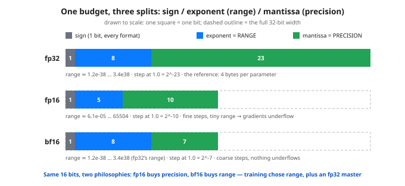

# Day 77 — Mixed Precision: FP16/BF16, and Why It (Mostly) Just Works

**Tonight you'll be able to:** read any floating-point format as a bit budget — sign, exponent, mantissa — and predict its two failure modes before they bite: fp16 gradients underflowing to zero (fixed by loss scaling) and low-precision weights swallowing small updates (fixed by the fp32 master copy you priced on Day 73).

## The one idea

Day 73 priced the mixed-precision recipe — bf16 compute copy, fp32 master, 16 bytes a parameter — without ever opening the formats up. Tonight is the missing picture, and it's a single idea: **a floating-point number is a bit budget.** Every float is stored as `sign × 2^exponent × 1.mantissa`. The **exponent** bits pick the scale, how big or small the number can be: that's *range*. The **mantissa** bits say how many distinct values exist inside each scale band — how far apart neighboring representable numbers sit: that's *precision*. The total is fixed, so every format is just a decision about the split:

- **fp32** — 1 sign / 8 exponent / 23 mantissa. Range ≈1.2e-38 … 3.4e38; neighbors at 1.0 sit 2^-23 apart.
- **fp16** — 1 / 5 / 10. Finer steps than bf16 near 1.0 (2^-10), but only 5 exponent bits: max 65504, smallest normal ≈6.1e-5, smallest step of any kind 2^-24 ≈ 6e-8.
- **bf16** — 1 / 8 / 7. Literally fp32 with the mantissa chopped from 23 bits to 7: *same exponent, same range*, values just get coarser — neighbors at 1.0 sit 2^-7 apart.

**Why halving the bits works at all:** the matmuls from Day 13 don't care. Weights and activations live in a modest band, 16-bit tensor-core math runs roughly twice as fast at half the memory, and SGD (Day 18) is noisy enough that rounding noise disappears into it. The failures live at the edges, and there are exactly two.

**Failure 1 — underflow (fp16's disease).** Gradients are products of many small numbers; late in training plenty sit at 1e-6 to 1e-8. In fp16, anything below half of 2^-24 rounds to *exactly 0.0* — not small, gone. That weight silently stops learning and nothing crashes; the loss just gets a little worse (Day 31's flatline, one weight at a time). bf16 is immune: its floor is fp32's floor. The fp16 fix is **loss scaling**: multiply the loss by a constant S (say 1024) before `backward()`. The chain rule (Day 23) multiplies every gradient by the same S, lifting the tiny ones into fp16's representable band; divide by S again right before the optimizer step, so the actual update is unchanged. PyTorch's `GradScaler` is exactly this, with S auto-adjusted when it spots an inf.

**Failure 2 — swamping (both formats).** The update rule is `w -= lr × g`: tiny edits to a biggish weight. At w = 1.0 the representable gap is 2^-10 in fp16 and 2^-7 in bf16, so a typical 1e-4 update falls *inside* the gap and rounds straight back to w — every step, deterministically. The fix is Day 73's fp32 master copy: updates accumulate in fp32, and a fresh 16-bit copy is cast for compute each step. Note the direction of the trade: bf16's gap is *wider*, so swamping is worse there — bf16 bought range, not precision, and the master copy is what pays the precision bill.

So “we train in bf16” unpacks to: compute in a format that can't overflow or underflow, remember in a format that can't swallow updates. Two formats, each covering the other's failure — that's the whole recipe.

## Analogy

A float is a ruler printed for one decade at a time. The exponent chooses which decade the ruler covers (10^-38 up to 10^38); the mantissa is how many tick marks get printed in that decade — always the same count, so the ticks spread wider as numbers grow. fp16 prints 1,024 ticks per decade but only stocks the middle decades; bf16 prints a measly 128 ticks per decade but stocks every decade fp32 does. Loss scaling is the stopwatch trick: if your clock only shows whole seconds, time the race in milliseconds — same durations, shifted into the band where the ticks exist. And swamping is the metrics-counter bug every systems engineer has met: add 0.0001 to a float counter sitting at 1.0 a hundred times and it never moves, because each increment falls between the ticks. The fp32 master copy is simply refusing to keep the counter in the lossy format.

## See it



Three floats drawn to scale, one square per bit. fp32 (top) is the reference budget: 1/8/23. fp16 spends its 16 bits on mantissa — finer ticks, but the exponent shrinks to 5 bits and the range collapses. bf16 keeps fp32's 8 exponent bits and pays with mantissa — same range, coarser ticks. The dashed outline is the full 32-bit width, for scale.

## Code it (~30 min)

numpy tonight: it ships real `float16`, and bf16 is emulated honestly — a one-line function that chops an fp32's mantissa to its top 7 bits (on your Mac, `torch.bfloat16` is the genuine dtype; real hardware rounds instead of chopping, so a value can differ by one last-bit step — the grid of representable values is identical). **Part 1** casts everyday values and prints what survives. **Part 2** kills a gradient in fp16, then rescues it with loss scaling. **Part 3** is the money shot: 100 updates that never happen in fp16, and all land in the fp32 master.

```python
"""Day 77 - Mixed Precision: FP16/BF16, and Why It (Mostly) Just Works.

Day 73 priced the mixed-precision recipe at 16 bytes per
parameter without ever saying what the formats ARE. Tonight
is the missing bit-level picture, and it is one idea:

    A float is a BIT BUDGET split between RANGE (exponent
    bits: how big/small a number can be) and PRECISION
    (mantissa bits: how finely it can be told apart from
    its neighbors). fp32 = 1/8/23, fp16 = 1/5/10,
    bf16 = 1/8/7 (sign / exponent / mantissa).

bf16 keeps fp32's 8 exponent bits - the same range, roughly
1e-38 to 3e38 - and pays with precision: only 7 mantissa
bits. fp16 spends 5 bits on exponent and 10 on mantissa:
finer steps, but the range collapses to about 6e-5..65504
for normal numbers. That single trade explains everything
that follows:

  Part 1  Representability probes. Cast everyday values
          into fp16 and bf16 and print what survives. Both
          formats mangle pi and a $1000.10 price; only fp16
          dies at 70000 (overflow to inf). bf16 is coarser
          everywhere - precision is what it sold.
  Part 2  Underflow, and the loss-scaling rescue. Real
          gradients are tiny: 1e-8 in fp16 rounds to EXACTLY
          0.0 - the update silently never happens. bf16's
          range lets 1e-8 survive unscaled. For fp16,
          multiply the loss by S=1024 before backward and
          every gradient comes out 1024x bigger; divide by
          S before the step. The gradient lands back, alive.
  Part 3  Swamping - why the master copy stays fp32.
          w = 1.0, update = 1e-4, 100 steps. In fp16 the
          update is 10x smaller than the gap between
          representable neighbors (2^-10), so w + u rounds
          back to w EVERY time: 100 updates, zero movement.
          The fp32 master copy absorbs all 100. bf16 is
          even coarser near 1.0 (gap 2^-7), so the master
          copy is not optional in either format - bf16
          fixes range, NOT precision.

Runs on the ~/ai-lab venv: numpy only (free), no CUDA, no
paid APIs, no downloads. numpy has float16 built in but NO
bfloat16, so bf16 is emulated here by chopping an fp32's
mantissa to its top 7 bits - real hardware rounds instead
of chopping, so a value can differ by one last-bit step,
but the grid of representable values is identical. On the
Mac, torch has the real thing: torch.tensor(x,
dtype=torch.bfloat16). Every input is a fixed literal -
no RNG anywhere, every digit exact.

Expected output:

  Part 1 - the bit budget: fp32 1/8/23, fp16 1/5/10, bf16 1/8/7
    (sign / exponent = RANGE / mantissa = PRECISION)
             0.1  fp16 ->     0.099976   bf16 ->     0.099609
             1.1  fp16 ->     1.099609   bf16 ->     1.093750
      3.14159265  fp16 ->     3.140625   bf16 ->     3.140625
          1000.1  fp16 ->  1000.000000   bf16 ->  1000.000000
         70000.0  fp16 ->          inf   bf16 -> 69632.000000
    both mangle 0.1, pi, and the $1000.10 price; only fp16
    overflows at 70000 (its max is 65504) - bf16 kept fp32's range
  Part 2 - tiny gradients: fp16 underflow vs loss scaling (S=1024)
    true grad   fp16 direct   fp16 via scale   bf16 direct
        1e-03    1.0004e-03       1.0004e-03    9.9945e-04
        1e-05    1.0014e-05       9.9987e-06    9.9540e-06
        1e-07    1.1921e-07       1.0000e-07    9.9652e-08
        1e-08    0.0000e+00       1.0012e-08    9.9535e-09
    fp16's smallest step is 2^-24 = 5.96e-08, so 1e-8 rounds to 0.0
    scaled by 1024 it casts safely, then /1024 brings it back alive
    bf16 needs no scaling here: its range reaches down to ~1e-38
  Part 3 - swamping: w = 1.0, update = 1e-4, applied 100 times
    after   1 updates:  fp16 w = 1.0000000   fp32 master = 1.0001000
    after  10 updates:  fp16 w = 1.0000000   fp32 master = 1.0010002
    after 100 updates:  fp16 w = 1.0000000   fp32 master = 1.0100017
    total movement: fp16 0.0000000   fp32 0.0100017   (true: 0.0100000)
    fp32's extra 0.0000017 is its own rounding dust - every update
    LANDED; in fp16 the 100 updates never existed at all
    near 1.0 the representable gap is 2^-10 (fp16) / 2^-7 (bf16) /
    2^-23 (fp32): a 1e-4 update falls inside fp16's gap and rounds
    away every single step - the fp32 master is where updates live
    verdict: low precision computes, fp32 remembers - that is the
    whole recipe, and Day 73's 16 bytes/param is its price tag
"""
import warnings

import numpy as np

warnings.filterwarnings("ignore")   # fp16 overflow prints inf on purpose


def to_bf16(x):
    """Emulate bfloat16: keep fp32's sign + 8 exponent bits,
    truncate the mantissa to its top 7 bits. (numpy has no
    bf16 dtype; torch does - see the docstring.)"""
    bits = np.float32(x).view(np.uint32)
    return (bits & np.uint32(0xFFFF0000)).view(np.float32)


# ---------- Part 1: the bit budget - what survives the cast ----------
print("Part 1 - the bit budget: fp32 1/8/23, fp16 1/5/10, bf16 1/8/7")
print("  (sign / exponent = RANGE / mantissa = PRECISION)")
probes = [0.1, 1.1, 3.14159265, 1000.1, 70000.0]
for v in probes:
    f16 = float(np.float16(v))
    bf = float(to_bf16(v))
    print(f"  {v:>12}  fp16 -> {f16:>12.6f}   bf16 -> {bf:>12.6f}")
print("  both mangle 0.1, pi, and the $1000.10 price; only fp16")
print("  overflows at 70000 (its max is 65504) - bf16 kept fp32's range")

# ---------- Part 2: underflow, and the loss-scaling rescue ----------
print("Part 2 - tiny gradients: fp16 underflow vs loss scaling (S=1024)")
S = 1024.0
grads = [1e-3, 1e-5, 1e-7, 1e-8]
print("  true grad   fp16 direct   fp16 via scale   bf16 direct")
for g in grads:
    direct = float(np.float16(g))
    rescued = float(np.float16(g * S)) / S   # scale up, cast, scale back
    bf = float(to_bf16(g))
    print(f"  {g:>9.0e}   {direct:>11.4e}   {rescued:>14.4e}   {bf:>11.4e}")
print("  fp16's smallest step is 2^-24 = 5.96e-08, so 1e-8 rounds to 0.0")
print("  scaled by 1024 it casts safely, then /1024 brings it back alive")
print("  bf16 needs no scaling here: its range reaches down to ~1e-38")

# ---------- Part 3: swamping - why the master copy stays fp32 ----------
print("Part 3 - swamping: w = 1.0, update = 1e-4, applied 100 times")
w16, w32 = np.float16(1.0), np.float32(1.0)
u16, u32 = np.float16(1e-4), np.float32(1e-4)
marks = {}
for step in range(1, 101):
    w16 = np.float16(w16 + u16)      # pure fp16 weight: update + store
    w32 = np.float32(w32 + u32)      # fp32 master copy
    if step in (1, 10, 100):
        marks[step] = (float(w16), float(w32))
for step, (a, b) in marks.items():
    print(f"  after {step:>3} updates:  fp16 w = {a:.7f}   fp32 master = {b:.7f}")
moved16 = float(w16) - 1.0
moved32 = float(w32) - 1.0
print(f"  total movement: fp16 {moved16:.7f}   fp32 {moved32:.7f}"
      "   (true: 0.0100000)")
print("  fp32's extra 0.0000017 is its own rounding dust - every update")
print("  LANDED; in fp16 the 100 updates never existed at all")
print("  near 1.0 the representable gap is 2^-10 (fp16) / 2^-7 (bf16) /")
print("  2^-23 (fp32): a 1e-4 update falls inside fp16's gap and rounds")
print("  away every single step - the fp32 master is where updates live")
print("  verdict: low precision computes, fp32 remembers - that is the")
print("  whole recipe, and Day 73's 16 bytes/param is its price tag")
```

**Expected output:**

```
Part 1 - the bit budget: fp32 1/8/23, fp16 1/5/10, bf16 1/8/7
  (sign / exponent = RANGE / mantissa = PRECISION)
           0.1  fp16 ->     0.099976   bf16 ->     0.099609
           1.1  fp16 ->     1.099609   bf16 ->     1.093750
    3.14159265  fp16 ->     3.140625   bf16 ->     3.140625
        1000.1  fp16 ->  1000.000000   bf16 ->  1000.000000
       70000.0  fp16 ->          inf   bf16 -> 69632.000000
  both mangle 0.1, pi, and the $1000.10 price; only fp16
  overflows at 70000 (its max is 65504) - bf16 kept fp32's range
Part 2 - tiny gradients: fp16 underflow vs loss scaling (S=1024)
  true grad   fp16 direct   fp16 via scale   bf16 direct
      1e-03    1.0004e-03       1.0004e-03    9.9945e-04
      1e-05    1.0014e-05       9.9987e-06    9.9540e-06
      1e-07    1.1921e-07       1.0000e-07    9.9652e-08
      1e-08    0.0000e+00       1.0012e-08    9.9535e-09
  fp16's smallest step is 2^-24 = 5.96e-08, so 1e-8 rounds to 0.0
  scaled by 1024 it casts safely, then /1024 brings it back alive
  bf16 needs no scaling here: its range reaches down to ~1e-38
Part 3 - swamping: w = 1.0, update = 1e-4, applied 100 times
  after   1 updates:  fp16 w = 1.0000000   fp32 master = 1.0001000
  after  10 updates:  fp16 w = 1.0000000   fp32 master = 1.0010002
  after 100 updates:  fp16 w = 1.0000000   fp32 master = 1.0100017
  total movement: fp16 0.0000000   fp32 0.0100017   (true: 0.0100000)
  fp32's extra 0.0000017 is its own rounding dust - every update
  LANDED; in fp16 the 100 updates never existed at all
  near 1.0 the representable gap is 2^-10 (fp16) / 2^-7 (bf16) /
  2^-23 (fp32): a 1e-4 update falls inside fp16's gap and rounds
  away every single step - the fp32 master is where updates live
  verdict: low precision computes, fp32 remembers - that is the
  whole recipe, and Day 73's 16 bytes/param is its price tag
```

## Today's win

Done when your run shows all three signatures: Part 1's `70000.0` casting to `inf` in fp16 but `69632.000000` in bf16; Part 2's 1e-8 gradient reading `0.0000e+00` fp16-direct, `1.0012e-08` via loss scaling, `9.9535e-09` in bf16; and Part 3's fp16 weight frozen at `1.0000000` after 100 updates while the fp32 master lands at `1.0100017`. Keeper test, no notes: someone hands you a format spec — sign/exponent/mantissa — and you state its range, its gap at 1.0, and which of the two failures to expect first.

## Short on time? 20-minute version

Read “The one idea”, study the bit-budget diagram until you can sketch the three bars from memory, then run Part 3 only — a weight that takes 100 updates and never moves is the whole lesson in one line of output. Parts 1 and 2 are the receipts for why the fixes are what they are.

## Tomorrow's teaser

Tomorrow: real runs span hundreds of GPUs for weeks at a time — so what happens when one machine dies on day 19 of 20? A training run has to be built to survive its own hardware.

Streak: 77 day(s) · Never miss twice.
