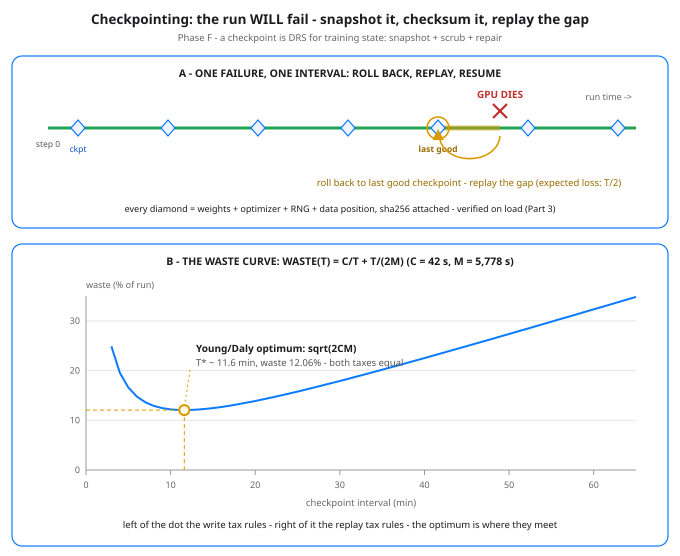

# Day 78 — Checkpointing & Fault Tolerance at Scale

**Tonight you'll be able to:** read a cluster’s failure rate straight off its size, price a training checkpoint in seconds, pick the interval that wastes the least of a six-week run — and prove, on Day 7’s line, that a crashed run resumed from a checksummed checkpoint lands on exactly the uninterrupted answer.

## The one idea

Everything since Day 73 assumed the machines keep running. They don’t — not at the scale Phase F lives at. A frontier training run is a weeks-long mutation of one enormous state, spread over thousands of GPUs, and hardware fails during it as a matter of arithmetic, not bad luck. State the assumption plainly (Part 1): one accelerator — GPU plus its share of host, NIC, and power — fails on average every ~3 years, which makes a single GPU a rock. But failure rates add: at 16,384 GPUs the cluster MTBF (mean time between failures — the average gap from one failure to the next) is 26,298 ÷ 16,384 ≈ 1.6 hours. Expect ~15 interruptions a day, ~900 over a 60-day run, before a single software bug is counted. Meta’s Llama 3 report is the reality check: 466 interruptions in 54 days on 16,384 H100s. That run still finished — because it was built to be interrupted.
A checkpoint is the full training state, snapshotted to durable storage: the fp32 master weights; the optimizer state — Adam’s m and v (Day 18’s two running averages), two more arrays the size of the weights themselves; the RNG state, so dropout and data shuffling resume on the same random stream; and the dataloader position, which samples the next step should see. Skip any piece and the resume still runs — it just silently becomes a different run. For the 70B model from Day 73 the resumable payload is 840 GB (gradients are the one thing left out: the next step recomputes them). That number — not the 140 GB of bf16 inference weights — is what your storage system has to swallow, over and over, for weeks.
So checkpointing is an interval choice, and both directions cost you. Checkpoint every T seconds. Each write costs C seconds of progress: 840 GB ÷ your aggregate write bandwidth — 42 s at a stated 20 GB/s, a full 7 minutes through one 2 GB/s stream. Failures arrive every M seconds, and each one throws away on average half an interval of work, because the crash lands uniformly inside the interval: expected loss T/2. Total waste ≈ C/T + T/(2M) — the first term falls as you space checkpoints out, the second rises. Minimizing it (one derivative, taken at face value — this is the Young/Daly result) gives T* = sqrt(2CM): here sqrt(2 × 42 × 5,778) ≈ 697 s, a checkpoint every ~11.6 minutes, wasting ≈ 12% of the run. At the optimum the two taxes are exactly equal — 6.03% each — which is how you know you’re there. Drift to hourly checkpoints and the replay tax alone eats a third of the cluster (Part 2’s table).
Two engineering moves keep C small and the snapshots honest. Writes are sharded and asynchronous: every GPU writes its own slice of the state in parallel to fast local storage — that is how you reach 20 GB/s aggregate instead of one stream’s 2 — and the copy-out to durable object storage finishes in the background while training resumes, so the run pays the fast write, not the slow archive. And every checkpoint carries a checksum manifest, verified on load (Day 68’s registry rule): a silently corrupted checkpoint — bitrot, a torn write — is worse than none, because the resume trusts it. Recovery is then mechanical: detect the failure, restart the job, load the last checkpoint whose hash verifies, replay forward. Keep the last few checkpoints, not just the latest, so one bad snapshot never strands the run. In PyTorch this ships as torch.save of a dict — model state_dict (Day 24), optimizer state_dict, RNG state, step — or torch.distributed.checkpoint for the sharded version. The API is boring, which is the point.

## Analogy

This is your system. Conveyor’s DRS assumes disks lie, die, and silently corrupt — so it scrubs checksums and repairs from good copies before anyone notices. Training checkpointing is the same three moves pointed at a different mutable object: the snapshot is replication of the run’s state to durable storage, the sha256 manifest is the scrub, and rollback-plus-replay is the repair — except the “corruption” is usually a dead node, and the repair replays compute instead of copying bytes. Even the tuning dial is the one you already know: scrub cadence trades I/O overhead against exposure window, and Young/Daly is that tradeoff with the derivative taken. Trading version, one line: it’s a stop-loss for compute — you pre-commit to losing at most T/2 per failure, and you pay a small, known premium (C per interval) for the insurance.

## See it



Top: one failure inside one interval — roll back to the last verified checkpoint and replay the gap; the expected loss is half the interval, and the amber stretch is the work computed twice. Bottom: Part 2’s waste curve — the write tax (C/T) falling, the replay tax (T/2M) rising, and the Young/Daly minimum where the two are equal.

## Code it (~30 min)

Pure stdlib again — tonight is arithmetic plus one honest file. Part 1 divides one MTBF by three cluster sizes. Part 2 prices the 70B checkpoint and sweeps the interval through the waste formula. Part 3 is the whole idea at toy scale: Day 7’s regression (same data, same lr 0.05 as Days 31/67) trained straight through, then trained again with a checkpoint at epoch 12, a simulated crash, a hash check — and a corrupted copy that gets rejected — before resuming. It writes to a temp dir and cleans up after itself.

```python
"""Day 78 - Checkpointing & Fault Tolerance at Scale.

You wrote the Data Reliability Service for an exabyte-scale
object store, so tonight's idea is one you already own,
pointed at a new kind of state: a training run IS a weeks-
long mutation of one giant object, and the hardware under
it fails on a schedule. Checkpointing is the snapshot +
checksum + repair loop you know from storage, run against
weights + optimizer state instead of objects.

    A checkpoint = the FULL training state (fp32 master
    weights + Adam m and v + RNG state + dataloader
    position), written with a checksum, often enough that
    the expected loss per failure - half an interval -
    plus the write cost is minimized. That minimum has a
    name: the Young/Daly interval, sqrt(2 * C * M).

  Part 1  Failure arithmetic. Stated assumption: one
          accelerator (GPU + its share of host, NIC, power)
          fails every ~3 years on average. One GPU is a
          rock. Divide that MTBF by 1,000 / 10,000 / 16,384
          devices and failure stops being an accident - it
          becomes a rate you plan around.
  Part 2  The tradeoff curve. A resumable 70B checkpoint
          is 840 GB (Day 73's bill minus the gradients,
          which the next step recomputes anyway). Writing
          it sharded at a stated 20 GB/s aggregate costs
          C = 42 s. Waste(T) = C/T (the writes tax) +
          T/(2M) (the expected replay), and Young/Daly
          picks the interval where the two terms meet.
  Part 3  The toy version, exact. Day 7's line, lr 0.05:
          train 30 epochs straight vs train 12, checkpoint
          (step + w + b + sha256) to a temp file, "crash",
          verify the hash, resume for 18 more. Floats
          round-trip through JSON exactly, so the resumed
          run must land on the uninterrupted answer to
          the last bit - IF the state was complete. A
          corrupted copy is rejected by its hash first
          (Day 68's rule: verify on load).

Pure Python standard library - no torch, no GPU, no
downloads, no APIs. Runs on the ~/ai-lab venv in
milliseconds. The temp checkpoint deletes itself.

Expected output:

  Part 1 - failure arithmetic: one GPU is a rock, 16,384 are a weather system
    stated assumption: one accelerator (GPU + its host share) fails every ~26,298 h (3 years)
      1,000 GPUs: cluster MTBF  26.30 h -> expect  0.91 failures/day
     10,000 GPUs: cluster MTBF   2.63 h -> expect  9.13 failures/day
     16,384 GPUs: cluster MTBF   1.61 h -> expect 14.95 failures/day
    a 60-day run at 16,384 GPUs expects ~897 interruptions - before software faults are counted
    reality check: Meta's Llama 3 report counted 466 interruptions in 54 days
    on 16,384 H100s (~8.6/day) - same order of magnitude, and that run finished
  Part 2 - the tradeoff: write too often, the disk eats the run; too rarely, the replay does
    checkpoint payload: fp32 master 280 GB + Adam m 280 GB + Adam v 280 GB = 840 GB
    (gradients not saved - the next step recomputes them; RNG + dataloader position ride along, ~KB)
    write time: one stream at 2 GB/s = 420 s (7.0 min)  |  sharded at 20 GB/s = 42 s
    cluster MTBF M = 5,778 s (1.61 h), checkpoint cost C = 42 s
      interval  write tax  replay tax  total waste
         5 min     14.00%       2.60%       16.60%
        10 min      7.00%       5.19%       12.19%
      11.6 min      6.03%       6.03%       12.06%  <- Young/Daly
        20 min      3.50%      10.38%       13.88%
        30 min      2.33%      15.58%       17.91%
        60 min      1.17%      31.15%       32.32%
    optimum: sqrt(2*C*M) = 697 s (11.6 min), waste 12.06% - the two taxes are equal there,
    which is the signature of every optimum: at the best interval, both failure modes cost the same
  Part 3 - save, crash, resume: complete state in, identical run out
    uninterrupted: 30 epochs -> w=2.4895 b=-0.9576  train loss 0.0020
    crashed run: checkpoint at epoch 12 (w=2.2196 b=-0.7176), sha256 4033c6ad7b81..., 148 bytes on disk
    integrity: sha256 verified on load - resuming from step 12 (a real loop also restores RNG state + dataloader index)
    corrupted copy: rejected - sha256 mismatch - checkpoint corrupt, refusing to resume from it
    resumed: epochs 13-30 -> w=2.4895 b=-0.9576  train loss 0.0020
    identical to uninterrupted: True (max diff 0.0) - resume is exact IF the state is complete
    temp checkpoint cleaned up: True
    verdict: checkpoint the FULL state, checksum it, and set the interval where the two taxes meet
"""
import hashlib
import json
import math
import shutil
import tempfile
from pathlib import Path

# ---------- Part 1: failure is a rate, not an accident ----------
print("Part 1 - failure arithmetic: one GPU is a rock, "
      "16,384 are a weather system")
PER_GPU_MTBF_H = 3 * 365.25 * 24      # stated assumption: ~3 years
print(f"  stated assumption: one accelerator (GPU + its host "
      f"share) fails every ~{PER_GPU_MTBF_H:,.0f} h (3 years)")
for n in (1_000, 10_000, 16_384):
    mtbf_h = PER_GPU_MTBF_H / n
    per_day = 24 / mtbf_h
    print(f"  {n:>7,} GPUs: cluster MTBF {mtbf_h:6.2f} h "
          f"-> expect {per_day:5.2f} failures/day")
per_day_16k = 24 / (PER_GPU_MTBF_H / 16_384)
print(f"  a 60-day run at 16,384 GPUs expects "
      f"~{per_day_16k * 60:,.0f} interruptions - before software "
      "faults are counted")
print("  reality check: Meta's Llama 3 report counted 466 "
      "interruptions in 54 days")
print("  on 16,384 H100s (~8.6/day) - same order of magnitude, "
      "and that run finished")

# ---------- Part 2: price the checkpoint, find the interval ----------
print("Part 2 - the tradeoff: write too often, the disk eats "
      "the run; too rarely, the replay does")
PARAMS = 70e9                          # the 70B run from Day 73
STATE_GB = PARAMS * (4 + 4 + 4) / 1e9  # master + Adam m + v
print(f"  checkpoint payload: fp32 master 280 GB + Adam m "
      f"280 GB + Adam v 280 GB = {STATE_GB:.0f} GB")
print("  (gradients not saved - the next step recomputes "
      "them; RNG + dataloader position ride along, ~KB)")
SLOW, FAST = 2.0, 20.0                 # GB/s, stated assumptions
print(f"  write time: one stream at {SLOW:.0f} GB/s = "
      f"{STATE_GB / SLOW:.0f} s ({STATE_GB / SLOW / 60:.1f} min)"
      f"  |  sharded at {FAST:.0f} GB/s = {STATE_GB / FAST:.0f} s")
C = STATE_GB / FAST                    # checkpoint cost, seconds
M = PER_GPU_MTBF_H / 16_384 * 3600     # cluster MTBF, seconds
T_STAR = math.sqrt(2 * C * M)          # Young/Daly optimum


def waste(t_s):
    """Fraction of the run wasted at interval t_s:
    C/T pays the writes, T/(2M) pays the expected replay."""
    return C / t_s + t_s / (2 * M)


print(f"  cluster MTBF M = {M:,.0f} s ({M / 3600:.2f} h), "
      f"checkpoint cost C = {C:.0f} s")
print(f"  {'interval':>10} {'write tax':>10} {'replay tax':>11}"
      f" {'total waste':>12}")
rows = [(300, ""), (600, ""), (T_STAR, "  <- Young/Daly"),
        (1200, ""), (1800, ""), (3600, "")]
for t_s, tag in rows:
    label = f"{t_s / 60:.1f} min" if tag else f"{t_s / 60:.0f} min"
    print(f"  {label:>10} {C / t_s:>10.2%} "
          f"{t_s / (2 * M):>11.2%} {waste(t_s):>12.2%}{tag}")
print(f"  optimum: sqrt(2*C*M) = {T_STAR:,.0f} s "
      f"({T_STAR / 60:.1f} min), waste {waste(T_STAR):.2%} - "
      "the two taxes are equal there,")
print("  which is the signature of every optimum: at the best "
      "interval, both failure modes cost the same")

# ---------- Part 3: save, crash, resume - exact ----------
print("Part 3 - save, crash, resume: complete state in, "
      "identical run out")
X_TRAIN = [-2.0, -1.5, -1.0, -0.5, 0.0, 0.5, 1.0, 1.5, 2.0]
Y_TRAIN = [2.5 * x - 1.0 for x in X_TRAIN]     # Day 7's line


def step(w, b, lr=0.05):
    """One full-batch gradient step (Day 6's hand math)."""
    n = len(X_TRAIN)
    dw = sum(2 * (w * x + b - y) * x
             for x, y in zip(X_TRAIN, Y_TRAIN)) / n
    db = sum(2 * (w * x + b - y)
             for x, y in zip(X_TRAIN, Y_TRAIN)) / n
    return w - lr * dw, b - lr * db


def mse(w, b):
    return sum((w * x + b - y) ** 2
               for x, y in zip(X_TRAIN, Y_TRAIN)) / len(X_TRAIN)


def save_ckpt(path, state):
    payload = json.dumps(state, sort_keys=True)
    digest = hashlib.sha256(payload.encode()).hexdigest()
    record = {"state": state, "sha256": digest}
    path.write_text(json.dumps(record, sort_keys=True))
    return digest


def load_ckpt(path):
    record = json.loads(path.read_text())
    payload = json.dumps(record["state"], sort_keys=True)
    digest = hashlib.sha256(payload.encode()).hexdigest()
    if digest != record["sha256"]:
        raise ValueError("sha256 mismatch - checkpoint corrupt, "
                         "refusing to resume from it")
    return record["state"]


EPOCHS, CKPT_AT = 30, 12
w_a = b_a = 0.0
for _ in range(EPOCHS):                        # the lucky run
    w_a, b_a = step(w_a, b_a)
print(f"  uninterrupted: {EPOCHS} epochs -> w={w_a:.4f} "
      f"b={b_a:.4f}  train loss {mse(w_a, b_a):.4f}")

tmp = Path(tempfile.mkdtemp(prefix="day78-"))
ckpt = tmp / "ckpt-step12.json"
w = b = 0.0
for _ in range(CKPT_AT):                       # the unlucky run
    w, b = step(w, b)
digest = save_ckpt(ckpt, {"step": CKPT_AT, "w": w, "b": b})
print(f"  crashed run: checkpoint at epoch {CKPT_AT} "
      f"(w={w:.4f} b={b:.4f}), sha256 {digest[:12]}..., "
      f"{ckpt.stat().st_size} bytes on disk")
w = b = None                                   # the crash: state gone
state = load_ckpt(ckpt)                        # verify, then resume
print(f"  integrity: sha256 verified on load - resuming from "
      f"step {state['step']} (a real loop also restores RNG "
      "state + dataloader index)")
bad = tmp / "ckpt-corrupt.json"
bad.write_text(ckpt.read_text().replace('"step": 12',
                                        '"step": 13'))
try:
    load_ckpt(bad)
    print("  corrupted copy: ACCEPTED - this line never prints")
except ValueError as e:
    print(f"  corrupted copy: rejected - {e}")
w, b = state["w"], state["b"]
for _ in range(EPOCHS - state["step"]):
    w, b = step(w, b)
print(f"  resumed: epochs {state['step'] + 1}-{EPOCHS} -> "
      f"w={w:.4f} b={b:.4f}  train loss {mse(w, b):.4f}")
print(f"  identical to uninterrupted: {w == w_a and b == b_a} "
      f"(max diff {max(abs(w - w_a), abs(b - b_a)):.1f}) - "
      "resume is exact IF the state is complete")
shutil.rmtree(tmp)
print(f"  temp checkpoint cleaned up: {not tmp.exists()}")
print("  verdict: checkpoint the FULL state, checksum it, "
      "and set the interval where the two taxes meet")
```

**Expected output:**

```
Part 1 - failure arithmetic: one GPU is a rock, 16,384 are a weather system
  stated assumption: one accelerator (GPU + its host share) fails every ~26,298 h (3 years)
    1,000 GPUs: cluster MTBF  26.30 h -> expect  0.91 failures/day
   10,000 GPUs: cluster MTBF   2.63 h -> expect  9.13 failures/day
   16,384 GPUs: cluster MTBF   1.61 h -> expect 14.95 failures/day
  a 60-day run at 16,384 GPUs expects ~897 interruptions - before software faults are counted
  reality check: Meta's Llama 3 report counted 466 interruptions in 54 days
  on 16,384 H100s (~8.6/day) - same order of magnitude, and that run finished
Part 2 - the tradeoff: write too often, the disk eats the run; too rarely, the replay does
  checkpoint payload: fp32 master 280 GB + Adam m 280 GB + Adam v 280 GB = 840 GB
  (gradients not saved - the next step recomputes them; RNG + dataloader position ride along, ~KB)
  write time: one stream at 2 GB/s = 420 s (7.0 min)  |  sharded at 20 GB/s = 42 s
  cluster MTBF M = 5,778 s (1.61 h), checkpoint cost C = 42 s
    interval  write tax  replay tax  total waste
       5 min     14.00%       2.60%       16.60%
      10 min      7.00%       5.19%       12.19%
    11.6 min      6.03%       6.03%       12.06%  <- Young/Daly
      20 min      3.50%      10.38%       13.88%
      30 min      2.33%      15.58%       17.91%
      60 min      1.17%      31.15%       32.32%
  optimum: sqrt(2*C*M) = 697 s (11.6 min), waste 12.06% - the two taxes are equal there,
  which is the signature of every optimum: at the best interval, both failure modes cost the same
Part 3 - save, crash, resume: complete state in, identical run out
  uninterrupted: 30 epochs -> w=2.4895 b=-0.9576  train loss 0.0020
  crashed run: checkpoint at epoch 12 (w=2.2196 b=-0.7176), sha256 4033c6ad7b81..., 148 bytes on disk
  integrity: sha256 verified on load - resuming from step 12 (a real loop also restores RNG state + dataloader index)
  corrupted copy: rejected - sha256 mismatch - checkpoint corrupt, refusing to resume from it
  resumed: epochs 13-30 -> w=2.4895 b=-0.9576  train loss 0.0020
  identical to uninterrupted: True (max diff 0.0) - resume is exact IF the state is complete
  temp checkpoint cleaned up: True
  verdict: checkpoint the FULL state, checksum it, and set the interval where the two taxes meet
```

## Today's win

Done when your run shows Part 1’s 14.95 failures/day at 16,384 GPUs, Part 2’s table bottoming out at the Young/Daly row (11.6 min, 12.06% total, both taxes 6.03%), and Part 3’s three proofs: checkpoint sha256 4033c6ad7b81…, the corrupted copy rejected, and resumed == uninterrupted (identical: True, max diff 0.0). The keeper sentence: a checkpoint is only as good as its state completeness and its checksum — and its interval is an optimization, not a habit.

## Short on time? 20-minute version

Read “The one idea”, study the diagram until you can sketch the waste curve and mark its minimum, then run only Part 3 and watch the crash/resume land on the identical weights. If you can say why Adam’s state doubles the checkpoint payload and why the optimum has both taxes equal, you have Day 78.

## Tomorrow's teaser

Tomorrow: we open the black box under every number this week — just enough of the GPU’s insides (SMs, warps, and the memory hierarchy) to see why bandwidth, not FLOPs, runs your world.

Streak: 78 day(s) · Never miss twice.
