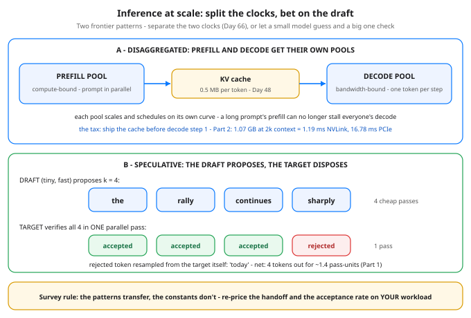

# Day 80 — Inference at Scale: Disaggregated Serving & Speculative Decoding

**Tonight you'll be able to:** name the two scale-out patterns frontier serving stacks are converging on — split prefill and decode onto separate GPU pools, and let a tiny draft model propose tokens that the big model verifies in one pass — and price both of them: the KV-cache handoff tax and the acceptance-rate speedup, from stated constants you can audit.

## The one idea

Phase E left you with one engine running two clocks that fight. A long prompt's **prefill** — compute-bound, the whole prompt processed in parallel — lands in the same machinery as everyone's **decode** — bandwidth-bound, one serial token per step (Days 48, 66). Continuous batching (Day 64) juggles the two; the batch sweep (Day 66) priced the truce. At frontier scale, operators stopped trucing and started separating. Tonight is a survey of the two patterns that came out of that — patterns, not product tours: the plumbing differs by vendor, the shapes don't.

**Pattern 1: disaggregated prefill/decode.** Give each clock its own GPU pool. The prefill pool crunches prompts and nothing else; the decode pool runs the serial token loop and nothing else; each pool is sized, batched, and scaled against its own appetite, so a summarization fleet (huge prompts, short answers) and a chat fleet (short prompts, long answers) stop compromising on one configuration. The connective tissue is Day 48's KV cache: after prefill, the prompt's K/V — 524,288 bytes per token on the Day 48/49 config — is shipped to a decode GPU, which picks up the loop from there. You'll see this as DistServe and Splitwise in the research literature, Mooncake in production write-ups, and disaggregated modes in vLLM and TensorRT-LLM. The cost is exactly one thing: the transfer happens before decode step one, so it lands on TTFT — and you've added a distributed system to operate. Part 2 prices the transfer; the verdict is a bandwidth question.

**Pattern 2: speculative decoding.** Decode's serial chain is the tax: one expensive target pass per token, most of it spent re-reading weights (Day 48). So speculate. A **draft model** — same tokenizer, a fraction of the size — autoregressively guesses the next *k* tokens. Still serial, but each guess costs ~a tenth of a target pass. Then the target scores all *k* positions in **one parallel pass** — the prefill-shaped pass its hardware is good at. Accept the longest prefix the target agrees with; at the first disagreement, resample that token from the target's own distribution; if the whole draft is accepted, the pass also yields one bonus token, so a cycle emits between 1 and *k*+1 tokens. Here is the load-bearing guarantee, stated plainly because everything rests on it: with the standard accept/reject rule (accept each draft token with probability min(1, p_target/p_draft), resample rejections from the corrected residual distribution), the emitted stream has *exactly* the target model's output distribution. Not approximately — exactly. The speedup is lossless; the draft only ever proposes. Tonight we take that theorem as given and price its consequences. The price hinges on **α (alpha), the per-token acceptance rate** — and α is a property of your traffic: code and formulaic text draft well (α 0.8–0.9 is common), open-ended prose worse (~0.5–0.6). Variants like EAGLE and Medusa replace the separate draft model with small heads on the target itself; the verify math is unchanged.

**How they compose, honestly:** the patterns are orthogonal — disaggregated pools can each run speculative decode, and serious stacks do. Both are moving targets (transfer plumbing over NVLink vs RDMA, draft designs, scheduler details change per release), so the durable skill is not the feature list. It's the two questions tonight's code answers for any workload: *what does the handoff cost?* and *what is α on my traffic?*

## Analogy

Speculative decoding is **branch prediction**, and you already know its every move. The CPU guesses the path, executes ahead speculatively, and on a mispredict flushes the pipeline and restarts from the true state — the committed result is bit-identical to never speculating, only faster. Draft model = the predictor, one verify pass = the commit stage, resampling the first rejected token = flush-and-recover. Even the tuning maps: prediction accuracy (α) and speculation depth (*k*) trade exactly like predictor quality and pipeline depth.

Disaggregation is your storage world: splitting a service whose two paths have **opposite resource profiles** into separate tiers with a state handoff between them — ingest separated from query serving, the materialized state shipped across. The design question is never "can we split it" but "what does the handoff cost per request, on *this* fabric" — which is why Part 2 is a bandwidth table, not an opinion.

## See it



Top: disaggregation — the two clocks get separate pools, and the only coupling left is the KV-cache handoff, priced in Part 2. Bottom: speculative decoding — the draft spends 4 cheap passes proposing, the target spends 1 parallel pass judging: 3 accepted, 1 rejected and resampled from the target itself, so the emitted stream is the target's own.

## Code it (~30 min)

No serving stack tonight — the deliverable is the pricing tool you'd run *before* adopting either pattern. Pure standard library, stated constants, no benchmarks to argue with. **Part 1** prices speculative decoding: expected tokens per cycle `E = (1 - α^(k+1))/(1 - α)` against the cycle's true cost (1 verify pass + *k* draft passes at 0.10 each), plus the break-even α and what α 0.75 does to Day 66's per-user stream rate. **Part 2** sizes the disaggregation handoff with Day 48's recipe and clocks it over NVLink vs PCIe at two context lengths. Change α, *k*, *c*, the context, or the fabric and re-run — the verdicts move, the shapes don't.

```python
"""Day 80 - Inference at Scale: Disaggregated Serving and
Speculative Decoding (a survey with a calculator).

Phase F. Phase E sized ONE engine (Days 64-66, 72): continuous
batching, quantization, the batch-vs-latency tradeoff on a
single pool of GPUs. Tonight is a survey of the two scale-out
patterns the frontier serving stacks (vLLM, TensorRT-LLM,
SGLang and friends) are converging on - patterns, not product
tours. Details vary by vendor; the shapes do not.

  Pattern 1  DISAGGREGATED PREFILL/DECODE. Day 66's two clocks
             have opposite appetites: prefill is compute-bound
             (the whole prompt in parallel, big matmuls), while
             decode is bandwidth-bound (one token per step, the
             step dominated by re-reading weights + KV). In one
             engine they share GPUs, so a long prompt's prefill
             stalls everyone's decode. Split the two clocks onto
             separate pools and each scales and schedules on its
             own curve - the price is a handoff: the prompt's
             KV cache (Day 48) must move from the prefill pool
             to the decode pool before the first decode step.
             Part 2 prices that handoff.

  Pattern 2  SPECULATIVE DECODING. Decode is serial: token n+1
             needs token n. So cheat the way a CPU does - a tiny
             DRAFT model (branch prediction for tokens) guesses
             the next k tokens autoregressively, which is cheap
             because it is small; then the big TARGET model
             checks all k guesses in ONE parallel pass, exactly
             the kind of pass decode never gets to make. Accept
             the longest prefix the target agrees with; at the
             first disagreement, resample that one token from
             the target's own distribution; if all k are
             accepted, the pass also yields one bonus token.
             With the standard accept/reject rule - accept each
             draft token with probability min(1, p_target /
             p_draft) - the output distribution is EXACTLY the
             target model's own. The speedup is lossless:
             faster, not different. (Stated, not proved - the
             one-line rule above is what makes it exact.)
             Part 1 prices it: expected tokens per target pass
             E = 1 + a + a^2 + ... + a^k
               = (1 - a^(k+1)) / (1 - a),
             where a (alpha) is the per-token acceptance rate.

Stated constants, so every number is auditable:
  k = 4 draft tokens per cycle; one draft pass costs c = 0.10
  of one target pass (a roughly 10x cheaper model); alpha in
  {0.60, 0.75, 0.90}. KV sizing reuses Day 48/49's model:
  32 layers, d_model 4096, fp16 -> 524,288 bytes of KV per
  token. Interconnects: NVLink 900 GB/s, PCIe 5.0 x16 64 GB/s.
  One more anchor: Day 66's operating point, TPOT 40 ms =
  25 tokens/sec per user.

Runs on the ~/ai-lab venv: pure standard library - no torch,
no GPU, no paid APIs, no downloads. Deterministic arithmetic
only, so every digit below is exact.

Expected output:

  Part 1 - speculative decoding: what one verify pass buys
    naive decode: 1 token per target pass, 1.00 pass-units per token
    spec cycle: 1 verify pass + 4 draft passes x 0.10 = 1.40 pass-units
    alpha 0.60: E[tokens] 2.3056 per cycle -> speedup 1.65x
    alpha 0.75: E[tokens] 3.0508 per cycle -> speedup 2.18x
    alpha 0.90: E[tokens] 4.0951 per cycle -> speedup 2.93x
    ceiling: alpha 1.00 gives k+1 = 5 tokens per cycle; a FREE draft
      (c = 0) at alpha 0.75 would give 3.05x - draft cost is real
    break-even: first alpha on a 0.05 grid whose speedup beats 1.00x: 0.30
    at Day 66's point (TPOT 40 ms = 25 tok/s per user), alpha 0.75
      streams ~54.5 tok/s to that user - same distribution, faster drip
    the guarantee: accept/reject keeps the output distribution exactly
      the target model's own - the draft only ever proposes
  Part 2 - disaggregation: the KV handoff tax (Day 48's recipe)
    KV per token: 2 (K and V) x 32 layers x 4096 x 2 bytes = 524,288 bytes
    context 2,048 tokens: KV = 1.07 GB -> NVLink 900 GB/s: 1.19 ms | PCIe 64 GB/s: 16.78 ms
    context 32,768 tokens: KV = 17.18 GB -> NVLink 900 GB/s: 19.09 ms | PCIe 64 GB/s: 268.44 ms
    the tax is paid ONCE per request, before decode step one - it lands on TTFT (Day 66)
    at 32k context the PCIe handoff alone is 6.7x the whole 40 ms TPOT budget
    verdict: disagg pays when the fabric is fast (NVLink-class) or prompts
      are short, and wins most when the mix is lopsided - huge prompts,
      short answers (or the reverse). On a slow link, keep the clocks together.
"""

# ---------- Part 1: speculative decoding, priced ----------
K = 4            # draft tokens proposed per cycle
C_DRAFT = 0.10   # one draft pass, in target-pass units


def expected_tokens(alpha, k):
    """E[tokens per cycle] = 1 + a + a^2 + ... + a^k: the bonus
    token always lands (1), plus each draft token that survives
    every check before it (a^i). Closed form of the same sum."""
    return (1 - alpha ** (k + 1)) / (1 - alpha)


cycle_cost = 1.0 + K * C_DRAFT
print("Part 1 - speculative decoding: what one verify pass buys")
print("  naive decode: 1 token per target pass, "
      "1.00 pass-units per token")
print(f"  spec cycle: 1 verify pass + {K} draft passes x "
      f"{C_DRAFT:.2f} = {cycle_cost:.2f} pass-units")
for alpha in (0.60, 0.75, 0.90):
    e = expected_tokens(alpha, K)
    print(f"  alpha {alpha:.2f}: E[tokens] {e:.4f} per cycle "
          f"-> speedup {e / cycle_cost:.2f}x")
e75 = expected_tokens(0.75, K)
print(f"  ceiling: alpha 1.00 gives k+1 = {K + 1} tokens per cycle; "
      "a FREE draft")
print(f"    (c = 0) at alpha 0.75 would give {e75:.2f}x "
      "- draft cost is real")
grid = [i / 20 for i in range(1, 20)]          # 0.05, 0.10, ..., 0.95
breakeven = next(a for a in grid
                 if expected_tokens(a, K) / cycle_cost > 1.0)
print(f"  break-even: first alpha on a 0.05 grid whose speedup "
      f"beats 1.00x: {breakeven:.2f}")
print("  at Day 66's point (TPOT 40 ms = 25 tok/s per user), "
      "alpha 0.75")
print(f"    streams ~{25 * e75 / cycle_cost:.1f} tok/s to that user "
      "- same distribution, faster drip")
print("  the guarantee: accept/reject keeps the output distribution "
      "exactly")
print("    the target model's own - the draft only ever proposes")

# ---------- Part 2: disaggregation, the handoff tax ----------
LAYERS, D_MODEL, BYTES = 32, 4096, 2      # Day 48/49 model, fp16
KV_PER_TOKEN = 2 * LAYERS * D_MODEL * BYTES

print("Part 2 - disaggregation: the KV handoff tax (Day 48's recipe)")
print(f"  KV per token: 2 (K and V) x {LAYERS} layers x {D_MODEL} "
      f"x {BYTES} bytes = {KV_PER_TOKEN:,} bytes")
for tokens in (2_048, 32_768):
    kv = KV_PER_TOKEN * tokens
    nvlink_ms = kv / (900 * 1e9) * 1000
    pcie_ms = kv / (64 * 1e9) * 1000
    print(f"  context {tokens:,} tokens: KV = {kv / 1e9:.2f} GB "
          f"-> NVLink 900 GB/s: {nvlink_ms:.2f} ms "
          f"| PCIe 64 GB/s: {pcie_ms:.2f} ms")
print("  the tax is paid ONCE per request, before decode step one "
      "- it lands on TTFT (Day 66)")
pcie_32k = KV_PER_TOKEN * 32_768 / (64 * 1e9) * 1000
print(f"  at 32k context the PCIe handoff alone is "
      f"{pcie_32k / 40:.1f}x the whole 40 ms TPOT budget")
print("  verdict: disagg pays when the fabric is fast (NVLink-class) "
      "or prompts")
print("    are short, and wins most when the mix is lopsided - huge "
      "prompts,")
print("    short answers (or the reverse). On a slow link, keep the "
      "clocks together.")
```

**Expected output:**

```
Part 1 - speculative decoding: what one verify pass buys
  naive decode: 1 token per target pass, 1.00 pass-units per token
  spec cycle: 1 verify pass + 4 draft passes x 0.10 = 1.40 pass-units
  alpha 0.60: E[tokens] 2.3056 per cycle -> speedup 1.65x
  alpha 0.75: E[tokens] 3.0508 per cycle -> speedup 2.18x
  alpha 0.90: E[tokens] 4.0951 per cycle -> speedup 2.93x
  ceiling: alpha 1.00 gives k+1 = 5 tokens per cycle; a FREE draft
    (c = 0) at alpha 0.75 would give 3.05x - draft cost is real
  break-even: first alpha on a 0.05 grid whose speedup beats 1.00x: 0.30
  at Day 66's point (TPOT 40 ms = 25 tok/s per user), alpha 0.75
    streams ~54.5 tok/s to that user - same distribution, faster drip
  the guarantee: accept/reject keeps the output distribution exactly
    the target model's own - the draft only ever proposes
Part 2 - disaggregation: the KV handoff tax (Day 48's recipe)
  KV per token: 2 (K and V) x 32 layers x 4096 x 2 bytes = 524,288 bytes
  context 2,048 tokens: KV = 1.07 GB -> NVLink 900 GB/s: 1.19 ms | PCIe 64 GB/s: 16.78 ms
  context 32,768 tokens: KV = 17.18 GB -> NVLink 900 GB/s: 19.09 ms | PCIe 64 GB/s: 268.44 ms
  the tax is paid ONCE per request, before decode step one - it lands on TTFT (Day 66)
  at 32k context the PCIe handoff alone is 6.7x the whole 40 ms TPOT budget
  verdict: disagg pays when the fabric is fast (NVLink-class) or prompts
    are short, and wins most when the mix is lopsided - huge prompts,
    short answers (or the reverse). On a slow link, keep the clocks together.
```

## Today's win

Done when Part 1 shows α 0.75 → E = `3.0508` tokens/cycle and `2.18x` after draft cost, break-even at α `0.30`; and Part 2 shows the 32k-context handoff at `19.09 ms` on NVLink vs `268.44 ms` on PCIe — 6.7× the whole TPOT budget, before token one. The keeper test, no notes: for each pattern you can name its tax (KV transfer charged to TTFT / draft cost charged per cycle), its guarantee (pools scale independently / output distribution identical to the target's), and the workload question that decides it (fabric bandwidth + prompt mix / α on your traffic).

## Short on time? 20-minute version

Read "The one idea", study the diagram until you can sketch both panels from memory, then run the code and read only the verdict lines. If you can say why speculative decoding cannot change the output distribution, and why disaggregation lives or dies on interconnect bandwidth, you have the survey — the tables are reference you'll re-run with your own constants.

## Tomorrow's teaser

Tomorrow: Phase F turns from serving other people's models to running your own training job — one step, instrumented end to end, until you can point at exactly where its time goes.

---
Streak: 80 day(s) · Never miss twice.
