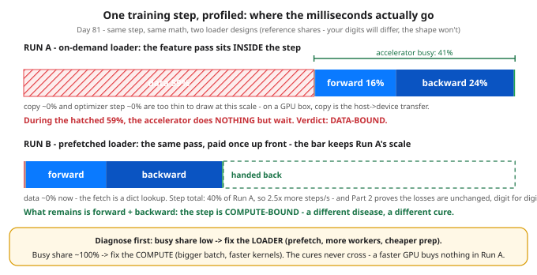

# Day 81 — Profile a Training Step: Find the Bottleneck

**Tonight you'll be able to:** split one training step into five timed segments, read the profile like a dashboard, and name the bottleneck — data-bound or compute-bound — before spending anything on a fix, because the two diseases have opposite cures.

## The one idea

Every training step since Day 7 has been written as one line — forward → loss → backward → step — but on real hardware that line is a pipeline of **five segments running on two different sides of the machine**:

- **data** — fetch and preprocess one batch: disk, decode, feature engineering. CPU-side.
- **copy** — move the batch host → device. On your Mac this is a memory copy; on a GPU box it's a PCIe/NVLink transfer.
- **forward** — predictions and the loss. Device.
- **backward** — gradients. Usually the fattest compute segment (Day 23's blame, at scale).
- **step** — the optimizer update (Day 18's editor, touching every parameter).

Data and copy happen on the CPU side while forward/backward/step own the accelerator — which means one side can *starve* the other, and the loop's wall-clock only ever shows you the sum.

**Profiling a step means timing the five segments and asking one question: what share of the step was the accelerator actually busy?** Busy share = (forward + backward + step) ÷ step total. If it's low, the accelerator sat idle waiting for batches — the step is **data-bound**. If it's ~100%, the device never waited — the step is **compute-bound**. Everything else in a profiler report is detail underneath that one number.

The diagnosis matters because **the two diseases have opposite cures, and the wrong cure costs real money.** Data-bound → fix the supply side: prefetch batches so they're ready before the step needs them, parallel loader workers, cheaper preprocessing, cache the prepared data. Compute-bound → fix the demand side: a bigger batch (Days 19/30 — more work per kernel launch), faster kernels, mixed precision (Day 77). Neither cure touches the other disease: more loader workers can't speed up a saturated GPU, and a faster GPU in a data-bound job buys literally nothing — it just waits more expensively. "Training is slow, buy bigger GPUs," said without a profile, is how ML budgets die.

In production the same split is measured by `torch.profiler` (or Nsight Systems on a cluster): you wrap a few steps and it records per-op CPU time and per-kernel device time — the five segments above, at finer grain. A labeled sketch for your first GPU box — it does not run tonight:

```python
from torch.profiler import profile, ProfilerActivity
with profile(activities=[ProfilerActivity.CPU,
                         ProfilerActivity.CUDA]) as prof:
    for step, batch in enumerate(loader):
        train_step(batch)            # your usual Day 25 loop
        if step > 5: break           # skip warm-up steps
print(prof.key_averages().table(sort_by="cuda_time_total"))
```

Two honesty notes that separate a profile from a screenshotted lie: **profilers perturb what they measure**, so profile a handful of steady-state steps, never step 1 (allocator warm-up and kernel autotuning live there); and on GPU the launches are asynchronous — the CPU clock says "launched," not "finished," which is why the real tool records device-side timestamps instead of trusting `perf_counter()`. Tonight's CPU run is synchronous end to end, so the naive timers are honest here.

Tonight's build is deliberately rigged, chaos-engineering style: a heavy feature pass is injected into the loader (its results are multiplied by 0.0, so the *numbers* never change — only the clock does), you profile it, then you fix it the production way — by *moving* the work out of the step, not deleting it. And the fix carries a proof: because nothing about the math changed, the step losses before and after must match digit for digit. **A speedup that changes the losses isn't a speedup — it's a different model.** That identity check is the unit test for every optimization you'll ever ship.

## Analogy

You already own this skill — it's distributed tracing, one level down. Day 4's autograd graph was request tracing through a call graph; a step profile is the same trace with *durations* on the spans, and the segment table is the flame graph flattened into five rows. The starved accelerator is a familiar shape too: your fastest service idle behind its slowest dependency — Conveyor's hottest node waiting on a cold read. The fix is never "make the fast part faster"; it's find the span that's actually eating the wall clock.

Trading version, one line: profiling before optimizing is checking whether your slippage lives in the signal or in the execution — you don't rewrite the strategy when the fills are the problem.

## See it



One step, two loader designs, bars drawn to the same millisecond scale from the reference run. Top: with preprocessing inside the step, the hatched data segment eats 59% of the step while the accelerator idles — busy only 41% of the time. Bottom: the identical pass hoisted into a one-time prep shrinks the whole step to 40% of its former length, and what remains is pure compute. Same losses either way — only the clock changed.

## Code it (~30 min)

One file, pure NumPy — no CUDA profiler exists on this Mac, so the CPU plays both roles (loader *and* accelerator) and `time.perf_counter()` does the timing; the production `torch.profiler` sketch is in "The one idea" above. The model is a Day 32/35-style tabular MLP (64 features → 512 → 1) over formula-built rows with a linear teacher — the hand-rolled forward/backward of Days 21–25, now with a stopwatch on each segment. **Part 1** profiles the beginner default: the loader runs its heavy feature pass inside every step. **Part 2** hoists the identical pass out of the loop — all 16 batches pre-built once, which is exactly what prefetching loader workers do while the accelerator trains — and checks the step losses match Part 1 digit for digit *before* trusting any timing. **Part 3** prints the ten-second verdict template you'll reuse on every profile from now on. Your millisecond digits will differ from the reference below — match the *shape*: which segment dominates, the busy share, the speedup.

```python
"""Day 81 - Build: Profile a Training Step, Find the Bottleneck.

Phase F build. Everything before tonight treated the training
loop as one black box: forward, loss, backward, step (Day 7).
Production training is too expensive for black boxes - a GPU
hour burned at 30% utilization is money set on fire - so
tonight you cut ONE step open into timed segments and let the
numbers answer the only question that matters:

    Is the accelerator WAITING (data-bound) or WORKING
    (compute-bound)?  The fixes are opposites - prefetch and
    loader workers vs bigger batches and better kernels - so
    you diagnose first and spend second. Guessing is how teams
    buy GPUs to fix a data loader.

The five segments of every step (PyTorch does the same split;
on a GPU box the stages map 1:1):
    data     load + preprocess one batch (CPU/disk side)
    copy     host -> device transfer (tiny here, real on GPU)
    forward  predictions + loss
    backward gradients (usually the fattest compute segment)
    step     the optimizer update (Day 18)

Honest machine note: there is no CUDA profiler on this Mac,
so the step runs in NumPy on CPU and the CPU plays both roles -
"accelerator busy" below means the forward+backward+step
segments, the part a GPU would be doing. The instrument is
time.perf_counter() around each stage. In production the same
job is done by torch.profiler - the labeled sketch after
Part 3 shows its shape; the discipline is identical.

  Part 1  Run A: the loader preprocesses INSIDE the step
          (decode/augment on demand - the beginner default).
          A heavy feature pass is injected on purpose:
          hundreds of transcendental passes per batch whose
          results are multiplied by 0.0, so the NUMBERS are
          untouched and
          only the clock changes. Chaos engineering for a
          data pipeline: break it on purpose, watch the
          profile name the culprit.
  Part 2  Run B: the same feature pass, hoisted OUT of the
          loop - all batches pre-built once (what prefetching
          loader workers do while the accelerator trains).
          Same seed, same data, same init: the step losses
          must match Run A digit for digit, or the "fix"
          changed the math and proved nothing.
  Part 3  The verdict template: read the busy share, name
          the bound, pick the fix from the right column.

Runs on the ~/ai-lab venv: numpy only (free), CPU on
purpose, no CUDA, no paid APIs, no downloads. Data, teacher
weights, batch order and init all come from seeded
generators, so the LOSSES are deterministic - the same
digits on any machine. The millisecond shares are NOT:
timers measure YOUR hardware, so shares are printed rounded
and the expected output below is labeled REFERENCE - match
the shape (which segment dominates, the busy share, the
speedup), not the digits.

Expected output (losses exact; timings/speedup REFERENCE -
author's machine, yours will differ in the digits only):

  Day 81 - profile a training step: segment first, guess never
  model: MLP 64 -> 512 -> 1, numpy float32 | data: 4,096 formula rows, batch 256, 24 steps, seed 81
  losses are deterministic; segment shares are rounded and machine-dependent
  Part 1 - Run A: on-demand loader (feature pass inside the step)
    step  1  loss 2.630888
    step  6  loss 1.781060
    step 12  loss 0.899651
    step 18  loss 0.771269
    step 24  loss 0.529924
    segment        ms/step   share
      data          18.70    59%  <- accelerator idle
      copy           0.01     0%
      forward        5.20    16%
      backward       7.60    24%
      step           0.03     0%
      step total    31.55    100%  -> 32 steps/s
    accelerator busy: 41%  -> DATA-BOUND: the accelerator waits on the loader
  Part 2 - Run B: prefetched loader (same pass, done once up front)
    one-time prep: 299.3 ms for 16 batches - paid once, reused every epoch
    step losses identical to Run A: True
    segment        ms/step   share
      data           0.01     0%
      copy           0.01     0%
      forward        5.15    41%
      backward       7.48    59%
      step           0.03     0%
      step total    12.68 (40% of Run A)  -> 79 steps/s
    accelerator busy: 100%  -> the idle segment is gone; what remains is compute (Part 3)
    speedup from moving work, not hardware: 2.5x
  Part 3 - read any profile in ten seconds
    busy share >= ~90%: COMPUTE-BOUND -> bigger batch / faster kernels;
      the loader is innocent, more loader workers buy nothing.
    busy share low: DATA-BOUND -> prefetch, more loader workers,
      cheaper preprocessing; a faster GPU buys nothing.
    verdict: same step, same math - the profile, not the price tag,
      told you which fix to buy.
"""
import time

import numpy as np

SEED = 81
N_ROWS, N_FEAT, HIDDEN = 4096, 64, 512
BATCH, STEPS, LR = 256, 24, 0.005
PRINT_STEPS = (1, 6, 12, 18, 24)
PREP_PASSES = 420           # injected loader cost (Part 1 notes)

# ---------- data: formula rows + a linear teacher ----------
rng = np.random.default_rng(SEED)
W_TRUE = (rng.normal(0.0, 1.0, size=(N_FEAT, 1)) / 8.0).astype(np.float32)
RAW = rng.normal(0.0, 1.0, size=(N_ROWS, N_FEAT)).astype(np.float32)
Y = (RAW @ W_TRUE
     + 0.05 * rng.normal(size=(N_ROWS, 1))).astype(np.float32)
SCALE = np.linspace(0.8, 1.2, N_FEAT).astype(np.float32)
ORDER = rng.permutation(N_ROWS)
BATCHES = [ORDER[i * BATCH:(i + 1) * BATCH]
           for i in range(N_ROWS // BATCH)]


def preprocess(idx, slow):
    """One batch, features scaled - the loader's real job. With
    slow=True the SAME result is computed the expensive way:
    PREP_PASSES transcendental passes whose results are
    multiplied by 0.0. Values identical, clock very different
    - a stand-in for decode/augment work done per batch."""
    Xb = RAW[idx] * SCALE
    if slow:
        for _ in range(PREP_PASSES):
            Xb = Xb + 0.0 * (np.sin(Xb) + np.cos(Xb)
                             + np.tanh(Xb))
    return Xb


# ---------- the model: a small MLP, by hand (Days 21-25) ----------
def fresh_params():
    r = np.random.default_rng(SEED + 1)
    return {
        "W1": (r.normal(0.0, 1.0, size=(N_FEAT, HIDDEN))
               * np.sqrt(2.0 / N_FEAT)).astype(np.float32),
        "b1": np.zeros(HIDDEN, dtype=np.float32),
        "W2": (r.normal(0.0, 1.0, size=(HIDDEN, 1))
               * np.sqrt(2.0 / HIDDEN)).astype(np.float32),
        "b2": np.zeros(1, dtype=np.float32),
    }


def train_run(get_batch):
    """The Day 7 loop, instrumented: one perf_counter per
    segment. get_batch(bno, idx) supplies Xb so the two runs
    differ ONLY in when the loader's work happens."""
    p = fresh_params()
    seg = {"data": 0.0, "copy": 0.0, "forward": 0.0,
           "backward": 0.0, "step": 0.0}
    losses = {}
    for i in range(STEPS):
        bno = i % len(BATCHES)
        idx = BATCHES[bno]
        t = time.perf_counter()
        Xb = get_batch(bno, idx)                  # data segment
        yb = Y[idx]
        t_data = time.perf_counter()
        Xb = Xb.astype(np.float32, copy=True)     # "host -> device"
        yb = yb.astype(np.float32, copy=True)
        t_copy = time.perf_counter()
        z1 = Xb @ p["W1"] + p["b1"]               # forward
        h = np.maximum(z1, 0.0)
        pred = h @ p["W2"] + p["b2"]
        err = pred - yb
        loss = float(np.mean(err * err))
        t_fwd = time.perf_counter()
        d_pred = (2.0 / err.size) * err           # backward
        gW2 = h.T @ d_pred
        gb2 = d_pred.sum(axis=0)
        dz1 = (d_pred @ p["W2"].T) * (z1 > 0)
        gW1 = Xb.T @ dz1
        gb1 = dz1.sum(axis=0)
        t_bwd = time.perf_counter()
        for k, g in (("W1", gW1), ("b1", gb1),      # optimizer step
                     ("W2", gW2), ("b2", gb2)):
            p[k] -= LR * g
        t_step = time.perf_counter()
        seg["data"] += t_data - t
        seg["copy"] += t_copy - t_data
        seg["forward"] += t_fwd - t_copy
        seg["backward"] += t_bwd - t_fwd
        seg["step"] += t_step - t_bwd
        if i + 1 in PRINT_STEPS:
            losses[i + 1] = loss
    return seg, losses


def report(seg, total_ref=None):
    """Segment table + the one diagnostic number: busy share."""
    total = sum(seg.values())
    print("    segment        ms/step   share")
    for name in ("data", "copy", "forward", "backward", "step"):
        ms = seg[name] / STEPS * 1000.0
        share = 100.0 * seg[name] / total
        note = ("  <- accelerator idle"
                if name == "data" and share >= 5.0 else "")
        print(f"      {name:<10} {ms:8.2f} {share:5.0f}%{note}")
    ms_total = total / STEPS * 1000.0
    busy = 100.0 * (seg["forward"] + seg["backward"]
                    + seg["step"]) / total
    if total_ref:
        share_txt = f"({100.0 * total / total_ref:.0f}% of Run A)"
    else:
        share_txt = "100%"
    print(f"      step total {ms_total:8.2f} {share_txt:>7}"
          f"  -> {1000.0 / ms_total:.0f} steps/s")
    return busy, total


print("Day 81 - profile a training step: segment first, guess never")
print(f"  model: MLP {N_FEAT} -> {HIDDEN} -> 1, numpy float32 | "
      f"data: {N_ROWS:,} formula rows, batch {BATCH}, "
      f"{STEPS} steps, seed {SEED}")
print("  losses are deterministic; segment shares are rounded "
      "and machine-dependent")

# ---------- Part 1: on-demand loader ----------
print("Part 1 - Run A: on-demand loader (feature pass inside "
      "the step)")
seg_a, losses_a = train_run(
    lambda bno, idx: preprocess(idx, slow=True))
for s in PRINT_STEPS:
    print(f"    step {s:>2}  loss {losses_a[s]:.6f}")
busy_a, total_a = report(seg_a)
print(f"    accelerator busy: {busy_a:.0f}%  -> DATA-BOUND: "
      "the accelerator waits on the loader")

# ---------- Part 2: prefetched loader ----------
print("Part 2 - Run B: prefetched loader (same pass, done once "
      "up front)")
t = time.perf_counter()
READY = {i: preprocess(idx, slow=True)
         for i, idx in enumerate(BATCHES)}
prep_ms = (time.perf_counter() - t) * 1000.0
print(f"    one-time prep: {prep_ms:.1f} ms for {len(BATCHES)} "
      "batches - paid once, reused every epoch")
seg_b, losses_b = train_run(lambda bno, idx: READY[bno])
same = all(abs(losses_a[s] - losses_b[s]) < 1e-9
           for s in PRINT_STEPS)
print(f"    step losses identical to Run A: {same}")
busy_b, total_b = report(seg_b, total_ref=total_a)
print(f"    accelerator busy: {busy_b:.0f}%  -> the idle segment "
      "is gone; what remains is compute (Part 3)")
print(f"    speedup from moving work, not hardware: "
      f"{total_a / total_b:.1f}x")

# ---------- Part 3: the verdict template ----------
print("Part 3 - read any profile in ten seconds")
print("    busy share >= ~90%: COMPUTE-BOUND -> bigger batch / "
      "faster kernels;")
print("      the loader is innocent, more loader workers buy "
      "nothing.")
print("    busy share low: DATA-BOUND -> prefetch, more loader "
      "workers,")
print("      cheaper preprocessing; a faster GPU buys nothing.")
print("    verdict: same step, same math - the profile, not the "
      "price tag,")
print("      told you which fix to buy.")
```

**Expected output:**

```
Day 81 - profile a training step: segment first, guess never
  model: MLP 64 -> 512 -> 1, numpy float32 | data: 4,096 formula rows, batch 256, 24 steps, seed 81
  losses are deterministic; segment shares are rounded and machine-dependent
Part 1 - Run A: on-demand loader (feature pass inside the step)
    step  1  loss 2.630888
    step  6  loss 1.781060
    step 12  loss 0.899651
    step 18  loss 0.771269
    step 24  loss 0.529924
    segment        ms/step   share
      data          18.70    59%  <- accelerator idle
      copy           0.01     0%
      forward        5.20    16%
      backward       7.60    24%
      step           0.03     0%
      step total    31.55    100%  -> 32 steps/s
    accelerator busy: 41%  -> DATA-BOUND: the accelerator waits on the loader
Part 2 - Run B: prefetched loader (same pass, done once up front)
    one-time prep: 299.3 ms for 16 batches - paid once, reused every epoch
    step losses identical to Run A: True
    segment        ms/step   share
      data           0.01     0%
      copy           0.01     0%
      forward        5.15    41%
      backward       7.48    59%
      step           0.03     0%
      step total    12.68 (40% of Run A)  -> 79 steps/s
    accelerator busy: 100%  -> the idle segment is gone; what remains is compute (Part 3)
    speedup from moving work, not hardware: 2.5x
Part 3 - read any profile in ten seconds
    busy share >= ~90%: COMPUTE-BOUND -> bigger batch / faster kernels;
      the loader is innocent, more loader workers buy nothing.
    busy share low: DATA-BOUND -> prefetch, more loader workers,
      cheaper preprocessing; a faster GPU buys nothing.
    verdict: same step, same math - the profile, not the price tag,
      told you which fix to buy.
```

## Today's win

Done when your run shows the diagnosis flip: Run A's data segment holding the majority of the step with a busy share well under 90%, then Run B printing `step losses identical to Run A: True` with the step total collapsed to roughly a third-to-half of Run A's and busy ≈ 100%. The keeper test, no notes allowed: someone hands you any five-segment profile and you answer three things without hesitating — which bound it is, which fix you buy, and which popular fix would burn money for zero gain.

## Short on time? 20-minute version

Read "The one idea", study the diagram until you can sketch both bars from memory, then run the code and look only at the two segment tables and the `identical: True` line. If you can say out loud why a faster GPU buys nothing in Run A, you have the lesson — the `torch.profiler` sketch is for your first GPU box.

## Tomorrow's teaser

Tomorrow: Phase F closes. Every system from the last nine days — the memory wall, parallelism in its three flavors, mixed precision, checkpointing, the GPU itself, and tonight's stopwatch — lands on one map, side by side with the infra career you already have. Bring a finger to point with.

Streak: 81 day(s) · Never miss twice.
