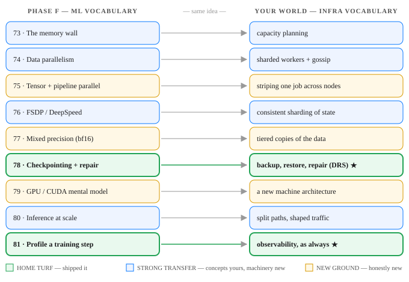

# Day 82 — Recap: The ML Systems Map — Where Your Infra Career Plugs In

**Tonight you'll be able to:** compress all of Phase F (Days 73–81) into one sentence you can carry into any AI-infra interview — *every Phase F problem is a distributed-systems problem in new clothes: state too big for one node, work sharded across many, state checksummed and repaired, traffic shaped at the edge* — and back it with a translation table: nine ML-systems ideas, each with its infra-world name, the evidence already on your record, and the one honest gap.

## The one idea

Day 20 compressed Phase A into a sentence, Day 34 did Phase B, Day 50 Phase C, Day 63 Phase D. Phase F gets the same treatment tonight — and this one is personal, because Phase F was never really a new subject:

**Every Phase F problem is a distributed-systems problem in new clothes — state too big for one node, work sharded across many, state checksummed and repaired, traffic shaped at the edge — and the scarcest seats in AI sit where that machinery meets the model.**

**State too big for one node (Days 73, 76, 77).** The memory wall (Day 73) is capacity planning: the working set — weights, gradients, optimizer states, activations — exceeds one GPU the way a dataset exceeds one disk. FSDP and DeepSpeed (Day 76) answer it with *consistent sharding of state*: no worker holds the whole model, shards are gathered on demand, exactly the placement problem you have designed for years. Mixed precision (Day 77) shrinks the state by keeping tiered copies — a full-precision master, a bf16 working tier — a hot/cold split your DynamoDB Tiered Storage launch would recognize.

**Work sharded across many (Days 74, 75).** Data parallelism (Day 74) shards the *data* and synchronizes with all-reduce, a gossip aggregation. Tensor and pipeline parallelism (Day 75) shard the *model itself* — striping one job across nodes. The second is the newest idea of the phase for you; the first is sharded workers keeping replicas in step, which is home ground conceptually even if you haven't run the GPU version yet.

**State checksummed, repaired, and watched (Days 78, 81).** Checkpointing at scale (Day 78) is backup, restore, and repair pointed at weights: durable snapshots in object storage, integrity checks, a dead worker rebuilt from the last good state instead of restarting a month-long run. You authored the Data Reliability Service on Conveyor — this row of the table is not a translation, it's a citation. Profiling a training step (Day 81) is the same observability instinct: find the bottleneck, don't guess.

**Traffic shaped at the edge (Day 80).** Inference at scale splits prefill from decode the way systems split write paths from read paths, and shapes request traffic for a fleet — the team you've been on since August 2026 does the infra version of this daily.

**Where the translation runs out (Day 79).** One row is honestly new: the GPU itself. SMs, warps, the memory hierarchy — a new machine architecture, where you have the mental model and not yet the depth. The recap names it instead of bluffing it, because the whole point of this map is that it's *credible*: nine rows, two home turf, four strong transfers, three honestly new — and every gap is "machinery not yet operated," never "systems thinking."

**Why this is the scarcest seat.** Frontier labs can hire modeling talent faster than they can hire people who keep training data flowing, checkpoints durable, KV caches hot, and a ten-thousand-GPU fleet alive. Training data pipelines, checkpoint storage, cache infrastructure, reliability at GPU scale — that layer is your decade, renamed. You're not entering AI from outside. You're translating.

## Analogy

It's a **port of a system you designed to a new platform**. The architecture review would be short — state placement, sharding, repair, load shaping are decisions you've defended for ten years. What's new is platform knowledge: the GPU's memory hierarchy instead of the disk hierarchy, bf16 range instead of byte ranges, NCCL instead of your RPC stack. Ports fail when engineers mistake new vocabulary for new ideas, or old confidence for platform skill. This map avoids both: it says exactly which rows are the same architecture (most of them) and exactly which rows are platform depth you still owe (CUDA, numerics, real clusters). That's how you'd write the port plan at work. It's also how you answer "why you, for AI infra?" in an interview.

## See it



The one page to keep from Phase F. Left: the nine days in ML vocabulary. Right: the same nine ideas in the vocabulary you've used for a decade. Green rows (78, 81) are home turf — checkpointing/repair and observability are the reliability rows, and they're yours. Blue rows transfer strongly: the concepts are yours, the machinery is new. Amber rows are honestly new ground — model parallelism mechanics, numerics, and the GPU itself.

## Code it (~30 min)

One file, three views of the map, in pure stdlib — tonight the artifact *is* the interview prep. The program is a **translation table + readiness inventory**. **Part 1** prints the map: every Phase F day, its infra-world name, and a verdict — HOME TURF, STRONG TRANSFER, or NEW GROUND. **Part 2** prints the inventory: for each row, the evidence already on the record (Conveyor + DRS, S3 core, DynamoDB team lead and the Tiered Storage launch, traffic shaping since Aug 2026 — nothing beyond that record is claimed) and the one honest gap. **Part 3** totals the verdicts, prints the sentence, and asserts the map's shape: nine rows, Days 73–81 exactly once, and the home-turf rows are the reliability rows (78, 81).

```python
"""Day 82 - Recap: The ML Systems Map - Where Your
Infra Career Plugs In.

Phase F recap, same treatment as Days 20, 34, 50 and
63: one carry sentence, a slot map of every day in
the phase, and a small artifact that makes the map
executable. Phase F (Days 73-81) was the systems
phase: the memory wall, the ways training gets split
across GPUs, mixed precision, checkpointing, the GPU
itself, inference at scale, and profiling. The
sentence:

    Every Phase F problem is a distributed-systems
    problem in new clothes - state too big for one
    node, work sharded across many, state checksummed
    and repaired, traffic shaped at the edge - and
    the scarcest seats in AI sit where that machinery
    meets the model.

Tonight the map becomes a TRANSLATION TABLE plus a
READINESS INVENTORY:

  Part 1  The map: each Phase F day, the name the
          same idea already has in your infra world,
          and a verdict - HOME TURF (you have shipped
          this), STRONG TRANSFER (the concepts are
          yours, the machinery is new), or NEW GROUND
          (honestly new: name it, never bluff it).
  Part 2  The inventory: for every row, the evidence
          already on the record, and the one honest
          gap. The record, and nothing beyond it:
          Staff SWE on Conveyor, Tesla's exabyte-scale
          Rust object store for AI training, and
          author of its Data Reliability Service;
          AWS S3 core and DynamoDB team lead (Tiered
          Storage launch); traffic shaping team since
          Aug 2026. Invented claims die in interviews;
          these nine rows don't need any.
  Part 3  The totals and the sentence: how the nine
          days sort, and the one line to carry into
          the interview loop.

Pure stdlib, deterministic - no RNG, no torch, no
APIs, no downloads. Runs as-is in the ~/ai-lab venv
on the MacBook.

Expected output:

  Part 1 - the translation table (Days 73-81)
    day  Phase F                      in your world                verdict
     73  The memory wall              capacity planning            STRONG TRANSFER
     74  Data parallelism             sharded workers + gossip     STRONG TRANSFER
     75  Tensor + pipeline parallel   striping one job             NEW GROUND
     76  FSDP / DeepSpeed             consistent sharding of state STRONG TRANSFER
     77  Mixed precision (bf16)       tiered copies of the data    NEW GROUND
     78  Checkpointing + repair       backup, restore, repair      HOME TURF
     79  GPU / CUDA mental model      a new machine architecture   NEW GROUND
     80  Inference at scale           split paths, shaped traffic  STRONG TRANSFER
     81  Profile a training step      observability, as always     HOME TURF
    every row is the same idea wearing two vocabularies:
    the left column is what the ML team calls it, the
    middle column is what you have been calling it.
  Part 2 - readiness inventory: evidence + the honest gap
    Day 73  The memory wall
      evidence: capacity math at exabyte scale (Conveyor storage)
      gap:      training-job budgets (activations, optimizer states) are new
      arithmetic
    Day 74  Data parallelism
      evidence: sharded data systems at S3 / DynamoDB scale
      gap:      no multi-GPU training job run yet - all-reduce met in simulation
      (Day 74)
    Day 75  Tensor + pipeline parallel
      evidence: striping / pipelining intuition from storage data paths
      gap:      no hands-on model splitting (Megatron-style) yet
    Day 76  FSDP / DeepSpeed
      evidence: placement + sharding design (DynamoDB partitions, Conveyor)
      gap:      FSDP / DeepSpeed not yet operated on a real cluster
    Day 77  Mixed precision (bf16)
      evidence: tiering instinct: led the DynamoDB Tiered Storage launch
      gap:      numerics judgement (bf16 range, loss scaling) is new
    Day 78  Checkpointing + repair
      evidence: authored the Data Reliability Service on Conveyor
      gap:      training-checkpoint tooling (async, distributed) not yet operated
    Day 79  GPU / CUDA mental model
      evidence: deep systems fundamentals - no GPU claims made
      gap:      CUDA depth: mental model only, no kernels written - the big honest
      gap
    Day 80  Inference at scale
      evidence: traffic shaping team since Aug 2026: routing, load, edges
      gap:      no production inference fleet operated yet
    Day 81  Profile a training step
      evidence: reliability + observability work on Conveyor / DRS
      gap:      GPU profilers (Nsight) and training-loop ownership still ahead
    the gaps are all of one kind - machinery not yet
    operated - and none of them is 'systems thinking'.
    That is the strongest sentence in the inventory.
  Part 3 - the totals
    HOME TURF:       2 of 9 - checkpointing/repair, profiling
    STRONG TRANSFER: 4 of 9 - memory wall, data parallelism, FSDP, inference at scale
    NEW GROUND:      3 of 9 - model parallelism, mixed precision, the GPU itself
    the sentence:
      Every Phase F problem is a distributed-systems problem in new
      clothes - state too big for one node, work sharded across many,
      state checksummed and repaired, traffic shaped at the edge - and
      the scarcest seats in AI sit where that machinery meets the model.
    checks: 9 rows, Days 73-81 each exactly once - verdicts sum to 9 - home-turf rows are the reliability rows (78, 81)
  verdict: you are not entering AI from outside - you are translating a decade of systems work into its vocabulary, gaps named out loud.
"""
import textwrap

# The map: day, Phase F concept, the infra-world name
# for the same idea, and the honest verdict.
MAP = [
    (73, "The memory wall", "capacity planning",
     "STRONG TRANSFER"),
    (74, "Data parallelism", "sharded workers + gossip",
     "STRONG TRANSFER"),
    (75, "Tensor + pipeline parallel", "striping one job",
     "NEW GROUND"),
    (76, "FSDP / DeepSpeed", "consistent sharding of state",
     "STRONG TRANSFER"),
    (77, "Mixed precision (bf16)", "tiered copies of the data",
     "NEW GROUND"),
    (78, "Checkpointing + repair", "backup, restore, repair",
     "HOME TURF"),
    (79, "GPU / CUDA mental model", "a new machine architecture",
     "NEW GROUND"),
    (80, "Inference at scale", "split paths, shaped traffic",
     "STRONG TRANSFER"),
    (81, "Profile a training step", "observability, as always",
     "HOME TURF"),
]

# The inventory: evidence strictly from the record,
# plus the one honest gap per row.
INVENTORY = [
    (73, "capacity math at exabyte scale (Conveyor storage)",
     "training-job budgets (activations, optimizer states) "
     "are new arithmetic"),
    (74, "sharded data systems at S3 / DynamoDB scale",
     "no multi-GPU training job run yet - all-reduce met "
     "in simulation (Day 74)"),
    (75, "striping / pipelining intuition from storage "
     "data paths",
     "no hands-on model splitting (Megatron-style) yet"),
    (76, "placement + sharding design (DynamoDB "
     "partitions, Conveyor)",
     "FSDP / DeepSpeed not yet operated on a real cluster"),
    (77, "tiering instinct: led the DynamoDB Tiered "
     "Storage launch",
     "numerics judgement (bf16 range, loss scaling) is new"),
    (78, "authored the Data Reliability Service on Conveyor",
     "training-checkpoint tooling (async, distributed) "
     "not yet operated"),
    (79, "deep systems fundamentals - no GPU claims made",
     "CUDA depth: mental model only, no kernels written - "
     "the big honest gap"),
    (80, "traffic shaping team since Aug 2026: routing, "
     "load, edges",
     "no production inference fleet operated yet"),
    (81, "reliability + observability work on Conveyor / DRS",
     "GPU profilers (Nsight) and training-loop ownership "
     "still ahead"),
]

NAMES = {day: concept for day, concept, _, _ in MAP}

# ---------- Part 1: the translation table ----------
print("Part 1 - the translation table (Days 73-81)")
print(f"  {'day':>3}  {'Phase F':<28} {'in your world':<28} verdict")
for day, concept, infra, verdict in MAP:
    print(f"  {day:>3}  {concept:<28} {infra:<28} {verdict}")
print("  every row is the same idea wearing two vocabularies:")
print("  the left column is what the ML team calls it, the")
print("  middle column is what you have been calling it.")

# ---------- Part 2: readiness inventory ----------
print("Part 2 - readiness inventory: evidence + the honest gap")
for day, evidence, gap in INVENTORY:
    print(f"  Day {day}  {NAMES[day]}")
    for line in textwrap.wrap("evidence: " + evidence, 76):
        print(f"    {line}")
    for line in textwrap.wrap("gap:      " + gap, 76):
        print(f"    {line}")
print("  the gaps are all of one kind - machinery not yet")
print("  operated - and none of them is 'systems thinking'.")
print("  That is the strongest sentence in the inventory.")

# ---------- Part 3: totals + the sentence ----------
print("Part 3 - the totals")
counts = {}
for *_, verdict in MAP:
    counts[verdict] = counts.get(verdict, 0) + 1
home = [d for d, _, _, v in MAP if v == "HOME TURF"]
print(f"  HOME TURF:       {counts['HOME TURF']} of 9 - "
      "checkpointing/repair, profiling")
print(f"  STRONG TRANSFER: {counts['STRONG TRANSFER']} of 9 - "
      "memory wall, data parallelism, FSDP, inference at scale")
print(f"  NEW GROUND:      {counts['NEW GROUND']} of 9 - "
      "model parallelism, mixed precision, the GPU itself")
SENTENCE = ("Every Phase F problem is a distributed-systems "
            "problem in new clothes - state too big for one "
            "node, work sharded across many, state checksummed "
            "and repaired, traffic shaped at the edge - and "
            "the scarcest seats in AI sit where that machinery "
            "meets the model.")
print("  the sentence:")
for line in textwrap.wrap(SENTENCE, 66):
    print(f"    {line}")
days = [d for d, *_ in MAP]
assert days == list(range(73, 82))
assert sum(counts.values()) == 9
assert home == [78, 81]
print(f"  checks: 9 rows, Days 73-81 each exactly once - "
      f"verdicts sum to 9 - home-turf rows are the "
      f"reliability rows ({', '.join(map(str, home))})")
print("verdict: you are not entering AI from outside - you are "
      "translating a decade of systems work into its vocabulary, "
      "gaps named out loud.")
```

**Expected output:**

```
Part 1 - the translation table (Days 73-81)
  day  Phase F                      in your world                verdict
   73  The memory wall              capacity planning            STRONG TRANSFER
   74  Data parallelism             sharded workers + gossip     STRONG TRANSFER
   75  Tensor + pipeline parallel   striping one job             NEW GROUND
   76  FSDP / DeepSpeed             consistent sharding of state STRONG TRANSFER
   77  Mixed precision (bf16)       tiered copies of the data    NEW GROUND
   78  Checkpointing + repair       backup, restore, repair      HOME TURF
   79  GPU / CUDA mental model      a new machine architecture   NEW GROUND
   80  Inference at scale           split paths, shaped traffic  STRONG TRANSFER
   81  Profile a training step      observability, as always     HOME TURF
  every row is the same idea wearing two vocabularies:
  the left column is what the ML team calls it, the
  middle column is what you have been calling it.
Part 2 - readiness inventory: evidence + the honest gap
  Day 73  The memory wall
    evidence: capacity math at exabyte scale (Conveyor storage)
    gap:      training-job budgets (activations, optimizer states) are new
    arithmetic
  Day 74  Data parallelism
    evidence: sharded data systems at S3 / DynamoDB scale
    gap:      no multi-GPU training job run yet - all-reduce met in simulation
    (Day 74)
  Day 75  Tensor + pipeline parallel
    evidence: striping / pipelining intuition from storage data paths
    gap:      no hands-on model splitting (Megatron-style) yet
  Day 76  FSDP / DeepSpeed
    evidence: placement + sharding design (DynamoDB partitions, Conveyor)
    gap:      FSDP / DeepSpeed not yet operated on a real cluster
  Day 77  Mixed precision (bf16)
    evidence: tiering instinct: led the DynamoDB Tiered Storage launch
    gap:      numerics judgement (bf16 range, loss scaling) is new
  Day 78  Checkpointing + repair
    evidence: authored the Data Reliability Service on Conveyor
    gap:      training-checkpoint tooling (async, distributed) not yet operated
  Day 79  GPU / CUDA mental model
    evidence: deep systems fundamentals - no GPU claims made
    gap:      CUDA depth: mental model only, no kernels written - the big honest
    gap
  Day 80  Inference at scale
    evidence: traffic shaping team since Aug 2026: routing, load, edges
    gap:      no production inference fleet operated yet
  Day 81  Profile a training step
    evidence: reliability + observability work on Conveyor / DRS
    gap:      GPU profilers (Nsight) and training-loop ownership still ahead
  the gaps are all of one kind - machinery not yet
  operated - and none of them is 'systems thinking'.
  That is the strongest sentence in the inventory.
Part 3 - the totals
  HOME TURF:       2 of 9 - checkpointing/repair, profiling
  STRONG TRANSFER: 4 of 9 - memory wall, data parallelism, FSDP, inference at scale
  NEW GROUND:      3 of 9 - model parallelism, mixed precision, the GPU itself
  the sentence:
    Every Phase F problem is a distributed-systems problem in new
    clothes - state too big for one node, work sharded across many,
    state checksummed and repaired, traffic shaped at the edge - and
    the scarcest seats in AI sit where that machinery meets the model.
  checks: 9 rows, Days 73-81 each exactly once - verdicts sum to 9 - home-turf rows are the reliability rows (78, 81)
verdict: you are not entering AI from outside - you are translating a decade of systems work into its vocabulary, gaps named out loud.
```

## Today's win

Done when your run prints the whole map: Part 1's nine-row translation table, Part 2's inventory with a named gap beside every piece of evidence, and Part 3's totals — **2 home turf, 4 strong transfer, 3 new ground** — with the checks line confirming the home-turf rows are 78 and 81. The keeper test, no notes allowed: someone names any Phase F term — "FSDP," "checkpointing," "disaggregated decode" — and you give its infra name, your evidence, and your gap in one breath. That's not a party trick; that's the interview answer, rehearsed.

## Short on time? 20-minute version

Read "The one idea" and study the diagram until you can redraw it: nine rows, two columns, green where you're already strong. Then run the code and read only Part 3 — the totals and the sentence. If you can say the sentence and explain why Day 79 is amber while Day 78 is green, you have the recap.

## Tomorrow's teaser

Tomorrow: Phase G opens — the capstone. We leave the cluster and turn to your other world, the market, and ask why it's the hardest place in all of ML to be right.

*Streak: 82 day(s) · Never miss twice.*
