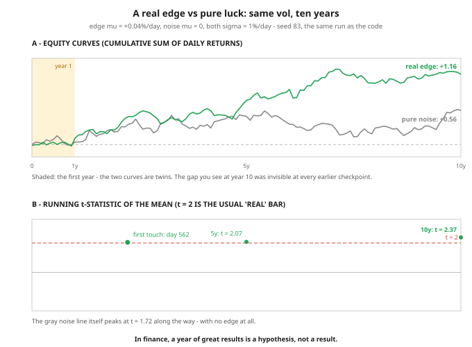

# Day 83 — Quant ML 1: Why Finance Is the Hardest ML Domain

**Tonight you'll be able to:** name the four ways finance breaks the assumptions every earlier phase quietly relied on — vanishing signal-to-noise, non-stationarity, tiny effective samples, adversarial decay — and compute, for any strategy, how many *days* of track record it takes before its results are even tellable from luck.

## The one idea

Phase G points the whole machine — fit, grade, ship — at the domain you care about most. But finance is not "ML, but with stock data." It is the domain where the assumptions Phases A–F quietly relied on are at their weakest. You know markets; tonight is about what markets do to *models*. Four pieces of failure physics.

**1. Signal-to-noise is brutal (the big one).** A genuinely good strategy might expect **+0.04% per day** while daily prices swing **±1%** — a per-day Sharpe of 0.04, inside the 0.05–0.15 band real edges live in after costs. The signal is 1/25th of the noise, so a single day tells you almost nothing; only averaging squeezes the noise down (it shrinks like σ/√n) while the mean stays put. Proving an edge is therefore a *sample-size purchase* at a brutal exchange rate: days needed grows with (σ/μ)². Part 1 prices it exactly — a real +0.04%/day edge needs on the order of **2,500 days, a decade**, to certify at the usual t = 2 bar. A year of great returns is a hypothesis, not a result.

**2. Non-stationarity: the target moves.** Day 70's drift warning becomes the whole climate. The process generating returns changes — rate regimes, volatility regimes, liquidity, who else is trading. A model right about 2015–2020 can be wrong about everything after, not because it was badly fit but because the world it was fit to *ended*. Cats stay cats; markets rewire themselves. Part 3 runs the extreme case: an edge that flips sign halfway makes the pooled ten-year fit worse than useless — it confidently learns a world that never existed.

**3. Tiny effective samples.** Ten years of daily bars is 2,520 rows — before you notice that a 20-day feature computed on consecutive days shares 19 of its days with yesterday's copy, so the *independent* observation count is far lower than the row count. And there is exactly **one history**: you cannot re-run the 2010s with a different seed. Image models train on millions of independent examples; you get one path of one market, regimes and all.

**4. The dataset fights back.** In every other domain the data sits still while you model it. Here, an edge that gets published — or merely crowded — gets traded against and arbitraged away; other participants are optimizing over the same patterns, against you. Edges decay *because* they were found. That is the world's half of the problem; tomorrow (Day 84) covers the self-inflicted half. Tonight's stance, the one the whole capstone runs on: in finance, ML is mostly a **measurement discipline** — small edges, honest validation, regime awareness — and the wins come from not fooling yourself.

## Analogy

It's an A/B test on a noisy system — your home turf. Detecting a real edge in markets is like detecting a **0.04% latency improvement** in a service whose p99 swings ±25× that from hour to hour. You would never ship on an hour of metrics: you'd demand weeks of traffic, and you'd still argue about seasonality shifting the baseline mid-experiment. Markets are that experiment, except the seasonality (regimes) never repeats on schedule, the traffic is one unrepeatable stream, and the moment you publish the optimization, every other team copies it and the win evaporates — the benchmark itself is adversarial.

## See it



Top: ten years of two strategies with identical volatility — one carrying a real +0.04%/day edge, one carrying nothing. For the first year (shaded) they are twins, and after a decade the *noise* strategy is still up +0.56 on luck alone. Bottom: the evidence meter — the edge strategy's running t-statistic needs about five years to touch t = 2 and the full decade to hold it, while the edgeless gray line itself peaks at 1.72 along the way. Same run as the code (seed 83).

## Code it (~30 min)

One file, three parts, all **simulated** — on purpose. With real market data you never know the true edge, so you could never check whether the statistics were right; in simulation the ground truth is printed on the label. **Part 1** races a real edge against pure noise and reads the t-statistic (standard-error score for "is this mean distinguishable from zero?") at a quarter, a year, five years, ten. **Part 2** runs the luck factory: 100 edgeless strategies, one year each, and counts the fake track records. **Part 3** flips one strategy's edge at year 5 and pools the decade. numpy only, seed fixed at 83 — change the seed and the wiggles change; double `MU` and the theory line drops to 625 days, which is the physics talking.

```python
"""Day 83 - Quant ML 1: Why Finance Is the Hardest ML Domain.

Phase G opener. Days 1-82 built the general machine:
fit f_theta, grade it on held-out data, ship it. Finance
keeps the machine and breaks its assumptions. Four
pieces of failure physics, one per paragraph of the
lesson:

  1. Signal-to-noise. A GOOD strategy's true edge is
     ~0.04% per day against ~1% daily noise - a per-day
     Sharpe of 0.04. The signal is a rounding error on
     the noise, every single day.
  2. Non-stationarity. The process generating the data
     moves: regimes flip, and yesterday's edge can
     become tomorrow's drag. Cats stay cats; markets
     rewire themselves.
  3. Tiny effective samples. One market, one history.
     Overlapping windows are not independent samples,
     so "10 years of data" is far fewer real observations
     than it looks - and they all share the same regimes.
  4. Adversarial decay. A published or crowded edge gets
     traded against and arbitraged away. The dataset
     fights back.

Tonight's code makes (1) and (2) measurable:

  Part 1  Two simulated strategies, same vol. One has
          the real edge above, one is pure noise. Watch
          the t-statistic of the mean - the standard
          "is this distinguishable from zero?" score -
          at one quarter, one year, five years, ten.
          Theory says the AVERAGE edge strategy needs
          (2*sigma/mu)^2 = 2,500 days to reach t = 2.
  Part 2  The luck factory: 100 pure-noise strategies,
          one year each. Count how many print t > 2 -
          a "proven" track record manufactured by chance
          alone, ready to be sold as skill.
  Part 3  Non-stationarity, one run: the strategy's
          edge is +0.08%/day for five years, then flips
          to -0.08%/day for five. The pooled 10-year
          backtest averages the two regimes into a lie.

Everything is simulated: no market data, no downloads,
no APIs. numpy only, one fixed seed (83) - the seed is
part of the lesson, because the exact wiggle of any one
run is luck; the SIZES are the physics. Runs in the
~/ai-lab venv on CPU in about a second.

Expected output:

  Part 1 - the edge is real, and invisible for years
    true edge: mu = +0.04%/day, sigma = 1.00%/day  (per-day Sharpe 0.04)
    theory: days for the average edge run to reach t = 2: (2*sigma/mu)^2 = 2500 days = 9.9 years
    one simulated pair, same seed, 10 years:
      after    63 days (one quarter): edge t = +0.66   noise t = +0.05
      after   252 days (one year   ): edge t = +0.57   noise t = +0.24
      after  1260 days (five years ): edge t = +2.07   noise t = +1.33
      after  2520 days (ten years  ): edge t = +2.37   noise t = +1.11
    this edge run first touches t = 2 on day 562 - and a touch is not a hold
    the edge strategy's realized Sharpe over the decade: 0.75 annualized - a good strategy
    verdict: at one year, the REAL edge is statistically indistinguishable from luck
  Part 2 - the luck factory: 100 strategies with NO edge, 1 year each
    pure-noise strategies printing t > 2 after 252 days: 5 of 100
    the best of them: t = +2.80 - at exactly one year, t IS the annualized Sharpe
    chance alone predicts ~2-3 of 100 (a one-sided t > 2 is a ~2.3% event)
    verdict: a great one-year track record is what luck looks like at scale
  Part 3 - the target moves: one strategy, regime flip at year 5
    years 1-5  (edge +0.08%/day): t = +1.93, cumulative +0.680
    years 6-10 (edge -0.08%/day): t = -3.73, cumulative -1.301
    all 10 years pooled:          t = -1.25 -> reads as 'no edge'
    verdict: pooled, the backtest learns a world that never existed
"""
import numpy as np

MU, SIGMA = 0.0004, 0.01      # true edge: +0.04%/day; daily vol: 1%
DAYS = 2520                   # 10 years x 252 trading days


def t_stat(r):
    """t-statistic of the mean: how many standard errors
    the average daily return sits from zero."""
    return r.mean() / (r.std(ddof=1) / np.sqrt(len(r)))


def running_t(r):
    """t-statistic of every prefix of r, vectorized via
    cumulative sums (used to find the first t = 2 touch)."""
    n = np.arange(1, len(r) + 1)
    mean = np.cumsum(r) / n
    with np.errstate(divide="ignore", invalid="ignore"):
        # n = 1 has no sample std; we only ever read n >= 30.
        var = (np.cumsum(r ** 2) / n - mean ** 2) * n / (n - 1)
        return mean / (np.sqrt(var) / np.sqrt(n))


rng = np.random.default_rng(83)
edge = rng.normal(MU, SIGMA, DAYS)     # real edge, buried in noise
noise = rng.normal(0.0, SIGMA, DAYS)   # no edge at all, same vol

# ---------- Part 1: how long until real is tellable from lucky? ----
print("Part 1 - the edge is real, and invisible for years")
print(f"  true edge: mu = +{MU * 100:.2f}%/day, sigma = {SIGMA * 100:.2f}%/day"
      f"  (per-day Sharpe {MU / SIGMA:.2f})")
need = (2.0 * SIGMA / MU) ** 2
print(f"  theory: days for the average edge run to reach t = 2:"
      f" (2*sigma/mu)^2 = {need:.0f} days = {need / 252:.1f} years")
print("  one simulated pair, same seed, 10 years:")
for n, label in ((63, "one quarter"), (252, "one year"),
                 (1260, "five years"), (2520, "ten years")):
    print(f"    after {n:>5} days ({label:<11}): "
          f"edge t = {t_stat(edge[:n]):+.2f}   noise t = {t_stat(noise[:n]):+.2f}")
cross = int(np.argmax(running_t(edge)[29:] >= 2.0)) + 30
print(f"  this edge run first touches t = 2 on day {cross}"
      " - and a touch is not a hold")
sharpe = edge.mean() / edge.std(ddof=1) * np.sqrt(252)
print(f"  the edge strategy's realized Sharpe over the decade:"
      f" {sharpe:.2f} annualized - a good strategy")
print("  verdict: at one year, the REAL edge is statistically"
      " indistinguishable from luck")

# ---------- Part 2: the luck factory ----------
print("Part 2 - the luck factory: 100 strategies with NO edge, 1 year each")
crowd = rng.normal(0.0, SIGMA, (100, 252))
cts = crowd.mean(axis=1) / (crowd.std(axis=1, ddof=1) / np.sqrt(252))
lucky = int((cts > 2.0).sum())
print(f"  pure-noise strategies printing t > 2 after 252 days: {lucky} of 100")
print(f"  the best of them: t = {cts.max():+.2f} - at exactly one year,"
      " t IS the annualized Sharpe")
print("  chance alone predicts ~2-3 of 100 (a one-sided t > 2 is a ~2.3% event)")
print("  verdict: a great one-year track record is what luck looks like at scale")

# ---------- Part 3: the target moves ----------
print("Part 3 - the target moves: one strategy, regime flip at year 5")
flip = rng.normal(0.0, SIGMA, DAYS)
flip[:1260] += 0.0008          # regime 1: the edge is real, +0.08%/day
flip[1260:] -= 0.0008          # regime 2: the same edge, inverted
print(f"  years 1-5  (edge +0.08%/day): t = {t_stat(flip[:1260]):+.2f},"
      f" cumulative {flip[:1260].sum():+.3f}")
print(f"  years 6-10 (edge -0.08%/day): t = {t_stat(flip[1260:]):+.2f},"
      f" cumulative {flip[1260:].sum():+.3f}")
print(f"  all 10 years pooled:          t = {t_stat(flip):+.2f}"
      " -> reads as 'no edge'")
print("  verdict: pooled, the backtest learns a world that never existed")
```

**Expected output:**

```
Part 1 - the edge is real, and invisible for years
  true edge: mu = +0.04%/day, sigma = 1.00%/day  (per-day Sharpe 0.04)
  theory: days for the average edge run to reach t = 2: (2*sigma/mu)^2 = 2500 days = 9.9 years
  one simulated pair, same seed, 10 years:
    after    63 days (one quarter): edge t = +0.66   noise t = +0.05
    after   252 days (one year   ): edge t = +0.57   noise t = +0.24
    after  1260 days (five years ): edge t = +2.07   noise t = +1.33
    after  2520 days (ten years  ): edge t = +2.37   noise t = +1.11
  this edge run first touches t = 2 on day 562 - and a touch is not a hold
  the edge strategy's realized Sharpe over the decade: 0.75 annualized - a good strategy
  verdict: at one year, the REAL edge is statistically indistinguishable from luck
Part 2 - the luck factory: 100 strategies with NO edge, 1 year each
  pure-noise strategies printing t > 2 after 252 days: 5 of 100
  the best of them: t = +2.80 - at exactly one year, t IS the annualized Sharpe
  chance alone predicts ~2-3 of 100 (a one-sided t > 2 is a ~2.3% event)
  verdict: a great one-year track record is what luck looks like at scale
Part 3 - the target moves: one strategy, regime flip at year 5
  years 1-5  (edge +0.08%/day): t = +1.93, cumulative +0.680
  years 6-10 (edge -0.08%/day): t = -3.73, cumulative -1.301
  all 10 years pooled:          t = -1.25 -> reads as 'no edge'
  verdict: pooled, the backtest learns a world that never existed
```

## Today's win

Done when your run matches the expected output: the edge's t crawling `+0.66 → +0.57 → +2.07 → +2.37` while the edgeless run sits at `+0.24` after a full year; **5 of 100** pure-noise strategies faking t > 2 (best: a "Sharpe 2.80" manufactured from nothing); and Part 3's pooled `t = −1.25` plastered over two strong, opposite regimes. The keeper skill, no notes allowed: for any strategy someone shows you, you can now ask the only question that matters first — *how many days, and what's the daily Sharpe?* — because days-to-proof ≈ (2 / daily Sharpe)². Even an excellent annual-Sharpe-1.0 strategy needs roughly four years to prove itself.

## Short on time? 20-minute version

Read "The one idea", then stare at the diagram's bottom panel until the shape sinks in: evidence grows like √days, so proof is bought in years, not months. Run the code and read only the three verdict lines. The four failure modes plus one number — **2,500 days to certify a real 0.04%-per-day edge** — are tonight's whole payload.

## Tomorrow's teaser

Tomorrow: the enemy moves indoors — how backtests manufacture fake edges out of pure noise even when the market holds perfectly still, and the arithmetic of how many strategies you tried before this one "worked."

*Streak: 83 day(s) · Never miss twice.*
