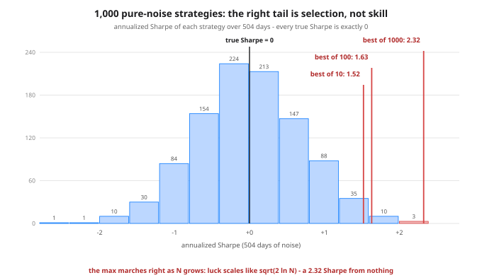

# Day 84 — Quant ML 2: The #1 Killer — Overfitting Backtests

**Tonight you'll be able to:** put a price on luck in any backtest — compute the luck bar for the number of variants actually tried, watch the best of 1,000 pure-noise strategies print a 2.32 Sharpe, and watch its year-1 crown collapse on data it was never tuned on — so from tonight, a winner has to clear the bar for *your* N, not just beat zero.

## The one idea

Day 83's verdict: in markets the signal is a whisper and the noise is a stadium. Tonight is the trap that stadium sets for anyone who backtests more than once — which is everyone.

**A backtest never reports the strategy you tried. It reports the best of everything you tried.** Run one strategy on pure noise — true Sharpe exactly 0 — over T days, and its measured Sharpe is a draw centered on 0 with spread s = √(252/T) annualized: about 0.71 for two years of daily data. Now run N variants and keep the winner. You are no longer sampling that bell curve; you are sampling its **maximum**, and the maximum is a different animal:

**E[best of N] ≈ s · √(2 ln N)** — the expected best Sharpe of N zero-edge strategies. It grows slowly (a log under a square root) but it never stops, and at honest N it is enormous:

| variants tried (N) | 10 | 100 | 1,000 |
|---|---|---|---|
| expected best Sharpe, pure luck (2 yrs data) | ~1.1 | ~1.8 | ~2.3 |

Nothing in that table is a tail event or bad luck — those are the *averages* of luck. The refined version is Bailey & López de Prado's expected maximum (the engine inside their **deflated Sharpe ratio**, 2014): E[max] ≈ s · [(1−γ)·Φ⁻¹(1 − 1/N) + γ·Φ⁻¹(1 − 1/(N·e))], where Φ⁻¹ is the normal quantile and γ ≈ 0.5772. Tonight's code uses it as-is; the envelope √(2 ln N) is its leading term — at N = 1,000 it overshoots (2.63 vs 2.30), so read the envelope as *the scale luck reaches for* and the BLdP number as *what luck produces on average*.

Two honest wrinkles. **First, the max is itself a draw.** Tonight's realized best-of-10 spiked to 1.52, well above its ~1.1 expectation, while the best-of-1,000 landed at 2.32 on an expectation of 2.30. Any single sweep realizes one sample of the max — sometimes tamer than the table, sometimes wilder. The table is the average over many sweeps, and it is already damning. **Second, your real N is bigger than your spreadsheet.** Every lookback you eyeballed and rejected counts. Every "what if I add a filter" you tested in your head counts. A small Pine grid — 10 lookbacks × 8 thresholds × 5 symbols — is 400 trials before lunch, and 400 trials on two years of data carries a luck bar around 2. And correlated variants (ten lookbacks of the same indicator) make the *effective* N smaller than the nominal count — BLdP's machinery absorbs that through the spread of the trial Sharpes — but since you can't measure the effective N exactly, the conservative move is to count the nominal one.

The fixes are discipline, not cleverness. **Count trials honestly** — log every variant you run (Day 67's experiment tracker exists for exactly this). **Hold out data you never tune on** and judge once: tonight's split-sample crowns a year-1 winner at 3.47 and watches it post 0.51 in year 2, ranked #312 of 1,000, while year 1's top 10 *average* −0.24 out of sample against +0.01 for the whole field. That's the winner's curse with the mask off. **Cut knobs** — every parameter multiplies N. And **demand the winner clear the luck bar for your N**, not zero. Day 87 turns the holdout into a system (walk-forward); tonight is the number that tells you why you need one.

## Analogy

It's the **false-page problem** from your own world. Wire 1,000 monitors to a perfectly healthy fleet, each with a small false-alarm rate, and you will be paged — constantly — by a system where nothing is wrong. The *any-of-many* view of noisy gauges is biased by construction: nobody gets paged by the 990 quiet monitors. A parameter sweep is a fleet of 1,000 gauges strapped to noise, and the backtest reports only the one that paged loudest. Same shape in A/B testing (ship the best of 1,000 config tweaks measured on noise and you've shipped the luckiest measurement, not the best config) and in fuzzing (run long enough against *correct* code and the strangest input in the corpus is strange by selection). Trading translation, one line: every Pine sweep you've ever run was tonight's experiment with your strategy names taped over the bars.

## See it



All 1,000 strategies are pure noise — true Sharpe exactly 0 — so the bell sits on zero, spread s ≈ 0.71, just as theory says. The red markers are the nested winners from tonight's run: the best of the first 10 (1.52), of the first 100 (1.63), of all 1,000 (2.32). Nothing about the strategies changed as N grew — only the size of the haystack the needle was selected from.

## Code it (~30 min)

One file, numpy only, fixed seed (84) — every digit reproduces. **Part 1** generates 1,000 noise strategies × 504 days and prints the best annualized Sharpe at N = 10 / 100 / 1,000 against both predictions (same s, same annualization on every column — apples to apples). **Part 2** inverts the envelope: how few tries does luck need to *expect* a 2.0 Sharpe, and how many noise strategies clear 1.0 and 1.5 by chance alone. **Part 3** is the honesty test: crown the best of 1,000 on year 1 only, then read its year-2 Sharpe and its rank. **Part 4** prints tonight's luck bar and the three fixes.

```python
"""Day 84 - Quant ML 2: The #1 Killer - Overfitting Backtests.

Day 8 said "overfitting = curve-fitting a backtest" and left it
as intuition. Today it gets a number. Run a thousand pure-noise
"strategies" - daily returns drawn from a distribution with
true mean ZERO, no edge anywhere - and look at the best one.
It will show a Sharpe ratio most traders would brag about.
Not because you got unlucky: because the MAXIMUM of N tries is
a different distribution from a single try, and its expected
value grows like sqrt(2 ln N).

  Part 1  Best-of-N on noise. 1000 noise strategies x 504 days
          (2 years). Print the best annualized Sharpe for
          N = 10, 100, 1000 next to two predictions:
            - the back-of-envelope bar: s * sqrt(2 ln N)
            - the refined Bailey & Lopez de Prado expected max
          where s = sqrt(252/504) = 0.7071 is the standard
          error of one annualized Sharpe estimate on 504 days
          of noise: a single Sharpe estimate over T days has
          std 1/sqrt(T) in daily units (Lo 2002), and
          annualizing multiplies by sqrt(252).
  Part 2  The flip side: how FEW trials luck needs. Solve the
          envelope for a 2.0 Sharpe, and count how many of the
          1000 noise strategies clear 1.0 and 1.5 by chance.
  Part 3  The honesty test: split-sample. Crown the best of
          1000 on year 1 only, then read its year-2 Sharpe.
          If the edge was selection, it collapses to ~0.
  Part 4  The luck bar for tonight's N, and the three fixes:
          count trials honestly, keep an untouched holdout,
          cut knobs (each knob multiplies N).

Correlated variants caveat (in the lesson): real parameter
sweeps are correlated, so the effective N is smaller than the
nominal count - the deflated Sharpe handles it through the
variance of the trial Sharpes. Counting nominal N is the
conservative choice, and it is the one used here.

Runs on the ~/ai-lab venv: numpy only, no downloads, no paid
APIs, fixed seed (84) - every digit below reproduces exactly.

Expected output:

  Part 1 - best-of-N on pure noise (true Sharpe of every strategy = 0)
    one Sharpe estimate on 504 noise days: std s = sqrt(252/504) = 0.7071
    best of    10 tries: 1.52   envelope s*sqrt(2 ln N) = 1.52   BLdP expected max = 1.11
    best of   100 tries: 1.63   envelope s*sqrt(2 ln N) = 2.15   BLdP expected max = 1.79
    best of  1000 tries: 2.32   envelope s*sqrt(2 ln N) = 2.63   BLdP expected max = 2.30
  Part 2 - how little luck needs
    trials for luck ALONE to expect a 2.0 Sharpe: ~55
    noise strategies (of 1000) with Sharpe > 1.0: 90
    noise strategies (of 1000) with Sharpe > 1.5: 18
    P(at least one of 100 noise tries clears 1.5) = 81.9%
  Part 3 - split-sample: crown on year 1, judge on year 2
    year-1 winner: strategy #210  year-1 Sharpe 3.47  (best of 1000 on 252 days)
    the same strategy, year 2: Sharpe 0.51  (rank #312 of 1000)
    year-2 Sharpe of year-1's top 10, average: -0.24
    year-2 Sharpe of all 1000, average: 0.01
  Part 4 - the luck bar and the fixes
    after 1000 tries on 2 years of data, luck alone expects a best Sharpe of 2.30
    a winner has to CLEAR that bar, not just 0 - and then
    survive data it was never tuned on (Part 3).
    fixes: log every trial (Day 67), hold out untouched
    data, and cut knobs - every knob multiplies N.
"""
import numpy as np
from statistics import NormalDist

SEED = 84
DAYS = 504                    # 2 years of daily bars
YEAR = 252                    # trading days per year
N_MAX = 1000                  # strategies in the sweep
VOL = 0.01                    # 1% daily vol; Sharpe is scale-free

Z = NormalDist()              # standard normal: cdf / inv_cdf
GAMMA = 0.5772156649          # Euler-Mascheroni constant

rng = np.random.default_rng(SEED)
# 1000 "strategies", each 504 days of PURE NOISE. True mean = 0.
rets = rng.normal(0.0, VOL, size=(N_MAX, DAYS))


def ann_sharpe(r):
    """Annualized Sharpe of daily returns along the last axis."""
    return r.mean(axis=-1) / r.std(axis=-1, ddof=1) * np.sqrt(YEAR)


def expected_max(n, s):
    """Bailey & Lopez de Prado's expected maximum Sharpe of n
    independent zero-edge trials whose Sharpe estimates have
    std s:  s * [(1-g) Z(1 - 1/n) + g Z(1 - 1/(n e))]."""
    a = Z.inv_cdf(1 - 1 / n)
    b = Z.inv_cdf(1 - 1 / (n * np.e))
    return s * ((1 - GAMMA) * a + GAMMA * b)


# One noise strategy's annualized Sharpe estimate over 504 days
# has std s = sqrt(252)/sqrt(504): 1/sqrt(T) in daily units,
# annualized by sqrt(252). Both prediction formulas use THIS s,
# and the empirical maxima come from the same Sharpe numbers -
# apples to apples.
S_ERR = np.sqrt(YEAR / DAYS)

print("Part 1 - best-of-N on pure noise (true Sharpe of every "
      "strategy = 0)")
print(f"  one Sharpe estimate on {DAYS} noise days: std "
      f"s = sqrt({YEAR}/{DAYS}) = {S_ERR:.4f}")
S = ann_sharpe(rets)
for n in (10, 100, 1000):
    emp = S[:n].max()
    env = S_ERR * np.sqrt(2 * np.log(n))
    ref = expected_max(n, S_ERR)
    print(f"  best of {n:>5} tries: {emp:.2f}   envelope "
          f"s*sqrt(2 ln N) = {env:.2f}   BLdP expected max "
          f"= {ref:.2f}")

print("Part 2 - how little luck needs")
n_for_2 = int(np.ceil(np.exp(0.5 * (2.0 / S_ERR) ** 2)))
print(f"  trials for luck ALONE to expect a 2.0 Sharpe: "
      f"~{n_for_2}")
for bar in (1.0, 1.5):
    k = int((S > bar).sum())
    print(f"  noise strategies (of {N_MAX}) with Sharpe > "
          f"{bar}: {k}")
p1 = 1 - Z.cdf(1.5 / S_ERR)
print(f"  P(at least one of 100 noise tries clears 1.5) "
      f"= {1 - (1 - p1) ** 100:.1%}")

print("Part 3 - split-sample: crown on year 1, judge on year 2")
S1 = ann_sharpe(rets[:, :YEAR])
S2 = ann_sharpe(rets[:, YEAR:])
best = int(S1.argmax())
rank2 = int((S2 > S2[best]).sum()) + 1
top10 = S1.argsort()[::-1][:10]
print(f"  year-1 winner: strategy #{best}  year-1 Sharpe "
      f"{S1[best]:.2f}  (best of {N_MAX} on {YEAR} days)")
print(f"  the same strategy, year 2: Sharpe {S2[best]:.2f}  "
      f"(rank #{rank2} of {N_MAX})")
print(f"  year-2 Sharpe of year-1's top 10, average: "
      f"{S2[top10].mean():.2f}")
print(f"  year-2 Sharpe of all {N_MAX}, average: "
      f"{S2.mean():.2f}")

print("Part 4 - the luck bar and the fixes")
print(f"  after {N_MAX} tries on 2 years of data, luck alone "
      f"expects a best Sharpe of {expected_max(N_MAX, S_ERR):.2f}")
print("  a winner has to CLEAR that bar, not just 0 - and then")
print("  survive data it was never tuned on (Part 3).")
print("  fixes: log every trial (Day 67), hold out untouched")
print("  data, and cut knobs - every knob multiplies N.")
```

**Expected output:**

```
Part 1 - best-of-N on pure noise (true Sharpe of every strategy = 0)
  one Sharpe estimate on 504 noise days: std s = sqrt(252/504) = 0.7071
  best of    10 tries: 1.52   envelope s*sqrt(2 ln N) = 1.52   BLdP expected max = 1.11
  best of   100 tries: 1.63   envelope s*sqrt(2 ln N) = 2.15   BLdP expected max = 1.79
  best of  1000 tries: 2.32   envelope s*sqrt(2 ln N) = 2.63   BLdP expected max = 2.30
Part 2 - how little luck needs
  trials for luck ALONE to expect a 2.0 Sharpe: ~55
  noise strategies (of 1000) with Sharpe > 1.0: 90
  noise strategies (of 1000) with Sharpe > 1.5: 18
  P(at least one of 100 noise tries clears 1.5) = 81.9%
Part 3 - split-sample: crown on year 1, judge on year 2
  year-1 winner: strategy #210  year-1 Sharpe 3.47  (best of 1000 on 252 days)
  the same strategy, year 2: Sharpe 0.51  (rank #312 of 1000)
  year-2 Sharpe of year-1's top 10, average: -0.24
  year-2 Sharpe of all 1000, average: 0.01
Part 4 - the luck bar and the fixes
  after 1000 tries on 2 years of data, luck alone expects a best Sharpe of 2.30
  a winner has to CLEAR that bar, not just 0 - and then
  survive data it was never tuned on (Part 3).
  fixes: log every trial (Day 67), hold out untouched
  data, and cut knobs - every knob multiplies N.
```

## Today's win

Done when your run reproduces the four anchors: best of 1,000 = **2.32** against a BLdP expected max of **2.30** (luck, predicted to two decimals); **~55** trials for luck alone to expect a 2.0 Sharpe; 90 of 1,000 noise strategies over 1.0 without a single real edge among them; and the year-1 winner's collapse **3.47 → 0.51**, rank #312, with year 1's top 10 averaging −0.24 out of sample. The keeper test, no notes: someone shows you a backtest — you ask "how many variants did you try, including the ones you threw away?", compute s·√(2 ln N) on the spot, and say whether the winner cleared the luck bar or just won the lottery it entered 1,000 times.

## Short on time? 20-minute version

Read "The one idea" and run the code. Spend your minutes on two lines: Part 1's best-of-1000 row (2.32 printed by pure noise, predicted at 2.30) and Part 3's winner collapse (3.47 → 0.51). If you can state the luck-bar formula and the three fixes from memory, you have the day — Part 2's arithmetic is the victory lap.

## Tomorrow's teaser

Tomorrow: what actually goes *into* a market model — returns, volatility, and the microstructure basics — and why raw price is almost never the right input.

---
*Streak: 84 day(s) · Never miss twice.*
