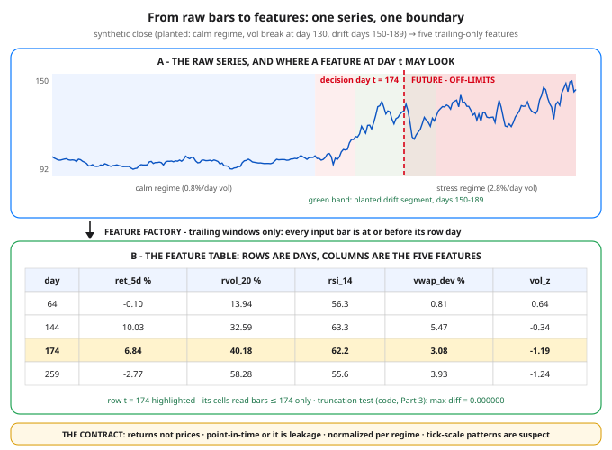

# Day 85 — Features for Market Data: Returns, Volatility, Microstructure Basics

**Tonight you'll be able to:** turn a raw price series into a feature table a model can trust — log returns at several horizons, realized vol, Wilder RSI, VWAP deviation, and a volume z-score — where every cell is computable at decision time, scaled for its regime, and proven leak-free by a truncation test you run yourself.

## The one idea

You already know tonight's cast as a trader: RSI, VWAP, realized vol — annotations you read on a chart, with a human (you) silently supplying the context: *what regime are we in, what does this number usually look like lately, is this move big for this name?* A model gets none of that context for free. It gets columns of numbers. So an indicator becomes an ML **feature** only when it signs a contract with four clauses — and tonight each clause gets a receipt from the code.

**Clause 1: returns, not prices.** A price level is non-stationary (Day 83): its mean and standard deviation are whatever the ride happened to make them. In Part 1 the same synthetic ticker has price std 2.09 in its calm segment and 12.60 in its stress segment — neither number means anything. **Log returns** — `log(P_t / P_t-1)` — fix all three problems at once: they are scale-free (a 1% move is 0.01 at $10 or $1,000), they *add* over time (Part 1 checks: the 21-day log return equals the sum of the 21 daily ones, 0.207962 both ways — simple returns can't do that), and their statistics hold still inside a regime: return std prints 0.847%/day against 0.8% planted in the calm segment, 2.860% against 2.8% planted in stress. Feed a model returns and it can learn relationships that survive a split, a trend, a new price level. Feed it prices and it learns "the close is usually near 130" — true until it isn't.

**Clause 2: point-in-time, or it is leakage.** Day 69's law, applied to markets: the feature for day *t* may be computed from bars at *t* and earlier — full stop. The leaks that ruin quant models are rarely exotic; they are centered rolling windows, statistics normalized with the full sample's mean, anything quietly rebuilt with future bars. On a chart you'd call that a *repainting indicator*, and traders treat repainting as fraud — backtests built on it are Day 84's casualty list. Tonight's factory is trailing-only by construction, and Part 3 doesn't ask you to trust that: it amputates the data at day *t*, recomputes every feature from the stump, and compares. Max diff 0.000000, asserted.

**Clause 3: normalize per regime.** Raw feature values are not comparable across regimes, and models assume comparable inputs. Part 2's regime check is the whole argument in two lines: realized vol of 35.0% on day 150 — just after the vol break — scores z = +2.22 against its trailing 60 days (an event); realized vol of 35.2% on day 245 scores z = −1.38 (slightly *quiet* for the regime it lives in). Same raw number, opposite meaning. The z-score is itself trailing-window, so it stays point-in-time legal: it answers "unusual *for lately*?", which is the only version of unusual a model should ever hear.

**Clause 4: microstructure is noise with a signature.** Zoom into tick data and the tape itself starts lying politely. Trades print alternately at the bid and the ask, so consecutive tick returns are mechanically anti-correlated — bounce, not information. Part 4 builds a tape over a known "true" price and measures it: lag-1 autocorrelation of tick returns is −0.63 while the true price underneath sits at +0.01, and the bounce alone inflates measured tick vol to 1.64× the real thing. Any mean-reversion "signal" discovered at tick frequency has to beat that null hypothesis first. It's one reason the capstone builds work on daily bars.

**The five features** (all trailing, all computed in Part 2): **ret_5d**, the 5-day log return in % — horizons are free once returns add, and the code prints 1d/5d/21d side by side; **rvol_20**, 20-day realized volatility (std of daily log returns, annualized ×√252); **rsi_14**, Wilder's RSI — the 0–100 momentum oscillator from smoothed average gains vs losses, smoothing recursion written out in the code; **vwap_dev**, close vs the trailing 20-day VWAP in % (with daily bars, close stands in for the typical price — stated, not hidden); **vol_z**, today's volume as a z-score against its trailing 20 days. One honest footnote from Part 1: the planted drift was +0.40%/day, but the drift segment's realized mean reads +0.261%/day — through 2.8% daily vol, even 40 days of a real drift is still mostly noise. That gap is Day 83's signal-to-noise problem, visible in a single table row.

## Analogy

Think **event sourcing**, the pattern behind half the storage systems you've built. The raw bars are an append-only, timestamped event log. A feature table is a **projection** — a materialized view built by folding events in order. Asking for features "as of day *t*" is a time-travel query, and point-in-time correctness is the rule that the projection at *t* must be rebuildable from the log *prefix* alone. Part 3's truncation test is literally that rebuild: chop the log, re-run the projection, diff against production — zero is the only acceptable answer. The classic leaks map one-to-one: a full-sample z-score is a projection that secretly read tomorrow's events; a centered window is a read of uncommitted future writes. And returns vs prices is the oldest storage choice you know: log the *deltas*, not absolute snapshots — deltas compose, snapshots expire. You've operated this system for a decade. Tonight it just points at a price series.

## See it



Top: the synthetic close — calm regime, vol break at day 130, the planted drift segment shaded green — with the point-in-time boundary at decision day 174: a feature for that day may read anything left of the red line and nothing to its right. Bottom: the factory's output — rows are days, columns are the five features; the highlighted row is day 174, computed from bars ≤ 174 only. Every value in the table is the code's real output.

## Code it (~30 min)

One file, numpy only, no downloads — the series is **synthetic by design**, built by a stated formula with planted structure (two volatility regimes, one hidden drift segment), so every claim in the theory has a number you can check. **Part 1** builds it and prints the regime table: price statistics wandering, return statistics sitting on the planted values, plus the log-return additivity receipt. **Part 2** is the feature factory — five trailing-only features, the feature table, a multi-horizon look at day 259, and the regime-normalization demo (same raw vol, z of +2.22 vs −1.38). **Part 3** is the keeper: the truncation test that certifies the whole factory point-in-time. **Part 4** fabricates a tick tape over a known true price and measures the bid/ask bounce inventing a −0.63 autocorrelation out of thin air.

```python
"""Day 85 - Features for Market Data: Returns, Volatility,
Microstructure Basics.

Phase G turns to your other world. Days 83-84 set the
terms: markets are non-stationary and backtests lie.
Tonight the raw material gets the same honesty pass.
You know RSI, VWAP and realized vol as a trader - chart
annotations you eyeball. An ML feature is the same
arithmetic under a contract:

  1. Returns, not prices. A price remembers its level -
     "close = 187.42" expires the day the stock splits
     or trends away. A log return is scale-free, ADDS
     over time, and its distribution holds still inside
     a regime (Day 83's stationarity, made usable).
  2. Point-in-time or it is leakage. The feature at day
     t may use bars at t and earlier ONLY - Day 69's
     law, applied to markets. A feature that peeks is
     a repainting indicator: beautiful, fraudulent.
  3. Normalize per regime. A raw 40% vol means panic in
     a calm regime and Tuesday in a stress regime, so
     features get z-scored against a TRAILING window -
     comparable across time, still point-in-time legal.
  4. Microstructure is noise with a signature. At tick
     frequency, trades bounce between bid and ask, and
     that bounce manufactures negative autocorrelation
     that looks exactly like a mean-reversion signal.

The series is SYNTHETIC, built by the formula below -
no downloads, no API - with structure planted on
purpose so every claim can be checked: two volatility
regimes (0.8%/day, then 2.8%/day) and a +0.4%/day
drift segment hidden inside the second one.

  Part 1  The series + regime stats: price mean/std
          wander all over; log-return stats sit at the
          planted values. Plus the additivity receipt:
          a 21-day log return IS the sum of 21 dailies.
  Part 2  The feature factory: five features - 5-day
          log return, 20-day realized vol, Wilder RSI
          (14), VWAP deviation (20d), volume z-score
          (20d) - every one trailing-only. Then the
          regime-normalization demo: same raw vol,
          different z, at stress onset vs deep inside.
  Part 3  The leakage self-check: recompute every
          feature from data truncated at day t and
          compare with the full-series value at t.
          Trailing-only construction makes the max
          diff exactly 0.0 - asserted, not hoped.
  Part 4  Bid/ask bounce on a synthetic tape: lag-1
          autocorrelation of tick returns vs daily
          returns, and how much vol the bounce invents.

Runs on the ~/ai-lab venv: numpy only (free), no
CUDA, no paid APIs, no downloads. Fixed seed, so
every number is reproducible.

Expected output:

  Part 1 - synthetic series: 260 days, vol break at day 130, drift days 150-189
    close: day 0 100.00   day 129 99.51   day 189 123.58   day 259 144.33
    segment            price mean  price std ret mean %/d ret std %/d
    calm (planted .8%)      96.30       2.09       -0.004       0.847
    stress (planted 2.8%)     125.13      12.60        0.286       2.860
    drift seg (+0.4%/d)     123.40       6.58        0.261       2.946
    additivity: log-ret day 179->200 = 0.207962;  sum of the 21 daily log-rets = 0.207962
    price stats drift with the ride; return stats sit at the planted regime values
  Part 2 - the feature table (every cell uses bars <= its day only)
     day    close  ret_5d %  rvol_20 %  rsi_14  vwap_dev %   vol_z
      64    97.00     -0.10      13.94    56.3        0.81    0.64
     144   104.76     10.03      32.59    63.3        5.47   -0.34
     174   130.22      6.84      40.18    62.2        3.08   -1.19
     194   132.79      7.18      50.62    61.4        7.67   -1.50
     234   133.37      5.55      45.90    57.5        4.62   -1.00
     259   144.33     -2.77      58.28    55.6        3.93   -1.24
    horizons at day 259 (log-rets add, so pick by horizon): 1d +1.04%   5d -2.77%   21d +11.02%
    regime check day 150: raw rvol 35.0%  -> trailing-60 z +2.22  (same raw vol: regime event at onset, normal deep inside)
    regime check day 245: raw rvol 35.2%  -> trailing-60 z -1.38  (same raw vol: regime event at onset, normal deep inside)
  Part 3 - leakage self-check: recompute on data truncated at t
    max |full-series - truncated| over 5 days x 6 features: 0.000000
    PASS - the future cannot reach these features; they would survive live trading unchanged
  Part 4 - bid/ask bounce: noise that wears a signal's clothes
    lag-1 autocorr:  tick returns -0.63   mid-price returns +0.01   daily returns +0.06
    measured tick vol is 1.64x the true vol - the bounce invents the rest
  verdict: features are a contract - returns not prices, point-in-time or it is leakage,
           normalized per regime, and suspicious of any pattern that lives only at tick scale.
"""
import numpy as np

SEED = 85
N = 260                                # trading days

# ---------- Part 1: a synthetic series, planted structure ----------
rng = np.random.default_rng(SEED)
z = rng.standard_normal(N)
day = np.arange(N)
sigma = np.where(day < 130, 0.008, 0.028)      # two vol regimes
mu = np.where(day < 130, 0.0003, -0.0004)      # per-day drift
mu[150:190] = 0.0040                           # planted drift segment
logret = mu + sigma * z
logret[0] = 0.0
price = 100.0 * np.exp(np.cumsum(logret))
base_vol = np.where(day < 130, 1_000_000, 1_800_000)
volume = (base_vol * (1.0 + 1.5 * np.abs(z))
          * np.exp(0.15 * rng.standard_normal(N))).round().astype(int)

print("Part 1 - synthetic series: 260 days, vol break at day 130, "
      "drift days 150-189")
print(f"  close: day 0 {price[0]:.2f}   day 129 {price[129]:.2f}   "
      f"day 189 {price[189]:.2f}   day 259 {price[259]:.2f}")
print(f"  {'segment':<18}{'price mean':>11}{'price std':>11}"
      f"{'ret mean %/d':>13}{'ret std %/d':>12}")
for name, lo, hi in (("calm (planted .8%)", 1, 130),
                     ("stress (planted 2.8%)", 130, 260),
                     ("drift seg (+0.4%/d)", 150, 190)):
    p, r = price[lo:hi], logret[lo:hi]
    print(f"  {name:<18}{p.mean():>11.2f}{p.std():>11.2f}"
          f"{100 * r.mean():>13.3f}{100 * r.std():>12.3f}")
r21 = np.log(price[200] / price[179])
print(f"  additivity: log-ret day 179->200 = {r21:.6f};  "
      f"sum of the 21 daily log-rets = {logret[180:201].sum():.6f}")
print("  price stats drift with the ride; return stats sit at the "
      "planted regime values")

# ---------- Part 2: the feature factory (trailing windows ONLY) ----------
def rsi_wilder(close, period=14):
    """Wilder's RSI: seeded on the first `period` changes,
    then smoothed avg = (avg*(p-1) + today) / p. Causal -
    the value at day t reads changes up to day t only."""
    n = len(close)
    out = np.full(n, np.nan)
    d = np.diff(close)                       # d[k] = change INTO day k+1
    gains = np.where(d > 0, d, 0.0)
    losses = np.where(d < 0, -d, 0.0)
    ag, al = gains[:period].mean(), losses[:period].mean()
    for t in range(period, n):
        if t > period:
            ag = (ag * (period - 1) + gains[t - 1]) / period
            al = (al * (period - 1) + losses[t - 1]) / period
        out[t] = 100.0 if al == 0 else 100.0 - 100.0 / (1.0 + ag / al)
    return out


def compute_features(close, vol):
    """Every feature at day t is a function of bars <= t.
    That single property is what Part 3 proves."""
    n = len(close)
    lr = np.zeros(n)
    lr[1:] = np.log(close[1:] / close[:-1])
    f = {k: np.full(n, np.nan) for k in
         ("ret_5d", "rvol_20", "rsi_14", "vwap_dev", "vol_z", "rvol_z60")}
    f["rsi_14"] = rsi_wilder(close)
    for t in range(n):
        if t >= 5:
            f["ret_5d"][t] = 100.0 * lr[t - 4:t + 1].sum()
        if t >= 20:
            f["rvol_20"][t] = 100.0 * lr[t - 19:t + 1].std() \
                * np.sqrt(252)
            vw = (close[t - 19:t + 1] * vol[t - 19:t + 1]).sum() \
                / vol[t - 19:t + 1].sum()
            f["vwap_dev"][t] = 100.0 * (close[t] / vw - 1.0)
            w = vol[t - 19:t + 1].astype(float)
            f["vol_z"][t] = (vol[t] - w.mean()) / w.std()
    rv = f["rvol_20"]
    for t in range(79, n):                   # z vs trailing 60 values
        w = rv[t - 59:t + 1]
        f["rvol_z60"][t] = (rv[t] - w.mean()) / w.std()
    return f


FEATS = compute_features(price, volume)
print("Part 2 - the feature table (every cell uses bars <= its day only)")
print(f"  {'day':>4}{'close':>9}{'ret_5d %':>10}{'rvol_20 %':>11}"
      f"{'rsi_14':>8}{'vwap_dev %':>12}{'vol_z':>8}")
for t in (64, 144, 174, 194, 234, 259):
    print(f"  {t:>4}{price[t]:>9.2f}{FEATS['ret_5d'][t]:>10.2f}"
          f"{FEATS['rvol_20'][t]:>11.2f}{FEATS['rsi_14'][t]:>8.1f}"
          f"{FEATS['vwap_dev'][t]:>12.2f}{FEATS['vol_z'][t]:>8.2f}")
print("  horizons at day 259 (log-rets add, so pick by horizon): "
      f"1d {100 * logret[259]:+.2f}%   5d {FEATS['ret_5d'][259]:+.2f}%"
      f"   21d {100 * np.log(price[259] / price[238]):+.2f}%")
for t in (150, 245):
    print(f"  regime check day {t}: raw rvol {FEATS['rvol_20'][t]:.1f}%  "
          f"-> trailing-60 z {FEATS['rvol_z60'][t]:+.2f}  "
          "(same raw vol: regime event at onset, normal deep inside)")

# ---------- Part 3: the leakage self-check ----------
print("Part 3 - leakage self-check: recompute on data truncated at t")
worst = 0.0
for t in (100, 144, 174, 200, 259):
    sub = compute_features(price[:t + 1], volume[:t + 1])
    for k in FEATS:
        worst = max(worst, abs(FEATS[k][t] - sub[k][t]))
print(f"  max |full-series - truncated| over 5 days x 6 features: "
      f"{worst:.6f}")
assert worst == 0.0
print("  PASS - the future cannot reach these features; "
      "they would survive live trading unchanged")

# ---------- Part 4: microstructure - the bid/ask bounce ----------
rng2 = np.random.default_rng(7)
ticks = 4000
mid = 100.0 + np.cumsum(rng2.normal(0.0, 0.08, ticks))   # the "true" price
side = np.where(np.arange(ticks) % 2 == 0, 1.0, -1.0)    # buy at ask, sell at bid
tape = mid + side * 0.05                                 # half-spread 5 cents


def autocorr1(r):
    return np.corrcoef(r[:-1], r[1:])[0, 1]


tick_ret = np.diff(np.log(tape))
mid_ret = np.diff(np.log(mid))
daily = logret[1:]
print("Part 4 - bid/ask bounce: noise that wears a signal's clothes")
print(f"  lag-1 autocorr:  tick returns {autocorr1(tick_ret):+.2f}   "
      f"mid-price returns {autocorr1(mid_ret):+.2f}   "
      f"daily returns {autocorr1(daily):+.2f}")
print(f"  measured tick vol is {tick_ret.std() / mid_ret.std():.2f}x the "
      "true vol - the bounce invents the rest")
print("verdict: features are a contract - returns not prices, "
      "point-in-time or it is leakage,")
print("         normalized per regime, and suspicious of any pattern "
      "that lives only at tick scale.")
```

**Expected output:**

```
Part 1 - synthetic series: 260 days, vol break at day 130, drift days 150-189
  close: day 0 100.00   day 129 99.51   day 189 123.58   day 259 144.33
  segment            price mean  price std ret mean %/d ret std %/d
  calm (planted .8%)      96.30       2.09       -0.004       0.847
  stress (planted 2.8%)     125.13      12.60        0.286       2.860
  drift seg (+0.4%/d)     123.40       6.58        0.261       2.946
  additivity: log-ret day 179->200 = 0.207962;  sum of the 21 daily log-rets = 0.207962
  price stats drift with the ride; return stats sit at the planted regime values
Part 2 - the feature table (every cell uses bars <= its day only)
   day    close  ret_5d %  rvol_20 %  rsi_14  vwap_dev %   vol_z
    64    97.00     -0.10      13.94    56.3        0.81    0.64
   144   104.76     10.03      32.59    63.3        5.47   -0.34
   174   130.22      6.84      40.18    62.2        3.08   -1.19
   194   132.79      7.18      50.62    61.4        7.67   -1.50
   234   133.37      5.55      45.90    57.5        4.62   -1.00
   259   144.33     -2.77      58.28    55.6        3.93   -1.24
  horizons at day 259 (log-rets add, so pick by horizon): 1d +1.04%   5d -2.77%   21d +11.02%
  regime check day 150: raw rvol 35.0%  -> trailing-60 z +2.22  (same raw vol: regime event at onset, normal deep inside)
  regime check day 245: raw rvol 35.2%  -> trailing-60 z -1.38  (same raw vol: regime event at onset, normal deep inside)
Part 3 - leakage self-check: recompute on data truncated at t
  max |full-series - truncated| over 5 days x 6 features: 0.000000
  PASS - the future cannot reach these features; they would survive live trading unchanged
Part 4 - bid/ask bounce: noise that wears a signal's clothes
  lag-1 autocorr:  tick returns -0.63   mid-price returns +0.01   daily returns +0.06
  measured tick vol is 1.64x the true vol - the bounce invents the rest
verdict: features are a contract - returns not prices, point-in-time or it is leakage,
         normalized per regime, and suspicious of any pattern that lives only at tick scale.
```

## Today's win

Done when your run prints all four receipts: Part 1's regime table with return std at `0.847` (calm) and `2.860` (stress) against 0.8/2.8 planted, while price std wanders `2.09 → 12.60`; Part 2's six-row feature table plus the two regime-check lines (day 150: z `+2.22`; day 245: z `−1.38`, at the same raw vol); Part 4's tick autocorrelation `−0.63` against `+0.01` for the true price — and above all Part 3's `max |full-series − truncated| : 0.000000` with the PASS. That assert is the lesson: your features are certified point-in-time, the way a projection rebuilt from a log prefix either matches or doesn't. No in-between.

## Short on time? 20-minute version

Read "The one idea", run the code, and study two outputs: Part 1's regime table (why returns, not prices) and Part 3's PASS line (why trailing-only). Then look at the diagram's red line until the rule is physical: features read left of it, never right. If you can explain what breaks when a feature uses a centered window — and why the truncation test would catch it — you have the day.

## Tomorrow's teaser

Tomorrow: features describe the world up to today — but what exactly should the model be trying to predict? Labels, and why "up tomorrow: yes or no" is the crudest answer on the menu.

*Streak: 85 day(s) · Never miss twice.*
