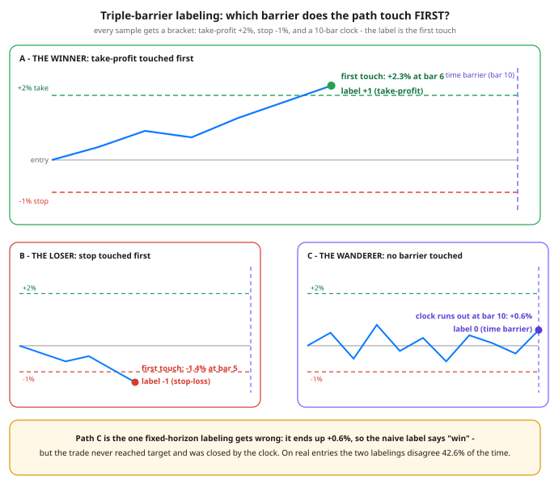

# Day 86 — Labeling: The Triple-Barrier Method

**Tonight you'll be able to:** label any price path the way your trades actually exit — by whichever barrier is touched *first*: take-profit, stop-loss, or the clock — and measure how often that disagrees with the naive "up in 10 bars?" label (tonight: 42.6% of entries).

## The one idea

Labels are the answer key: every model you train is, mechanically, a machine for reproducing them. Days 83–85 were about how hostile this domain is, how backtests lie, and how to build features. None of it survives a bad target variable — and the standard one is bad. The **fixed-horizon label** asks: *is the price higher exactly h bars from now?* It has three defects. It is **path-blind**: a trade stopped out at bar 2 that recovers by bar 10 is labeled a win — a win you never collected. It is **exit-blind**: it never asks how you would actually get out. And it is **magnitude-blind**: +0.1% and +8% get the same label, so the model cannot tell a real move from a coin flip that drifted up.

**The triple-barrier method** (López de Prado, *Advances in Financial Machine Learning*) replaces the question. For every sample, draw three barriers from the entry price: an **upper barrier** at +pt% (profit-taking — tonight +2%), a **lower barrier** at −sl% (stop-loss — tonight −1%), and a **vertical barrier** at entry + max_hold bars (the time limit — tonight 10 bars). Walk the path forward and take the *first touch*: upper first → label **+1**, lower first → **−1**, neither before the clock → **0**.

Three things follow. **Labels match the trade:** the model learns "will this setup reach target before stop, in time?" — the decision actually on the table — instead of "where will price be sitting on an arbitrary future Tuesday?" **Labels are path-dependent, and that is the point:** two paths with identical endpoints get different labels whenever one of them stopped you out on the way. **Asymmetry is explicit:** +2%/−1% encodes a 2:1 reward-to-risk bracket, and the class balance moves when the bracket moves — Part 3 flips it to +1%/−2% and 92 of 204 entries change label on identical prices. The barriers are part of the dataset's meaning, not an afterthought.

Read tonight's numbers with that lens. The mean realized return per label lands just past its barrier (+2.31% for the +1 class, −1.31% for −1) because a daily close overshoots the touch — the labels are tracking the bracket's actual P&L. The −1 class is the biggest (48.5%) mostly because the stop sits closer than the target: barrier *distance* is a prior on class balance. And the headline: fixed-horizon labels **disagree with triple-barrier labels on 42.6% of entries**. Train on the naive answer key and nearly half of it describes a different trade than the one you would have taken. One refinement of López de Prado's worth filing: in production he scales pt and sl by recent volatility, so the bracket breathes with the regime instead of sitting at fixed percentages — same method, vol-sized barriers.

**Meta-labeling, one paragraph to close.** Split the job in two: a *primary* model (any signal you like) predicts the side — long or short. A second, *meta* model is then trained on triple-barrier outcomes of the primary's calls to predict whether *this* call will succeed. Its probability is a quality filter (take the trade only when the meta-model agrees) and a sizing input (bet more when it is confident) — which is why a mediocre directional model can become a selective, profitable one without ever getting better at direction. Notice what makes it possible: the meta-model needs honest win/lose outcomes per call, and that is exactly what first-touch labels are. Sizing gets its own day (Day 90); tonight, file the name and the dependency.

## Analogy

You already label trades this way — every time you place a **bracket order**. A long entry with a take-profit limit at +2%, a stop at −1%, and an expiry at Friday's bell is a one-cancels-other bundle of exactly these three barriers, and the fill report tells you which leg executed. Nobody describes that trade by where price happened to sit ten days later if the bracket closed it on day three. Triple-barrier labeling is just backfilling that fill report for every historical entry: *which leg of my bracket would have filled first?* The systems echo, in one line: it is the same three-way outcome as a request under a deadline — success, error, or timeout — and you would never train an SLO model on "was the server up ten minutes later."

## See it



Three entries, one bracket (+2% / −1% / 10 bars). A's rally touches the take-profit first; B's slide touches the stop first; C touches nothing and is closed by the clock at +0.6% — the sample fixed-horizon labeling mislabels as a win. First touch is the label: the path, not the endpoint, decides.

## Code it (~30 min)

One file, three parts, numpy only — it runs in your `~/ai-lab` venv on the MacBook, no downloads, no APIs: the long series is synthesized so you can see its construction. **Part 1** runs `triple_barrier()` on three hand-designed paths — one per outcome — and asserts each label, so the function is proven on cases you can verify by eye against the diagram. **Part 2** labels 204 entries on a 620-bar series (uptrend, downtrend, chop; seeded `default_rng(86)`, so your run reproduces it bar for bar) and prints the class balance, the mean realized return per label, and the disagreement rate against fixed-horizon labels. **Part 3** re-labels the same entries with the bracket flipped — same prices, same features, different dataset.

```python
"""Day 86 - Labeling: The Triple-Barrier Method.

Phase G, finance ML capstone. Days 83-85 gave you the
features; tonight the LABELS - the answer key the model
trains against. The label IS the question you are asking,
and the naive question is the wrong one:

    Fixed-horizon label:  "is the price higher exactly
    10 bars from now?"  It ignores the PATH (the trade
    could have hit your stop at bar 2 and recovered),
    ignores your exits, and calls +0.1% and +5% the
    same thing: "up".

López de Prado's fix (Advances in Financial Machine
Learning): give every sample THREE barriers, exactly
like the bracket order you already trade with -

    upper barrier:  profit-take at +pt%   (tonight +2%)
    lower barrier:  stop-loss  at -sl%    (tonight -1%)
    vertical barrier: a time limit        (tonight 10 bars)

The label is whichever barrier the path touches FIRST:
+1 take-profit, -1 stop, 0 time-out. Path-dependent,
asymmetric if you want it, and honest about the trades
that resolve neither way.

  Part 1  Three hand-designed paths - one per outcome -
          labeled by triple_barrier(), with asserts.
          The wanderer is the lesson: fixed-horizon
          calls it a WIN (+0.60% at bar 10) but the
          trade never reached target and timed out.
  Part 2  A 620-bar synthetic series (uptrend, then
          downtrend, then chop; seeded Generator, no
          downloads) labeled at 204 entries: the class
          balance, the mean realized return per label,
          and the teaching number - how often the
          fixed-horizon label DISAGREES.
  Part 3  Barriers are a choice: flip the asymmetry
          (+1% / -2%) and the same entries relabel -
          the dataset encodes your exit policy.

Runs on the ~/ai-lab venv: numpy only (free), no
downloads, no paid APIs. All three Part 1 paths are
hand-set offsets, every digit exact; Part 2's series
comes from np.random.default_rng(86), stated seed,
so the run reproduces bar for bar.

Expected output:

  Part 1 - three designed paths, barriers +2.0% / -1.0%, time 10 bars
    A (climbs) : first touch +2.30% at bar 6  -> label +1  (fixed-horizon: +1)
    B (slides) : first touch -1.40% at bar 5  -> label -1  (fixed-horizon: -1)
    C (wanders): no barrier in 10 bars, ends +0.60%  -> label +0  (fixed-horizon: +1)
    asserts passed: the 3 paths give the 3 distinct labels; fixed-horizon disagrees on 1 of 3
  Part 2 - 620-bar synthetic series (uptrend / downtrend / chop, seed 86)
    204 entries (every 3rd bar), same barriers
    class balance:  +1: 33 (16.2%)   -1: 99 (48.5%)   +0: 72 (35.3%)
    mean realized return by label:  +1: +2.31%   -1: -1.31%   +0: +0.55%
    fixed-horizon vs triple-barrier: disagree on 87 of 204 (42.6%)
  Part 3 - same entries, flipped bracket (+1.0% / -2.0%): labels are policy
    class balance:  +1: 85 (41.7%)   -1: 50 (24.5%)   +0: 69 (33.8%)
    92 of 204 entries changed label - same prices, same features, different question
    verdict: the label is the exit policy written as data - choose the barriers
             your bracket would actually trade, or the model learns someone else's trade
"""
import numpy as np

P0 = 100.0
PT, SL, MAX_HOLD = 0.02, 0.01, 10   # +2% take, -1% stop, 10-bar clock


def triple_barrier(prices, entry, pt=PT, sl=SL, max_hold=MAX_HOLD):
    """Label one sample: which barrier does the path touch FIRST?

    Returns (label, exit_index): +1 profit-take, -1 stop-loss,
    0 time barrier. Returns are measured from the entry price.
    """
    last = min(entry + max_hold, len(prices) - 1)
    for j in range(entry + 1, last + 1):
        r = prices[j] / prices[entry] - 1.0
        if r >= pt:
            return 1, j
        if r <= -sl:
            return -1, j
    return 0, last


def fixed_horizon(prices, entry, horizon=MAX_HOLD):
    """The old way: sign of the return exactly `horizon` bars later."""
    last = min(entry + horizon, len(prices) - 1)
    r = prices[last] / prices[entry] - 1.0
    return int(r > 0) - int(r < 0)


def path_from_offsets(offsets_pct):
    """A price path from hand-set % offsets off the entry price."""
    return P0 * (1.0 + np.asarray(offsets_pct, dtype=float) / 100.0)


# ---------- Part 1: three designed paths, one per outcome ----------
print("Part 1 - three designed paths, barriers +2.0% / -1.0%, "
      "time 10 bars")
DESIGNED = (
    ("A (climbs) ", [0, 0.4, 0.9, 0.7, 1.3, 1.8, 2.3], 1),
    ("B (slides) ", [0, -0.3, -0.6, -0.4, -0.9, -1.4], -1),
    ("C (wanders)", [0, 0.5, -0.5, 0.8, -0.2, 0.3, -0.6, 0.4,
                      0.1, -0.3, 0.6], 0),
)
n_disagree = 0
for name, offsets, want in DESIGNED:
    path = path_from_offsets(offsets)
    lab, ex = triple_barrier(path, 0)
    assert lab == want, (name, lab, want)
    fh = fixed_horizon(path, 0)
    n_disagree += int(fh != lab)
    ret = path[ex] / path[0] - 1.0
    if lab == 0:
        what = f"no barrier in {ex} bars, ends {ret:+.2%}"
    else:
        what = f"first touch {ret:+.2%} at bar {ex}"
    print(f"  {name}: {what}  -> label {lab:+d}  "
          f"(fixed-horizon: {fh:+d})")
print(f"  asserts passed: the 3 paths give the 3 distinct labels; "
      f"fixed-horizon disagrees on {n_disagree} of 3")

# ---------- Part 2: label a whole series, count the balance ----------
print("Part 2 - 620-bar synthetic series (uptrend / downtrend / "
      "chop, seed 86)")
rng = np.random.default_rng(86)
rets = np.concatenate([
    rng.normal(0.0012, 0.006, 207),    # trending up
    rng.normal(-0.0012, 0.006, 207),   # trending down
    rng.normal(0.0000, 0.004, 206),    # chop
])
prices = P0 * np.cumprod(1.0 + rets)
entries = range(0, len(prices) - MAX_HOLD, 3)
tb_labels, tb_rets, fh_labels = [], [], []
for e in entries:
    lab, ex = triple_barrier(prices, e)
    tb_labels.append(lab)
    tb_rets.append(prices[ex] / prices[e] - 1.0)
    fh_labels.append(fixed_horizon(prices, e))
tb_labels = np.array(tb_labels)
tb_rets = np.array(tb_rets)
fh_labels = np.array(fh_labels)
n = len(tb_labels)
bal = "   ".join(
    f"{s:+d}: {(tb_labels == s).sum()} ({(tb_labels == s).mean():.1%})"
    for s in (1, -1, 0))
print(f"  {n} entries (every 3rd bar), same barriers")
print(f"  class balance:  {bal}")
means = "   ".join(
    f"{s:+d}: {tb_rets[tb_labels == s].mean():+.2%}"
    for s in (1, -1, 0))
print(f"  mean realized return by label:  {means}")
dis = int((tb_labels != fh_labels).sum())
print(f"  fixed-horizon vs triple-barrier: disagree on {dis} of {n} "
      f"({dis / n:.1%})")

# ---------- Part 3: flip the asymmetry, the dataset changes ----------
print("Part 3 - same entries, flipped bracket (+1.0% / -2.0%): "
      "labels are policy")
flip = np.array([triple_barrier(prices, e, pt=0.01, sl=0.02)[0]
                 for e in entries])
bal2 = "   ".join(
    f"{s:+d}: {(flip == s).sum()} ({(flip == s).mean():.1%})"
    for s in (1, -1, 0))
print(f"  class balance:  {bal2}")
changed = int((flip != tb_labels).sum())
print(f"  {changed} of {n} entries changed label - same prices, "
      f"same features, different question")
print("  verdict: the label is the exit policy written as data - "
      "choose the barriers")
print("           your bracket would actually trade, or the model "
      "learns someone else's trade")
```

**Expected output:**

```
Part 1 - three designed paths, barriers +2.0% / -1.0%, time 10 bars
  A (climbs) : first touch +2.30% at bar 6  -> label +1  (fixed-horizon: +1)
  B (slides) : first touch -1.40% at bar 5  -> label -1  (fixed-horizon: -1)
  C (wanders): no barrier in 10 bars, ends +0.60%  -> label +0  (fixed-horizon: +1)
  asserts passed: the 3 paths give the 3 distinct labels; fixed-horizon disagrees on 1 of 3
Part 2 - 620-bar synthetic series (uptrend / downtrend / chop, seed 86)
  204 entries (every 3rd bar), same barriers
  class balance:  +1: 33 (16.2%)   -1: 99 (48.5%)   +0: 72 (35.3%)
  mean realized return by label:  +1: +2.31%   -1: -1.31%   +0: +0.55%
  fixed-horizon vs triple-barrier: disagree on 87 of 204 (42.6%)
Part 3 - same entries, flipped bracket (+1.0% / -2.0%): labels are policy
  class balance:  +1: 85 (41.7%)   -1: 50 (24.5%)   +0: 69 (33.8%)
  92 of 204 entries changed label - same prices, same features, different question
  verdict: the label is the exit policy written as data - choose the barriers
           your bracket would actually trade, or the model learns someone else's trade
```

## Today's win

Done when your run shows all three parts landing: Part 1's asserts pass (climbs → `+1` at bar 6, slides → `−1` at bar 5, wanders → `0` on the clock — with fixed-horizon disagreeing on the wanderer); Part 2's class balance (`+1: 33`, `−1: 99`, `0: 72`) with the **87 of 204 (42.6%)** disagreement; and Part 3's flipped bracket changing `92` labels. The keeper test, no notes: handed any new sample, you can say which barrier its label came from — and why that label, not the price 10 bars later, is the trade you would actually have lived.

## Short on time? 20-minute version

Read "The one idea," study panel C of the diagram until the disagreement makes sense, then run Part 1 only. If you can explain out loud why the wanderer is a `0` and not a win, you have the method — Parts 2 and 3 are the evidence at scale.

## Tomorrow's teaser

Tomorrow: walk-forward validation — tonight's labels overlap in time (neighboring entries share future bars), and tomorrow is about testing on them without ever peeking into the future.

*Streak: 86 day(s) · Never miss twice.*
