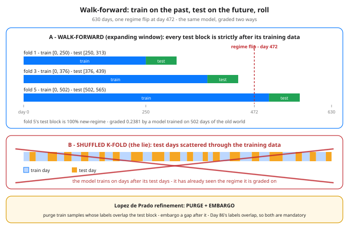

# Day 87 — Walk-Forward Validation: The Only Honest Backtest

**Tonight you'll be able to:** grade any time-series model the way time actually flows — train on [0..t], test on the next block, roll forward — and watch one honest model score 0.6587 under a random split but 0.5476 walk-forward, with its final fold at 0.1270.

## The one idea

Every validation scheme is secretly a claim about the future. Random k-fold's claim is: *days are interchangeable* — shuffle them, train on 80%, test on 20%, which day landed where doesn't matter. For photos of cats that's true. For a time series it is false three separate ways, and Phase G has now met all three: neighbouring days resemble each other (**autocorrelation**), the world changes underneath the model (**regimes**, Day 83), and a label isn't known until days after the sample was taken (**overlapping labels**, Day 86). Shuffle the days and each of those facts becomes a leak.

Watch the leaks work. A model trained on shuffled days trains on days *after* its test days — it has already seen the regime it is being graded on. And the test set blends every regime in the sample, so a model that is excellent in the long regime and catastrophic in the short one averages out to one respectable number. Neither fact appears anywhere in the score. Both appear immediately in live trading.

**Walk-forward validation** refuses the shuffle. Fix a first test day. Train on everything before it — or, in the *rolling* variant, on a fixed-length window of the most recent past. Test on the next block of days. Then step the whole apparatus forward and repeat until the data runs out. Every test score was earned on days the model had never seen, in the order a live account would have met them. Tonight's code uses the *expanding* window: train [0..t], test the next 63 days, step 63, six folds.

The pooled walk-forward score matters, but the **fold path** is the diagnosis. A strategy is lived as a path, not an average: which folds earned the score, where it broke, whether it recovered. A random split cannot even draw that picture — all of its folds are the same shuffled world, so every fold tells the same blended story.

One refinement, from López de Prado, that becomes mandatory the moment labels overlap: **purge** — drop any training sample whose label window overlaps the test block, so no near-duplicate straddles the boundary; and **embargo** — in rolling schemes, leave a small gap of unused days after each test block before training resumes, so autocorrelated label windows can't leak across either. Walk-forward without purging is honest about order and still sloppy about overlap. With both, it is the strictest grade a backtest can earn short of live trading.

So the house rule for every finance model from tonight on: **a single shuffled-split score is marketing. Ask for the fold table.**

## Analogy

You already run this distinction at work. Random k-fold is "testing" a restore against a replica that has already received the post-incident writes: of course the restore validates — the answer was in the building before the test started. Walk-forward is the real restore drill: cold backup, replay in order, no peeking at state written after the snapshot.

Trading version, one line: a random split grades your strategy on an exam whose answer key was mixed into the study material; walk-forward is the same exam sat in order, with the future chapters still sealed.

## See it



Top: walk-forward — the training window grows from the left edge and each 63-day test block sits strictly in its future; the dashed line is the day-472 regime flip, and fold 5's test block is graded entirely in the new world. Bottom: the shuffled split it replaces — test days scattered through the training data, so the model is graded on days whose regime it has already trained on.

## Code it (~30 min)

One model, one synthetic world, two grades. The world is stated in the open, so you can audit it: a slow, autocorrelated feature (φ = 0.85 — a trend-gauge stand-in), tomorrow's return = β·x + noise, and β = +1.3 until day 472, when the regime flips it to −1.3 (Day 83's non-stationarity, weaponised). The model is a single OLS slope, refit inside each evaluation on that evaluation's training days only; the metric is directional accuracy — did sign(β̂·x) match the sign of the return. **Part 1** grades it the flattering way: shuffled 80/20. **Part 2** grades the identical model walk-forward. **Part 3** prints the gap. Watch fold 4 (the block that straddles the flip) and fold 6's β̂ — the expanding window never adapts.

```python
"""Day 87 - Walk-Forward Validation: The Only Honest Backtest.

Phase G has been circling one rule since Day 32: a model may
only ever be graded on days it could not have seen. Tonight
that rule becomes a full validation scheme - and the demo is
two grades for ONE model on ONE dataset:

  Evaluation A  random 80/20 split (shuffled k-fold's baby
                picture). The training pool contains days
                from AFTER the test days, and the test set
                blends both market regimes into one average.
  Evaluation B  walk-forward. Train on [0..t], test on the
                next 63 days, step forward, repeat. No test
                day is ever in training, and every fold's
                score is earned in chronological order -
                the way live trading would have felt it.

The world (synthetic, stated so you can audit it): a feature
x (think: a slow trend gauge) that is autocorrelated - x
today is 0.85 of x yesterday plus fresh noise. Tomorrow's
return is beta * x + noise, sigma 1. Beta is +1.3 for the
first 472 days - a real, strong signal - then the regime
flips (Day 83) and beta becomes -1.3 for the last 158. The
model is the simplest thing that can learn this: one OLS
slope fit on its training days, predict the sign of beta*x.

The random split will report a blended beta (mostly the old
regime) and a blended accuracy that looks tradeable. The
walk-forward fold table will show what actually happened:
three strong folds, one coin-flip fold straddling the flip,
then two folds where the model is confidently WRONG - and
an expanding training window that never adapts, because 472
days of dead regime outweigh 93 days of new one.

Runs on the ~/ai-lab venv: numpy only (free), no CUDA, no
paid APIs, no downloads. Seed 87 fixes every draw, so every
digit below is exact and reproducible.

Expected output:

  Part 1 - random 80/20 split (the flattering grade)
    beta_hat fit on 504 shuffled days: +0.814  (a blend of both regimes)
    test accuracy: 0.6587  (83/126)  <- looks tradeable
    ...but the test set is a blend of two different worlds:
      pre-flip test days:  0.8163
      post-flip test days: 0.1071  <- averaged away in the headline
  Part 2 - walk-forward: train [0..t], test the next 63 days, roll
    fold 1: train [0,250)  test [250,313)  beta_hat +1.221  acc 0.7619
    fold 2: train [0,313)  test [313,376)  beta_hat +1.213  acc 0.8413
    fold 3: train [0,376)  test [376,439)  beta_hat +1.223  acc 0.8095
    fold 4: train [0,439)  test [439,502)  beta_hat +1.256  acc 0.5079
    fold 5: train [0,502)  test [502,565)  beta_hat +1.182  acc 0.2381
    fold 6: train [0,565)  test [565,628)  beta_hat +1.011  acc 0.1270
    pooled out-of-sample accuracy: 0.5476  (207/378 test days, none ever trained on)
  Part 3 - verdict
    random split says 0.6587; walk-forward says 0.5476 - a 0.1111 honesty gap
    the fold path is the real story: the score was earned in the
    old regime, the flip fold is a coin toss, and the last folds
    are worse than chance - the model never adapted, because an
    expanding window drowns 93 new-regime days in 472 dead ones
    a single shuffled number would have shipped this strategy
"""
import numpy as np

SEED = 87
N = 630            # trading days, ~2.5 years
FLIP = 472         # day the regime flips: beta changes sign
BETA = 1.3         # true feature strength before the flip
PHI = 0.85         # feature autocorrelation

rng = np.random.default_rng(SEED)

# --- the world: autocorrelated feature, one regime flip ---
innov = rng.normal(0.0, np.sqrt(1 - PHI ** 2), N)
x = np.zeros(N)
for t in range(1, N):
    x[t] = PHI * x[t - 1] + innov[t]          # slow-moving gauge
beta_true = np.where(np.arange(N) < FLIP, BETA, -BETA)
r = beta_true * x + rng.normal(0.0, 1.0, N)   # next-day return


def fit_beta(idx):
    """OLS slope through the origin on the training days only."""
    return float(np.sum(x[idx] * r[idx]) / np.sum(x[idx] * x[idx]))


def score(idx, b):
    """Directional accuracy of sign(b * x) against sign(r)."""
    hits = np.sign(b * x[idx]) == np.sign(r[idx])
    return float(np.mean(hits)), int(np.count_nonzero(hits))


# ---------- Part 1: the same model, graded the flattering way ----------
print("Part 1 - random 80/20 split (the flattering grade)")
perm = rng.permutation(N)                     # shuffle the days
tr, te = perm[:504], perm[504:]
b_a = fit_beta(tr)
acc_a, hits_a = score(te, b_a)
pre = te[te < FLIP]
post = te[te >= FLIP]
print(f"  beta_hat fit on 504 shuffled days: {b_a:+.3f}"
      "  (a blend of both regimes)")
print(f"  test accuracy: {acc_a:.4f}  ({hits_a}/{len(te)})"
      "  <- looks tradeable")
print("  ...but the test set is a blend of two different worlds:")
print(f"    pre-flip test days:  {score(pre, b_a)[0]:.4f}")
print(f"    post-flip test days: {score(post, b_a)[0]:.4f}"
      "  <- averaged away in the headline")

# ---------- Part 2: the same model, graded the honest way ----------
print("Part 2 - walk-forward: train [0..t], test the next 63 days, roll")
TRAIN0, H = 250, 63
tot_days, tot_hits = 0, 0
start, fold = TRAIN0, 1
while start + H <= N:
    tr = np.arange(0, start)                  # strictly the past
    te = np.arange(start, start + H)          # strictly the future
    b = fit_beta(tr)
    acc, hits = score(te, b)
    print(f"  fold {fold}: train [0,{start})  test [{start},{start + H})"
          f"  beta_hat {b:+.3f}  acc {acc:.4f}")
    tot_days += len(te)
    tot_hits += hits
    start += H
    fold += 1
acc_b = tot_hits / tot_days
print(f"  pooled out-of-sample accuracy: {acc_b:.4f}"
      f"  ({tot_hits}/{tot_days} test days, none ever trained on)")

# ---------- Part 3: verdict ----------
print("Part 3 - verdict")
print(f"  random split says {acc_a:.4f}; walk-forward says {acc_b:.4f}"
      f" - a {acc_a - acc_b:.4f} honesty gap")
print("  the fold path is the real story: the score was earned in the")
print("  old regime, the flip fold is a coin toss, and the last folds")
print("  are worse than chance - the model never adapted, because an")
print("  expanding window drowns 93 new-regime days in 472 dead ones")
print("  a single shuffled number would have shipped this strategy")
```

**Expected output:**

```
Part 1 - random 80/20 split (the flattering grade)
  beta_hat fit on 504 shuffled days: +0.814  (a blend of both regimes)
  test accuracy: 0.6587  (83/126)  <- looks tradeable
  ...but the test set is a blend of two different worlds:
    pre-flip test days:  0.8163
    post-flip test days: 0.1071  <- averaged away in the headline
Part 2 - walk-forward: train [0..t], test the next 63 days, roll
  fold 1: train [0,250)  test [250,313)  beta_hat +1.221  acc 0.7619
  fold 2: train [0,313)  test [313,376)  beta_hat +1.213  acc 0.8413
  fold 3: train [0,376)  test [376,439)  beta_hat +1.223  acc 0.8095
  fold 4: train [0,439)  test [439,502)  beta_hat +1.256  acc 0.5079
  fold 5: train [0,502)  test [502,565)  beta_hat +1.182  acc 0.2381
  fold 6: train [0,565)  test [565,628)  beta_hat +1.011  acc 0.1270
  pooled out-of-sample accuracy: 0.5476  (207/378 test days, none ever trained on)
Part 3 - verdict
  random split says 0.6587; walk-forward says 0.5476 - a 0.1111 honesty gap
  the fold path is the real story: the score was earned in the
  old regime, the flip fold is a coin toss, and the last folds
  are worse than chance - the model never adapted, because an
  expanding window drowns 93 new-regime days in 472 dead ones
  a single shuffled number would have shipped this strategy
```

## Today's win

Done when your run prints the two headline numbers — random split `0.6587`, walk-forward `0.5476` — and you can point at fold 6 and explain both halves of its `0.1270`: the relationship inverted at day 472, and the model's β̂ is still `+1.011` because 472 days of dead regime outweigh 93 days of new one. The keeper test, no notes allowed: someone shows you a backtest quoting one shuffled-split accuracy, and you ask for the fold table — and can say exactly what the folds would have to show to change your mind.

## Short on time? 20-minute version

Read "The one idea", study the diagram's two panels, then run the code and read only Part 2's fold table and Part 3. If you can say why the random split's own post-flip slice (`0.1071`) is the most honest number in Part 1, you have the lesson — the purge/embargo paragraph is the one part to come back for.

## Tomorrow's teaser

Tomorrow the capstone builds begin: the pieces from Days 85–87 — features, labels, and this validation — assembled into one end-to-end pipeline on equity data from your watchlist.

Streak: 87 day(s) · Never miss twice.
