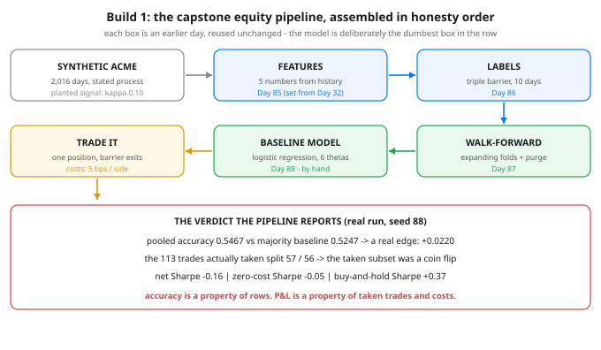

# Build 1: A Baseline Model on Equity Data - Day 88 of 100

**Tonight you'll be able to:** assemble Days 85-87 into one end-to-end equity pipeline - features, triple-barrier labels, walk-forward folds, a hand-written logistic regression - trade its predictions with costs charged, and read the verdict it reports without flinching.

## The one idea

Tonight is assembly, not new machinery. Every box in the diagram is an earlier day, used unchanged: Day 85's features, Day 86's triple-barrier labels, Day 87's walk-forward folds. The only new object is the pipeline itself - and the discipline that governs it: **baseline first**. The model is logistic regression written by hand, six numbers of theta, gradient descent with a fixed learning rate and a fixed iteration count chosen before anyone looked at a result. There is no tuning loop in the file. Day 84's ghost - the overfit backtest - can't haunt a house with no knobs.

**The data is synthetic, on purpose, and the lesson says so out loud.** ACME is a fictional stock: 2,016 trading days from a stated generating process - a small drift, volatility that flips between a calm 0.9%/day regime and a wild 2.0%/day regime (Day 83's non-stationarity, built in), and exactly **one planted signal**: returns mean-revert with strength kappa = 0.10, which Part 1 measures as a lag-1 autocorrelation of -0.127. That is the entire edge in this world, and we know it to three decimals. That makes tonight a calibration run: the pipeline can be *graded*. Did it find the signal we planted? How much of it survived honest evaluation? Point the same harness at a real watchlist name later and only the data loader changes - but you grade a harness on ground truth you control before you trust it on data you don't.

**Reading Part 3:** the model found the planted signal. Pooled walk-forward accuracy is **0.5467** against a majority-class baseline of **0.5247** - a real edge of +0.0220, earned out-of-sample, fold after fold. The folds swing from 0.4365 to 0.6984, which is not the pipeline being flaky: it's regimes. In some windows the reversion simply isn't paying, and an honest harness shows you those folds instead of averaging them away. And the final fold's weights tell the story in one line - `ret_1d` at -0.114 and `mom_20d` at -0.194: the model's biggest votes are *against* yesterday's move and the recent trend. It learned the reversion we planted, with the sign we planted it with.

**Reading Part 4 is the gut punch, and it comes in three lines.** First: accuracy counts *all* 1,134 test rows, but the strategy - one position at a time, exits set by the barriers - could only take 113 trades, and those split 57 up-first to 56 down-first. The taken subset was a coin flip, even though the full-row accuracy was real. Second: costs. At zero cost the same trades compound to -16.10% (Sharpe -0.05); charging a realistic 5 bps per side takes it to -25.01% (Sharpe -0.16). Roughly nine points of return were toll, paid 113 times. Third: the baselines. A literal coin flip, taking entries on a coin toss, finished at -5.13% / +0.05 - statistically indistinguishable from the model. And buy-and-hold, doing nothing at all, made +33.23% at Sharpe +0.37, because the series drifts and neither strategy was long often enough to collect it. Accuracy is a property of rows. P&L is a property of taken trades, payoff shape, and costs.

**So what was built tonight?** Not a money machine - a truth machine. A flattering pipeline (in-sample fit, no purge, no costs, cherry-picked window) would have printed a beautiful Sharpe for this exact dataset and lied to you. This one reports a genuine two-point edge that is too weak to survive execution, and it can prove every digit. That harness is the capstone asset: tomorrow it meets crypto, later it meets real data, and it will tell the same kind of truth there. In this domain, the pipeline that refuses to flatter you is worth more than any single model it will ever evaluate.

> **Analogy:** You already own this pattern: **the synthetic load test.** Before a system you built faces production traffic, you point it at a traffic generator with a *stated* request distribution - known mix, known burstiness - not because synthetic traffic is the point, but because it's the only way to grade the harness: when the dashboards say p99 spiked, you know exactly which knob in the generator did it. Tonight's ACME is that generator for a trading pipeline. The planted kappa is the known request mix; the walk-forward verdict is the dashboard; and a pipeline that can't recover a signal whose strength you dialed in by hand has no business being trusted on market data, where nobody tells you the ground truth. Same reason you diff an optimized implementation against a naive reference: the baseline model is the reference implementation, and it stays in the codebase forever.

Trading version, one line: this is a backtest harness whose first trade is against a market you manufactured - it has to pass that before it's allowed an opinion about a real one.

## See it



*Six boxes, five of them earlier days reused unchanged: synthetic data with a planted, measured signal; Day 85 features; Day 86 triple-barrier labels (which also supply the trade exits); Day 87 walk-forward folds with purging; the Day 88 baseline - hand-written logistic regression; and the trade step, where costs are charged. The panel underneath is the whole lesson: the same run that earns a real +0.0220 accuracy edge reports a negative Sharpe, and both numbers are true.*

## Code it (~30 min)

One file, four parts, numpy only. **Part 1** generates ACME from the stated process and measures the planted signal before anything is allowed to learn from it. **Part 2** builds Day 32's five features and Day 86's triple-barrier labels - each label also records its exit day and realized return, so Part 4's trades exit on exactly the labeler's terms (Day 69's one-definition rule). **Part 3** is Day 87's walk-forward: expanding folds, train rows purged if their barrier window touches the test block, features z-scored on train-fold statistics only, and logistic regression by full-batch gradient descent - lr 0.1, 1,000 iterations, zero init, all fixed in advance. **Part 4** trades the test predictions long-only, one position at a time, 5 bps charged per side, and prints the model next to a coin flip, buy-and-hold, and itself at zero cost. Run it in `~/ai-lab`; seed 88 makes every digit reproduce exactly.

```python
"""Day 88 - Build 1: A Baseline Model on Equity Data.

Phase G capstone, first build. Days 83-87 were five separate
warnings; tonight they become one pipeline, assembled in the
only order that keeps it honest:

    features (Day 85) -> triple-barrier labels (Day 86)
    -> walk-forward evaluation (Day 87)
    -> the dumbest model that could possibly work

The model is logistic regression written by hand in numpy -
sixty-year-old math, 6 numbers of theta. That is the
discipline (Day 84): baseline first. If the dumb model cannot
beat chance under honest evaluation, no bigger model gets a
turn, because a bigger model would only be better at lying.

  The data is SYNTHETIC, and the lesson says so out loud.
  No downloads, no pretending. 2,016 trading days (~8 years)
  for a fictional stock "ACME", generated by a stated process:

    - daily drift mu = 0.0002 (about +5%/yr before noise)
    - volatility REGIMES: sigma is 0.9%/day or 2.0%/day,
      switching with probability 0.02/day (blocks average
      ~50 days) - the non-stationarity of Day 83, built in
    - one WEAK planted signal: returns mean-revert,
      r_t = mu - KAPPA*(r_{t-1} - mu) + sigma_t * noise,
      KAPPA = 0.10. Yesterday's return carries a small
      negative vote on today's. Weak on purpose: Part 1
      measures the lag-1 autocorrelation so you can see
      exactly how weak.

  Part 1  Generate the series; measure the planted signal.
  Part 2  Features + labels. The SAME five features as
          Day 32 (ret_1d, mom_5d, mom_20d, vol_5d,
          up_frac_14d), computed from data up to day t only.
          Labels are Day 86's triple barrier: from close t,
          with trailing 20-day vol sigma_t, barriers at
          +/- 1.0 * sigma_t * sqrt(10), vertical barrier
          10 days. First barrier touched wins; at the time
          barrier the label is the sign of the move. Each
          label also records its exit day and realized
          return - Part 4's trading uses the SAME exits,
          so the labeler and the backtest can never drift
          apart (Day 69's one-definition rule).
  Part 3  Walk-forward (Day 87): expanding window, train
          756 sample-days, test 126, step 126. Train rows
          whose barrier window reaches into the test block
          are PURGED - their labels were decided by test
          prices. Features z-scored with train-fold stats
          only (Day 32's rule). Logistic regression:
          full-batch gradient descent, lr 0.1, 1,000
          iterations, zero init. Fixed numbers, chosen
          before looking - there is no tuning loop in this
          file (Day 84).
  Part 4  Trade the test predictions: prob >= 0.5 -> long
          at close t, exit at the label's barrier exit,
          one position at a time (signals during an open
          trade are skipped), each trade's return booked
          on its exit day. Cost 5 bps per side, charged on
          every round trip. Beside the model: buy-and-hold
          over the same span, a coin-flip strategy taking
          the same entries on a coin toss, and the model
          again at zero cost - Day 32's baselines, promoted
          from accuracy to money.

Runs on the ~/ai-lab venv: numpy only (free), no torch
needed, CPU, no CUDA, no paid APIs, no downloads. The seed
is stated (88), so every number below reproduces exactly.

Expected output:

  Part 1 - synthetic ACME: stated process, planted weak signal
    days 2016  price 100.75 -> 179.11  days in high-vol regime: 1294
    planted reversion KAPPA = 0.10 -> measured lag-1 autocorrelation of returns: -0.127
    that is the entire edge this pipeline is allowed to find
  Part 2 - features (Day 85) + triple-barrier labels (Day 86)
    samples 1987  features ['ret_1d', 'mom_5d', 'mom_20d', 'vol_5d', 'up_frac_14d']
    barriers +/- 1.0 x sigma_20 x sqrt(10), vertical barrier 10 days
    label balance: up-first 0.530  down/time 0.470  mean holding 8.1 days
  Part 3 - walk-forward (Day 87) + logistic regression by hand
    fold 1: train 750 rows (purged)  test days 775-900  accuracy 0.5397
    fold 2: train 872 rows (purged)  test days 901-1026  accuracy 0.4365
    fold 3: train 998 rows (purged)  test days 1027-1152  accuracy 0.6587
    fold 4: train 1125 rows (purged)  test days 1153-1278  accuracy 0.6111
    fold 5: train 1254 rows (purged)  test days 1279-1404  accuracy 0.4286
    fold 6: train 1376 rows (purged)  test days 1405-1530  accuracy 0.4524
    fold 7: train 1502 rows (purged)  test days 1531-1656  accuracy 0.5714
    fold 8: train 1628 rows (purged)  test days 1657-1782  accuracy 0.6984
    fold 9: train 1754 rows (purged)  test days 1783-1908  accuracy 0.5238
    pooled test accuracy 0.5467  majority-class baseline 0.5247
    final fold's weights (z-scored features):
      ret_1d       -0.114
      mom_5d       +0.110
      mom_20d      -0.194
      vol_5d       -0.147
      up_frac_14d  -0.014
  Part 4 - trade it: costs in, two baselines beside it
    model      trades 113  net total return -25.01%  Sharpe -0.16
    coin flip  trades 110  net total return -5.13%  Sharpe +0.05
    buy&hold   trades   1  net total return +33.23%  Sharpe +0.37
    same model, zero costs: total -16.10%  Sharpe -0.05  <- what the 5 bps/side ate
    of the 113 trades actually taken, 57 hit the up barrier first (50.4%)
    accuracy edge +0.0220 over the majority baseline - before any of it had to survive costs
    verdict: the pipeline is the product. Baseline first, honest folds, costs charged - whatever is left is the truth.
"""
import numpy as np

SEED = 88
N_DAYS = 2016            # ~8 years of trading days
MU = 0.0002              # daily drift
KAPPA = 0.10             # planted mean-reversion strength
SIGMA_LO, SIGMA_HI = 0.009, 0.020
P_SWITCH = 0.02          # vol-regime switch probability / day

HORIZON = 10             # triple-barrier vertical barrier (days)
BARRIER_MULT = 1.0       # barriers at +/- mult * sigma_t * sqrt(H)
COST_PER_SIDE = 0.0005   # 5 bps, charged on entry and on exit

TRAIN_DAYS, TEST_DAYS, STEP_DAYS = 756, 126, 126
LR, ITERS = 0.1, 1000
FEATURES = ("ret_1d", "mom_5d", "mom_20d", "vol_5d", "up_frac_14d")

# ---------- Part 1: the synthetic series, process stated ----------
rng = np.random.default_rng(SEED)
sigma = np.empty(N_DAYS)
state = 0
for t in range(N_DAYS):
    if rng.random() < P_SWITCH:
        state = 1 - state
    sigma[t] = SIGMA_HI if state else SIGMA_LO
eps = rng.standard_normal(N_DAYS)
r = np.empty(N_DAYS)
prev = 0.0
for t in range(N_DAYS):
    r[t] = MU - KAPPA * (prev - MU) + sigma[t] * eps[t]
    prev = r[t]
price = 100.0 * np.exp(np.cumsum(r))

print("Part 1 - synthetic ACME: stated process, planted weak signal")
print(f"  days {N_DAYS}  price {price[0]:.2f} -> {price[-1]:.2f}  "
      f"days in high-vol regime: {(sigma == SIGMA_HI).sum()}")
ac1 = np.corrcoef(r[:-1], r[1:])[0, 1]
print(f"  planted reversion KAPPA = {KAPPA:.2f} -> measured lag-1 "
      f"autocorrelation of returns: {ac1:+.3f}")
print("  that is the entire edge this pipeline is allowed to find")

# ---------- Part 2: features (Day 85) + triple-barrier labels (Day 86) ----------
def build_features(r):
    """One row per day t (t >= 19), data up to t only (Day 85)."""
    rows = []
    for t in range(19, len(r)):
        rows.append([
            r[t],                                   # ret_1d
            r[t - 4:t + 1].mean(),                  # mom_5d
            r[t - 19:t + 1].mean(),                 # mom_20d
            r[t - 4:t + 1].std(),                   # vol_5d
            (r[t - 13:t + 1] > 0).mean(),           # up_frac_14d
        ])
    return np.array(rows), np.arange(19, len(r))


def triple_barrier(price, r, t):
    """Day 86: from close t, first barrier touched wins.
    Returns (label 1/0, exit day index, realized simple return)."""
    sig = r[t - 19:t + 1].std()
    bar = BARRIER_MULT * sig * np.sqrt(HORIZON)
    entry = price[t]
    for s in range(1, HORIZON + 1):
        cum = price[t + s] / entry - 1.0
        if cum >= bar:
            return 1, t + s, cum
        if cum <= -bar:
            return 0, t + s, cum
    cum = price[t + HORIZON] / entry - 1.0
    return (1 if cum > 0 else 0), t + HORIZON, cum


X, days = build_features(r)
keep = days + HORIZON < N_DAYS
X, days = X[keep], days[keep]
labels, exits, rets = [], [], []
for t in days:
    lab, ex, ret = triple_barrier(price, r, int(t))
    labels.append(lab)
    exits.append(ex)
    rets.append(ret)
y = np.array(labels)
exit_day = np.array(exits)
exit_ret = np.array(rets)

print("Part 2 - features (Day 85) + triple-barrier labels (Day 86)")
print(f"  samples {len(y)}  features {list(FEATURES)}")
print(f"  barriers +/- {BARRIER_MULT:.1f} x sigma_20 x sqrt({HORIZON}), "
      f"vertical barrier {HORIZON} days")
print(f"  label balance: up-first {y.mean():.3f}  down/time {1 - y.mean():.3f}"
      f"  mean holding {(exit_day - days).mean():.1f} days")

# ---------- Part 3: walk-forward + hand-rolled logistic regression ----------
def sigmoid(z):
    return 1.0 / (1.0 + np.exp(-np.clip(z, -30, 30)))


def train_logreg(Xtr, ytr):
    """Full-batch GD, fixed lr/iters/zero init - no knobs turned."""
    w = np.zeros(Xtr.shape[1])
    b = 0.0
    for _ in range(ITERS):
        p = sigmoid(Xtr @ w + b)
        g = p - ytr
        w -= LR * (Xtr.T @ g) / len(ytr)
        b -= LR * g.mean()
    return w, b


print("Part 3 - walk-forward (Day 87) + logistic regression by hand")
all_pred, all_true = [], []
fold_rows = []
w_last = None
test_lo = TRAIN_DAYS
fold = 0
while test_lo + TEST_DAYS <= len(y):
    test_hi = test_lo + TEST_DAYS
    tr = np.arange(0, test_lo)
    tr = tr[exit_day[tr] < days[test_lo]]       # purge: no label peeks into test
    mu_x, sd_x = X[tr].mean(0), X[tr].std(0) + 1e-12
    w, b = train_logreg((X[tr] - mu_x) / sd_x, y[tr])
    p = sigmoid(((X[test_lo:test_hi] - mu_x) / sd_x) @ w + b)
    pred = (p >= 0.5).astype(int)
    acc = (pred == y[test_lo:test_hi]).mean()
    fold_rows.append((fold + 1, len(tr), acc,
                      test_lo, test_hi, pred, p))
    all_pred.append(pred)
    all_true.append(y[test_lo:test_hi])
    w_last = w
    fold += 1
    test_lo += STEP_DAYS

for f, ntr, acc, lo, hi, _, _ in fold_rows:
    print(f"  fold {f}: train {ntr} rows (purged)  test days "
          f"{days[lo]}-{days[hi - 1]}  accuracy {acc:.4f}")
pred_all = np.concatenate(all_pred)
true_all = np.concatenate(all_true)
pooled = (pred_all == true_all).mean()
base = max(true_all.mean(), 1 - true_all.mean())
print(f"  pooled test accuracy {pooled:.4f}  "
      f"majority-class baseline {base:.4f}")
print("  final fold's weights (z-scored features):")
for name, wi in zip(FEATURES, w_last):
    print(f"    {name:<12} {wi:+.3f}")

# ---------- Part 4: trade it, with costs, against two baselines ----------
def run_strategy(take, cost=COST_PER_SIDE):
    """take(prob) -> bool for each test row. Long-only, one
    position at a time, exit at the label's barrier exit,
    trade return booked on the exit day, cost per side.
    Returns (daily returns, n trades, taken row indices)."""
    daily = np.zeros(N_DAYS)
    busy_until = -1
    taken = []
    for f, _, _, lo, hi, _, probs in fold_rows:
        for j in range(lo, hi):
            if days[j] <= busy_until:
                continue                        # position already open
            if take(probs[j - lo]):
                daily[exit_day[j]] += exit_ret[j] - 2 * cost
                busy_until = exit_day[j]
                taken.append(j)
    return daily, len(taken), taken


def sharpe(daily):
    return daily.mean() / (daily.std() + 1e-12) * np.sqrt(252)


span = slice(int(days[fold_rows[0][3]]), int(days[fold_rows[-1][4] - 1]) + 1)
model_daily, n_model, taken = run_strategy(lambda p: p >= 0.5)
coin_rng = np.random.default_rng(7)
coin_daily, n_coin, _ = run_strategy(lambda p: coin_rng.random() < 0.5)
bh_daily = np.zeros(N_DAYS)
bh_daily[1:] = price[1:] / price[:-1] - 1.0

print("Part 4 - trade it: costs in, two baselines beside it")
for name, d, n in (("model", model_daily, n_model),
                   ("coin flip", coin_daily, n_coin)):
    seg = d[span]
    print(f"  {name:<10} trades {n:>3}  net total return "
          f"{(np.prod(1 + seg) - 1) * 100:+.2f}%  Sharpe {sharpe(seg):+.2f}")
seg_bh = bh_daily[span]
print(f"  {'buy&hold':<10} trades   1  net total return "
      f"{(np.prod(1 + seg_bh) - 1) * 100:+.2f}%  Sharpe {sharpe(seg_bh):+.2f}")
gross_daily, _, _ = run_strategy(lambda p: p >= 0.5, cost=0.0)
seg_g = gross_daily[span]
print(f"  same model, zero costs: total {(np.prod(1 + seg_g) - 1) * 100:+.2f}%  "
      f"Sharpe {sharpe(seg_g):+.2f}  <- what the 5 bps/side ate")
wins = int(y[taken].sum())
print(f"  of the {n_model} trades actually taken, {wins} hit the up barrier "
      f"first ({wins / n_model:.1%})")
print(f"  accuracy edge {pooled - base:+.4f} over the majority baseline - "
      "before any of it had to survive costs")
print("  verdict: the pipeline is the product. Baseline first, honest "
      "folds, costs charged - whatever is left is the truth.")
```

**Expected output:**

```
Part 1 - synthetic ACME: stated process, planted weak signal
  days 2016  price 100.75 -> 179.11  days in high-vol regime: 1294
  planted reversion KAPPA = 0.10 -> measured lag-1 autocorrelation of returns: -0.127
  that is the entire edge this pipeline is allowed to find
Part 2 - features (Day 85) + triple-barrier labels (Day 86)
  samples 1987  features ['ret_1d', 'mom_5d', 'mom_20d', 'vol_5d', 'up_frac_14d']
  barriers +/- 1.0 x sigma_20 x sqrt(10), vertical barrier 10 days
  label balance: up-first 0.530  down/time 0.470  mean holding 8.1 days
Part 3 - walk-forward (Day 87) + logistic regression by hand
  fold 1: train 750 rows (purged)  test days 775-900  accuracy 0.5397
  fold 2: train 872 rows (purged)  test days 901-1026  accuracy 0.4365
  fold 3: train 998 rows (purged)  test days 1027-1152  accuracy 0.6587
  fold 4: train 1125 rows (purged)  test days 1153-1278  accuracy 0.6111
  fold 5: train 1254 rows (purged)  test days 1279-1404  accuracy 0.4286
  fold 6: train 1376 rows (purged)  test days 1405-1530  accuracy 0.4524
  fold 7: train 1502 rows (purged)  test days 1531-1656  accuracy 0.5714
  fold 8: train 1628 rows (purged)  test days 1657-1782  accuracy 0.6984
  fold 9: train 1754 rows (purged)  test days 1783-1908  accuracy 0.5238
  pooled test accuracy 0.5467  majority-class baseline 0.5247
  final fold's weights (z-scored features):
    ret_1d       -0.114
    mom_5d       +0.110
    mom_20d      -0.194
    vol_5d       -0.147
    up_frac_14d  -0.014
Part 4 - trade it: costs in, two baselines beside it
  model      trades 113  net total return -25.01%  Sharpe -0.16
  coin flip  trades 110  net total return -5.13%  Sharpe +0.05
  buy&hold   trades   1  net total return +33.23%  Sharpe +0.37
  same model, zero costs: total -16.10%  Sharpe -0.05  <- what the 5 bps/side ate
  of the 113 trades actually taken, 57 hit the up barrier first (50.4%)
  accuracy edge +0.0220 over the majority baseline - before any of it had to survive costs
  verdict: the pipeline is the product. Baseline first, honest folds, costs charged - whatever is left is the truth.
```

> **Today's win:** Done when your run matches the expected output exactly: pooled accuracy `0.5467` over the majority baseline `0.5247`, the final-fold weights voting against yesterday's return, and Part 4's table - model -25.01% / -0.16, coin flip -5.13% / +0.05, buy-and-hold +33.23% / +0.37. The keeper test, no notes: explain why an accuracy of 0.5467 and a Sharpe of -0.16 are not a contradiction - name the three mechanisms (the taken subset isn't the scored set, payoffs and tolls are not accuracy, and drift pays whoever is simply long). If you can also say what would have to change in the *world* (not in the knobs) for this baseline to earn a bigger model, you own the capstone's first build.

> **Short on time? 20-minute version:** Read "The one idea" and study the diagram, then run the code and read only two blocks of output: Part 3's pooled line with the final weights, and Part 4's whole table. Say the verdict out loud once - real edge, too weak to survive execution, pipeline told the truth. That's the build; Parts 1-2 are the victory lap.

> **Tomorrow's teaser:** Tomorrow: the exact same pipeline, pointed at crypto - a market that never closes, with fatter tails and no drift you can count on. The pipeline doesn't change. The beast does.

Streak: 88 day(s) - Never miss twice.
