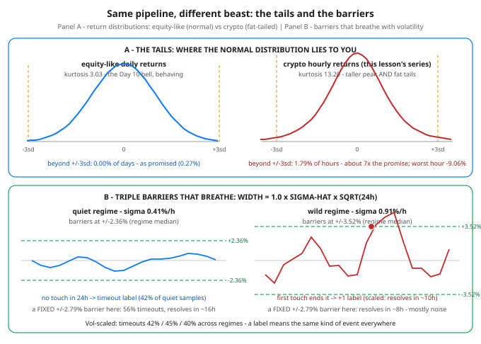

# Day 89 — Build 2: Crypto Data — Same Pipeline, Different Beast

**Tonight you'll be able to:** take Day 88's pipeline exactly as built — Day 85 features, Day 86 triple-barrier labels, Day 87 walk-forward, the hand-rolled logistic baseline — run it on hourly crypto, and name precisely what changes: the clock, the tails, the barrier widths, and the cost line. Almost none of it is the model.

## The one idea

Yesterday's build ran on daily equity bars. Crypto is not "equities, but faster." Four structural differences drive everything tonight, and each one lands in a different stage of the pipeline.

**1. The clock never stops — but it does thin out.** Equities hand you a daily bar with an overnight gap baked in; crypto trades 24/7, so tonight's series is 8,760 hourly bars with no open, no close, and no gap risk — the "day" is just a line humans drew. What replaces the gap is a liquidity cycle: weekends run thin, market makers pull back, and the same order flow moves price further. In tonight's series (planted at 1.25×) weekend hourly volatility measures **1.36×** the weekday rate — the effect survives the vol clustering around it. Your Day 85 features have to be re-horizoned (4h / 24h / 72h instead of days), and "daily" stats are an aggregation choice, not a fact of the market.

**2. The tails are not decoration; they are the distribution.** Day 10 gave you the normal distribution as the default dialect. Crypto returns don't speak it. Tonight's measured table: equity-like daily returns print kurtosis **3.03** with **0.00%** of bars beyond ±3σ — the normal promise (0.27%) roughly kept. The crypto series prints kurtosis **13.20** hourly and **5.54** even after aggregating to daily bars, with **1.79%** of hours beyond ±3σ — about **7×** the promised rate — a worst hour of **−9.06%** and a worst day of **−19.02%**. (Kurtosis is the tail-weight dial from Day 10: 3 is the normal's value; anything far above it means extreme bars are a routine feature, not an anomaly.) Any risk math that reads σ off a normal table — barrier widths, position sizes, "this is a 4-sigma event" — is calibrated to the wrong animal. Remember this on Day 90, when σ becomes a bet size.

**3. Crypto has native instruments equities don't.** The dominant crypto contract is the *perpetual swap*: a futures contract with no expiry, kept near spot by a **funding rate** — a small periodic payment between longs and shorts. Funding positive (the usual state in a bull tape) means longs pay shorts; when a rally gets crowded, funding climbs with it (tonight's series: correlation **+0.85** with the trailing 24h return, mean **+0.017%** per 8h, range −0.08% to +0.25%). That crowding is information: extreme funding says the long side is leveraged and leaning one way, which is why tonight adds exactly one new feature — the funding z-score — and why the model's largest learned weight lands on it (−0.55, a fade: crowded longs precede weak forward returns in the planted process). One more structural line, no code: there is no single crypto tape — price is a consensus across fragmented exchanges, so "the" price is already an aggregation decision upstream of your pipeline.

**4. The barriers must breathe — this is the one non-optional port.** Day 86's triple barrier used widths suited to daily equity vol. Port them naively — a fixed ±2.79% — and the *meaning* of a label flips with the regime: in the quiet third of tonight's data (σ ≈ 0.41%/h) a fixed barrier times out **56%** of the time and takes ~16h to resolve (labels = slow grinds); in the wild third (σ ≈ 0.91%/h) it resolves in ~8h with only **26%** timeouts (labels = noise flickers). Same ±2.79%, three different events wearing one label. The fix is Day 86's own rule, enforced: width = 1.0 × σ̂ × √H, with σ̂ the trailing-48h vol *shrunk toward the series median* (σ̂ = √(σ₄₈ · σ_median)) — shrunk because a trailing window lags regime turns, and betting the full width on a lagging estimate overshoots in both directions. Result: timeouts **42% / 45% / 40%** across quiet/middle/wild, resolution times **14h / 12h / 10h**. A label now means roughly the same kind of event in every regime — which was the entire point of triple-barrier labeling.

And then the result, in Day 88's reporting format, no cosmetics: pooled walk-forward accuracy **0.581** against a **0.547** majority-class baseline — a real edge, and a modest one. The per-fold column swings from **0.887** to **0.410** (Days 83–84's non-stationarity, live in your own table: two folds score *below* a coin flip during the 240–300 drawdown). The strategy trades 260 times, wins 53.5%, and nets **+0.026% per trade** — because the 0.15% round trip (taker fee + slippage; crypto's honest cost is several times the equity line from Day 88) consumed about **85%** of the +0.176% gross. Annualized per-trade Sharpe: **0.19**. Buy & hold over the identical test windows: **+95.4%**, in a year the series rose +134.9%. Both things are true at once: the model learned the planted effects (funding fade −0.55, momentum carrier +0.38) *and* a two-sided model in a one-way mania pays for every short. Skill and profit are different columns — Phase G keeps making you read both.

The data is synthesized, process stated in the code header: GARCH-flavored vol clustering (α=0.06, β=0.92), Student-t (df=5) innovations, the weekend multiplier, the funding process, and two planted effects — momentum continuation (0.13) and the crowded-funding fade (−0.08) — deliberately stronger and cleaner than real tape, because a baseline with literally nothing to learn teaches nothing. If the edge still nearly washes out after costs *here*, that is the lesson, not a bug.

## Analogy

It's a **port to a new platform**, the kind you've done at work: same binary, new failure modes. The pipeline stages are the binary — features, labels, validation, model — and they compile unchanged. What changes is the platform contract underneath: the clock (no maintenance window, ever — but traffic thins on weekends), the traffic shape (fat tails are flash crowds that arrive 7× more often than the capacity model promised), the config (barrier widths are a config value, and the old value is wrong in a regime-dependent way), and the egress bill (per-trade costs several times higher, charged on every call). Ports don't fail in the code you rewrote. They fail in the assumptions the old platform guaranteed and the new one doesn't. Tonight you audited the assumptions — that's the whole job, in ML exactly as in storage.

## See it



Panel A: the equity-like bell (kurtosis 3.03) keeps the normal distribution's promise — nothing lands beyond ±3σ. The crypto curve is a different animal: sharper peak, and shoulders that stay high out past the dashed ±3σ lines — 1.79% of all hours live out there. Panel B: vol-scaled barriers in two regimes. Quiet (σ 0.41%/h): narrow ±2.36% barriers, price wanders and times out. Wild (σ 0.91%/h): barriers widen to ±3.52%, and the first touch still ends the label at a comparable hour. Fixed ±2.79% barriers would make the quiet panel a 16-hour grind and the wild panel an 8-hour coin flip.

## Code it (~30 min)

One file, three parts, numpy only. **Part 1** builds the beast with its generating process stated in the header — no downloads, seed 89, every digit reproducible — and prints the distribution table next to an equity-like normal series. **Part 2** builds Day 85-shaped features at hourly horizons plus the funding z-score, then labels twice: fixed barriers vs vol-scaled (shrunk) barriers, with the regime table as the verdict. **Part 3** is Day 88's model and Day 87's walk-forward untouched — expanding window, 24h purge, scaler fit on train only, sequential non-overlapping trades so the Sharpe arithmetic means something — at crypto's 0.15% round-trip cost. Read the fold table the way Day 31 taught you to read a loss curve: the *shape* across folds is the information.

```python
"""Day 89 - Build 2: Crypto Data - Same Pipeline, Different Beast.

Day 88 ran the capstone pipeline on daily equity bars:
features (Day 85) -> triple-barrier labels (Day 86) ->
walk-forward validation (Day 87) -> a hand-rolled
logistic baseline. Tonight the SAME four stages run on
hourly crypto - and the lesson is what breaks:

  Part 1  The beast, measured. No downloads: a synthetic
          hourly series with its generating process stated
          up front - GARCH-flavored volatility clustering,
          Student-t (df=5) fat tails, a weekend liquidity
          effect, and a funding-rate series that crowds
          with momentum. Next to it, an equity-like normal
          series. The distribution table is the Day 10
          callback: kurtosis, worst bar, and how often
          price does what a normal distribution calls a
          3-sigma event (promised: 0.27% of bars).
  Part 2  The one adaptation that is NOT optional:
          barrier widths scaled to volatility (shrunk
          toward the long-run median, because a trailing
          vol window lags regime turns). A fixed +/-2.8%
          barrier is a grind in a quiet regime and pure
          noise in a wild one; the table proves it, and
          the vol-scaled version makes a label mean the
          same KIND of event in every regime. Features
          are Day 85 shapes at hourly horizons, plus one
          crypto native: funding-rate z-score.
  Part 3  Same model, same walk-forward (Day 87: purged,
          expanding window). Report is the Day 88 format:
          per-fold accuracy, pooled accuracy vs the
          majority-class baseline, sequential non-
          overlapping trades net of a stated 0.15% round
          trip - crypto taker fees plus slippage are
          several times equity's - and buy & hold over
          the identical windows as the honesty anchor.

The data plants two faint real effects (momentum
continuation, crowded-funding fade) because a baseline
with literally nothing to learn teaches nothing. They
are stronger and cleaner than anything you will find
in real tape - if the edge still nearly washes out
after costs here, that IS the lesson.

Runs on the ~/ai-lab venv: numpy only (free), no CUDA,
no paid APIs, no downloads. Seed fixed: every number
below reproduces exactly.

Expected output:

  Part 1 - the beast, measured (normal promises 0.27% beyond 3sd, kurtosis 3.00)
    synthetic crypto: $3,000 -> $7,048 (+134.9% over the year, 8,760 hourly bars)
    equity daily   n=  252  sd  0.99%  worst  -2.97%  kurtosis  3.03  |r|>3sd 0.00%
    crypto hourly  n= 8760  sd  0.78%  worst  -9.06%  kurtosis 13.20  |r|>3sd 1.79%
    crypto daily   n=  365  sd  3.81%  worst -19.02%  kurtosis  5.54  |r|>3sd 1.10%
    weekend vol 0.95%/h vs weekday 0.70%/h (ratio 1.36 - thin books, planted at 1.25)
    funding: mean 0.017%/8h, range -0.08..+0.25; corr(funding, trailing 24h return) +0.85

  Part 2 - labels: why the barriers must breathe with vol
    vol-scaled barrier: median 2.79%  (p10 2.25% .. p90 3.86%)  vs fixed 2.79%
    label mix (scaled): up 32.6%  down 25.3%  timeout 42.1%
    regime        sigma/h   fixed: timeout / resolves-in   scaled: timeout / resolves-in
    quiet third   0.41%     56% /   16h          42% /   14h
    middle third  0.57%     44% /   12h          45% /   12h
    wild third    0.91%     26% /    8h          40% /   10h

  Part 3 - walk-forward (Day 87: expanding window, 24h purge, 30-day tests)
    window        train   acc    trades  net %    tape %
    days  90-120    1099  0.577     28   +13.93    +12.8
    days 120-150    1552  0.887     30   +24.91    +68.5
    days 150-180    1963  0.609     30    -9.02     +8.1
    days 180-210    2305  0.545     30    +1.23    -10.7
    days 210-240    2712  0.510     30    -2.43    +16.0
    days 240-270    3065  0.410     29   -29.25    -40.1
    days 270-300    3495  0.423     25   -15.25    -37.0
    days 300-330    3925  0.699     30   +23.80    +85.6
    days 330-360    4362  0.579     28    -1.27     -7.6
    pooled walk-forward accuracy 0.581  vs majority-class baseline 0.547
    trades 260  win rate 53.5%  avg net/trade +0.026%  total net +6.7%
    per-trade Sharpe, annualized: 0.19   buy & hold, same windows: +95.4%
    final-fold weights: ret4h -0.08  ret24h +0.07  ret72h +0.08  distMA +0.38  vol24 -0.11  fundZ -0.55
    verdict: same pipeline, new beast - the code changed in the data
             and the barrier widths, and that was almost the whole port
"""
import numpy as np
from numpy.lib.stride_tricks import sliding_window_view

SEED = 89
HOURS = 365 * 24          # one year of hourly bars, 24/7 - no close
H = 24                    # label horizon: 24 hours (was: days, Day 86)
K = 1.0                   # barrier width = K * sigma * sqrt(H)
COST = 0.0015             # 0.15% round trip: taker fee + slippage
rng = np.random.default_rng(SEED)

# ---------- Part 1: build the beast, process stated ----------
DF = 5
z = rng.standard_t(DF, HOURS) * np.sqrt((DF - 2) / DF)   # fat tails, unit var
eps_f = rng.normal(0.0, 0.003, HOURS)        # funding noise, % per 8h
SIG_BAR = 0.0055                             # ~0.55%/hour unconditional
ALPHA, BETA = 0.06, 0.92                     # GARCH-flavored vol clustering
OMEGA = SIG_BAR**2 * (1 - ALPHA - BETA)
hour = np.arange(HOURS)
weekend = ((hour // 24) % 7) >= 5            # Sat/Sun: thinner books
wk = np.where(weekend, 1.25, 1.0)            # ...so vol runs 25% hotter

logp = np.zeros(HOURS + 1)
logp[0] = np.log(3000.0)                     # ETH-flavored starting price
rets = np.zeros(HOURS)                       # hourly log returns
fund = np.full(HOURS, 0.01)                  # funding, % per 8h (perp swap)
sig2 = SIG_BAR**2
f = 0.01
f_hist = [f] * 200                           # funding history for z-scores
for t in range(HOURS):
    s = np.sqrt(sig2) * wk[t]
    drift = 0.00003                          # gentle bull-tape drift
    if t >= 168:
        m24 = logp[t] - logp[t - 24]
        mom_z = m24 / (s * np.sqrt(24))
        fh = np.array(f_hist[-168:])
        fz = (f - fh.mean()) / (fh.std() + 1e-9)
        # the two planted effects: momentum continues a little,
        # crowded-long funding (high fz) fades a little
        drift += s * (0.13 * np.tanh(mom_z) - 0.08 * np.clip(fz, -2, 2))
    r = drift + s * z[t]
    rets[t] = r
    logp[t + 1] = logp[t] + r
    sig2 = OMEGA + ALPHA * r**2 + BETA * sig2
    if t + 1 < HOURS:                        # funding crowds with momentum
        m24n = logp[t + 1] - logp[t + 1 - 24] if t + 1 >= 24 else 0.0
        f = float(np.clip(0.01 + 0.85 * (f - 0.01) + 0.25 * m24n
                          + eps_f[t], -0.08, 0.30))
        fund[t + 1] = f
    f_hist.append(f)
price = np.exp(logp)

equity = np.random.default_rng(4).normal(0.0, 0.01, 252)  # equity-like
daily = np.array([logp[24 * (d + 1)] - logp[24 * d] for d in range(365)])


def kurt(x):                                 # Pearson kurtosis; normal = 3
    xc = x - x.mean()
    return float((xc**4).mean() / (xc**2).mean()**2)


def stats(name, x):
    sd = x.std()
    beyond = 100 * np.mean(np.abs(x) > 3 * sd)
    print(f"  {name:<14} n={len(x):>5}  sd {100 * sd:5.2f}%  "
          f"worst {100 * x.min():+6.2f}%  kurtosis {kurt(x):5.2f}  "
          f"|r|>3sd {beyond:4.2f}%")


print("Part 1 - the beast, measured (normal promises 0.27% beyond 3sd, kurtosis 3.00)")
print(f"  synthetic crypto: ${price[0]:,.0f} -> ${price[-1]:,.0f} "
      f"({100 * (price[-1] / price[0] - 1):+.1f}% over the year, 8,760 hourly bars)")
stats("equity daily", equity)
stats("crypto hourly", rets)
stats("crypto daily", daily)
wv, dv = rets[weekend].std(), rets[~weekend].std()
print(f"  weekend vol {100 * wv:.2f}%/h vs weekday {100 * dv:.2f}%/h "
      f"(ratio {wv / dv:.2f} - thin books, planted at 1.25)")
m24_all = np.array([logp[t] - logp[t - 24] for t in range(24, HOURS)])
corr_f = np.corrcoef(fund[24:], m24_all)[0, 1]
print(f"  funding: mean {fund.mean():.3f}%/8h, range {fund.min():+.2f}.."
      f"{fund.max():+.2f}; corr(funding, trailing 24h return) {corr_f:+.2f}")

# ---------- Part 2: features + vol-scaled triple-barrier labels ----------
t0, t1 = 168, HOURS - H                      # need 168h of history, H ahead
ts = np.arange(t0, t1)
vol24 = np.array([rets[t - 24:t].std() for t in ts])
vol48 = np.array([rets[t - 48:t].std() for t in ts])
ma72 = np.array([logp[t - 71:t + 1].mean() for t in ts])
fund_z = np.array([(fund[t] - fund[t - 168:t].mean())
                   / (fund[t - 168:t].std() + 1e-9) for t in ts])
X = np.column_stack([                        # Day 85 shapes, hourly horizons
    logp[ts] - logp[ts - 4],                 # ret 4h
    logp[ts] - logp[ts - 24],                # ret 24h
    logp[ts] - logp[ts - 72],                # ret 72h
    (logp[ts] - ma72) / (vol24 * np.sqrt(24)),   # distance from 72h mean, in vol units
    vol24,                                   # current vol regime
    fund_z,                                  # crypto native: crowded longs/shorts
])
X = np.clip(X, -8, 8)                        # one wild bar must not own the fit

win = sliding_window_view(logp, H + 1)       # win[t] = logp[t .. t+H]
cw = (win - win[:, [0]])[ts][:, 1:]          # forward path, hours 1..H
sig_med = np.median(vol48)
sig_hat = np.sqrt(vol48 * sig_med)           # trailing vol, shrunk to typical
b = K * sig_hat * np.sqrt(H)                 # vol-scaled barrier half-width
b_fix = np.median(b)                         # the fixed barrier Day 86 would use

def label_paths(width):
    up = cw >= width[:, None]
    dn = cw <= -width[:, None]
    BIG = H + 5
    ui = np.where(up.any(1), up.argmax(1), BIG)
    di = np.where(dn.any(1), dn.argmax(1), BIG)
    lab = np.where(ui < di, 1, np.where(di < ui, -1, 0))
    first = np.minimum(ui, di)
    hrs = np.where(first <= H, first + 1, np.nan)   # hours to resolution
    return lab, hrs

lab, hrs = label_paths(b)
lab_f, hrs_f = label_paths(np.full_like(b, b_fix))
out_ret = np.where(lab == 1, b, np.where(lab == -1, -b, cw[:, -1]))

print("\nPart 2 - labels: why the barriers must breathe with vol")
print(f"  vol-scaled barrier: median {100 * np.median(b):.2f}%  "
      f"(p10 {100 * np.percentile(b, 10):.2f}% .. p90 {100 * np.percentile(b, 90):.2f}%)"
      f"  vs fixed {100 * b_fix:.2f}%")
print(f"  label mix (scaled): up {np.mean(lab == 1):.1%}  "
      f"down {np.mean(lab == -1):.1%}  timeout {np.mean(lab == 0):.1%}")
terc = np.argsort(np.argsort(vol48)) * 3 // len(vol48)
print("  regime        sigma/h   fixed: timeout / resolves-in   scaled: timeout / resolves-in")
for name, m in (("quiet third", terc == 0), ("middle third", terc == 1),
                ("wild third", terc == 2)):
    print(f"  {name:<13} {100 * np.median(vol48[m]):.2f}%     "
          f"{np.mean(lab_f[m] == 0):.0%} / {np.nanmedian(hrs_f[m]):4.0f}h          "
          f"{np.mean(lab[m] == 0):.0%} / {np.nanmedian(hrs[m]):4.0f}h")

# ---------- Part 3: same model, same walk-forward, crypto costs ----------
def fit_logreg(Xtr, ytr, epochs=300, lr=0.1, l2=1e-3):
    """Day 88's hand-rolled logistic: full-batch gradient descent."""
    w = np.zeros(Xtr.shape[1])
    bb = 0.0
    y01 = (ytr == 1).astype(float)
    for _ in range(epochs):
        p = 1 / (1 + np.exp(-(Xtr @ w + bb)))
        g = p - y01
        w -= lr * (Xtr.T @ g / len(y01) + l2 * w)
        bb -= lr * g.mean()
    return w, bb


print("\nPart 3 - walk-forward (Day 87: expanding window, 24h purge, 30-day tests)")
print("  window        train   acc    trades  net %    tape %")
acc_all, lab_all, trades = [], [], []
bh = 0.0
test_hours = 0
T = 2160                                     # first test starts day 90
while T + 720 <= HOURS - H:
    tr = (ts + H <= T) & (lab != 0)          # purge: labels resolved before T
    te = (ts >= T) & (ts < T + 720)
    mu, sd = X[tr].mean(0), X[tr].std(0) + 1e-12   # scaler fit on train only
    w, bb = fit_logreg((X[tr] - mu) / sd, lab[tr])
    ii = np.where(te)[0]
    p = 1 / (1 + np.exp(-(((X[ii] - mu) / sd) @ w + bb)))
    yte, ote = lab[ii], out_ret[ii]
    nz = yte != 0
    acc = np.mean((p[nz] > 0.5) == (yte[nz] == 1))
    nets, j = [], 0                          # sequential trades: one position
    while j < len(ii):                       # at a time, held to its barrier
        pos = 1 if p[j] > 0.55 else (-1 if p[j] < 0.45 else 0)
        if pos != 0:
            nets.append(pos * ote[j] - COST)
            j += H
        else:
            j += 1
    trades += nets
    tape = np.exp(logp[T + 720] - logp[T]) - 1
    bh += tape
    test_hours += 720
    acc_all.append((p[nz] > 0.5) == (yte[nz] == 1))
    lab_all.append(yte[nz])
    print(f"  days {T // 24:>3}-{T // 24 + 30:<3} {int(tr.sum()):>7}  {acc:.3f}  "
          f"{len(nets):>5}  {100 * np.sum(nets):+7.2f}  {100 * tape:+7.1f}")
    T += 720

acc_all = np.concatenate(acc_all)
lab_all = np.concatenate(lab_all)
trades = np.array(trades)
maj = max(np.mean(lab_all == 1), np.mean(lab_all == -1))
yrs = test_hours / 8760
sharpe = trades.mean() / trades.std() * np.sqrt(len(trades) / yrs)
print(f"  pooled walk-forward accuracy {acc_all.mean():.3f}  "
      f"vs majority-class baseline {maj:.3f}")
print(f"  trades {len(trades)}  win rate {np.mean(trades > 0):.1%}  "
      f"avg net/trade {100 * trades.mean():+.3f}%  total net {100 * trades.sum():+.1f}%")
print(f"  per-trade Sharpe, annualized: {sharpe:.2f}   "
      f"buy & hold, same windows: {100 * bh:+.1f}%")
names = ["ret4h", "ret24h", "ret72h", "distMA", "vol24", "fundZ"]
print("  final-fold weights: " + "  ".join(f"{n} {v:+.2f}" for n, v in zip(names, w)))
print("  verdict: same pipeline, new beast - the code changed in the data")
print("           and the barrier widths, and that was almost the whole port")
```

**Expected output:**

```
Part 1 - the beast, measured (normal promises 0.27% beyond 3sd, kurtosis 3.00)
  synthetic crypto: $3,000 -> $7,048 (+134.9% over the year, 8,760 hourly bars)
  equity daily   n=  252  sd  0.99%  worst  -2.97%  kurtosis  3.03  |r|>3sd 0.00%
  crypto hourly  n= 8760  sd  0.78%  worst  -9.06%  kurtosis 13.20  |r|>3sd 1.79%
  crypto daily   n=  365  sd  3.81%  worst -19.02%  kurtosis  5.54  |r|>3sd 1.10%
  weekend vol 0.95%/h vs weekday 0.70%/h (ratio 1.36 - thin books, planted at 1.25)
  funding: mean 0.017%/8h, range -0.08..+0.25; corr(funding, trailing 24h return) +0.85

Part 2 - labels: why the barriers must breathe with vol
  vol-scaled barrier: median 2.79%  (p10 2.25% .. p90 3.86%)  vs fixed 2.79%
  label mix (scaled): up 32.6%  down 25.3%  timeout 42.1%
  regime        sigma/h   fixed: timeout / resolves-in   scaled: timeout / resolves-in
  quiet third   0.41%     56% /   16h          42% /   14h
  middle third  0.57%     44% /   12h          45% /   12h
  wild third    0.91%     26% /    8h          40% /   10h

Part 3 - walk-forward (Day 87: expanding window, 24h purge, 30-day tests)
  window        train   acc    trades  net %    tape %
  days  90-120    1099  0.577     28   +13.93    +12.8
  days 120-150    1552  0.887     30   +24.91    +68.5
  days 150-180    1963  0.609     30    -9.02     +8.1
  days 180-210    2305  0.545     30    +1.23    -10.7
  days 210-240    2712  0.510     30    -2.43    +16.0
  days 240-270    3065  0.410     29   -29.25    -40.1
  days 270-300    3495  0.423     25   -15.25    -37.0
  days 300-330    3925  0.699     30   +23.80    +85.6
  days 330-360    4362  0.579     28    -1.27     -7.6
  pooled walk-forward accuracy 0.581  vs majority-class baseline 0.547
  trades 260  win rate 53.5%  avg net/trade +0.026%  total net +6.7%
  per-trade Sharpe, annualized: 0.19   buy & hold, same windows: +95.4%
  final-fold weights: ret4h -0.08  ret24h +0.07  ret72h +0.08  distMA +0.38  vol24 -0.11  fundZ -0.55
  verdict: same pipeline, new beast - the code changed in the data
           and the barrier widths, and that was almost the whole port
```

## Today's win

Done when your run reproduces the four numbers that carry the lesson: kurtosis **13.20** (crypto hourly) against **3.03** (equity-like); vol-scaled timeouts flat across regimes (**42% / 45% / 40%**) where the fixed barrier swings **56% → 26%**; pooled accuracy **0.581** vs the **0.547** baseline with the funding z-score carrying the largest weight (**−0.55** — the model found the crowding fade on its own); and total net **+6.7%** against buy & hold's **+95.4%** on the same windows, with you able to explain — costs, shorts in a mania, one trade at a time — why both columns are honest. The keeper sentence: *porting a pipeline to crypto changes the data, the label widths, and the cost line — almost never the model.*

## Short on time? 20-minute version

Read "The one idea," run the code, and study only Part 1's table and Part 2's regime table. If you can say out loud why a fixed barrier changes meaning across vol regimes — and why kurtosis 13 breaks normal-based risk math — you have tonight. Part 3's fold table will keep; skim its last three lines (pooled accuracy, Sharpe, buy & hold) before you close the file.

## Tomorrow's teaser

Day 90: the model is only half the machine — tomorrow the other half gets its own math: how much to bet when you're right 58% of the time, why a real edge still gets sized small, and what volatility targeting does to a curve like tonight's.

---
*Day 89 of 100 · Streak: 89 day(s) · Never miss twice.*
