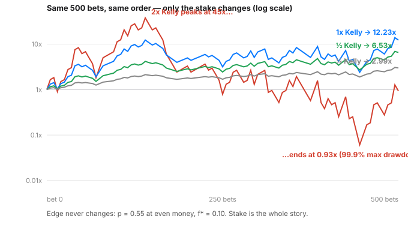

# Day 90 — Position Sizing & Risk: Kelly Intuition, Volatility Targeting

**Tonight you'll be able to:** turn a model's edge into a stake — compute the Kelly fraction for a bet, explain why full Kelly is a ceiling nobody sane trades at, and size positions by volatility so a regime change can't triple your risk overnight.

## The one idea

Days 83–89 were about the prediction: does the model have an edge at all, and is the backtest honest? Tonight is the other half of the P&L, the half with no model in it: **given an edge, how much do you bet?** Get it wrong in either direction and the edge doesn't save you — too small and the edge compounds to nothing; too big and variance eats the growth the edge was supposed to buy.

**Kelly in one paragraph.** Bet a fraction `f` of your bankroll on a bet that wins with probability `p` and pays `b`-to-1 (win `b·f`, lose `f`). Your bankroll multiplies each round, so what compounds is the *log* of wealth — Part 1 grows exactly that: `g(f) = p·ln(1 + b·f) + (1 − p)·ln(1 − f)`. Maximizing `g` over `f` gives the **Kelly criterion**: `f* = p − (1 − p)/b`. For tonight's bet — `p = 0.55`, even money — `f* = 0.10`: stake 10% of the roll per bet. The curve is the lesson: `g` rises to `f*`, then *falls*, crossing zero just past `2f*`. At `2f*` the bet is unchanged — same edge, same `p` — and the expected growth is **negative**. Overbetting doesn't just add risk; it subtracts growth. That asymmetry is the whole intuition: losses compound harder than wins because each loss shrinks the base the next win multiplies.

**Why nobody trades full Kelly.** `f*` is the growth *ceiling*, and the ride at the ceiling is brutal: in Part 1's single shared path, full Kelly finishes highest (12.23×) but passes through an **84% drawdown** on the way. Half Kelly gives up a quarter of the growth rate (`g` 0.00375 vs 0.00501) for a far shallower ride, and it's robust to the thing Day 83 warned about: **your `p` is an estimate.** If the true edge is smaller than you think, your computed `f*` is too big — and the penalty for betting past the true `f*` is exactly the cliff in the diagram. Fractional Kelly (½ or ¼) is what estimation error insurance looks like. Growth-optimal is a math answer; drawdown-tolerable is the trading answer.

**Volatility targeting: the second dial.** Kelly sizes one bet against a bankroll. Vol targeting sizes a *position* against a risk budget: `stake = target_vol / realized_vol`. If an asset's daily volatility doubles, you hold half as much, so each position contributes roughly the *same* day-to-day risk whether the market is calm or in a storm. Part 2 runs one asset through a calm regime (1% daily sd) and a storm regime (3%): fixed 100% sizing lets its daily sd jump 0.0090 → 0.0291, while vol-targeted sizing holds 0.0106 → 0.0120 — it quietly cuts the stake to ~0.37× when the storm arrives and restores ~1.17× in the calm. This is your wheel book's instinct — smaller size when IV and realized vol spike — written as a rule instead of a feeling.

One honesty note to carry into Day 91: both tools assume you *know* the inputs. Kelly wants the true `p` and `b`; vol targeting wants vol to be roughly persistent (it usually is, short-term — vol clusters). Neither manufactures an edge. Sizing converts edge into growth and caps the damage when the "edge" was noise — it never creates the edge.

## Analogy

Kelly is autoscaling for capital. Expected value is the average request rate; log-growth is what your fleet actually survives. A service provisioned at exactly its theoretical optimum with zero headroom looks brilliant in the load test and pages you at the first burst — full Kelly is that deployment. Fractional Kelly is running at 50–70% of the computed limit: you give up a little throughput you mostly can't measure, and you stop dying on variance. Vol targeting is the rate limiter: when the upstream (the market) gets 3× noisier, you don't let 3× the error budget flow through — you shed position size the way a good gateway sheds load, automatically, by rule, before the drawdown makes the decision for you.

## See it



One 500-bet path, four stakes, log scale. 2× Kelly (red) rockets to 45× — then gives essentially all of it back, ending at 0.93× after a 99.9% peak-to-trough drawdown. Full Kelly (blue) wins the race at 12.23× but through an 84% drawdown. Half Kelly (green) and quarter Kelly (grey) end lower and *sleep* better — and unlike the red line, they'd survive your `p` being wrong.

## Code it (~30 min)

Two parts, numpy only, two stated seeds — no RNG roulette in the results. **Part 1** prints the exact growth arithmetic for five stakes, then runs one shared 500-bet path (exactly 275 wins, shuffled once, seed 90) at ¼, ½, 1×, 1.5×, and 2× Kelly, reporting final multiple and max drawdown for each. Because the win count is exact, the finals are the arithmetic's predictions, not luck. **Part 2** builds one asset with a calm and a storm regime (seed 7) and compares fixed sizing against vol-targeted sizing — stake set from the trailing 20 days only, Day 87's no-peeking rule applied to risk itself.

```python
"""Day 90 - Position Sizing & Risk: Kelly Intuition, Volatility
Targeting.

Phase G has spent seven days on the prediction half: why
finance is hard (Day 83), honest labels and validation
(Days 84-89). Tonight is the other half - the half that
decides whether a real edge becomes real growth:

    Size. A bet's growth rate is set not by its expected
    value alone but by the fraction of bankroll you stake.

  Part 1  The Kelly criterion. A bet that wins with
          p = 0.55 at even money (b = 1): the growth-optimal
          stake is f* = p - (1-p)/b = 0.10. First the exact
          arithmetic - expected log growth per bet at five
          stakes - then ONE shared 500-bet path at 1/4, 1/2,
          1x, 1.5x and 2x Kelly. Same bets, same order, only
          the stake changes. 2x Kelly has the same positive
          edge as everyone else and still finishes UNDER
          water: past f*, extra stake buys variance, not
          growth, and variance compounds against you.
  Part 2  Volatility targeting. Kelly answers "how much of
          my roll on this bet"; vol targeting answers "how
          much risk per position": stake in inverse
          proportion to realized volatility. One asset, two
          regimes (calm 1% daily sd, storm 3%). Fixed
          fraction rides the regime change; vol-targeted
          sizing holds the daily-return sd nearly flat
          across both.

Runs on the ~/ai-lab venv: numpy only (free), CPU, no CUDA,
no paid APIs, no downloads. Two stated seeds; every number
below is the real run.

Expected output:

Part 1 - Kelly: one bet, five stakes (p = 0.55, b = 1, f* = 0.10)
  expected log growth per bet, g(f) = p*ln(1+b*f) + (1-p)*ln(1-f):
    0.25x Kelly  f = 0.025   g = +0.00219 per bet
     0.5x Kelly  f = 0.050   g = +0.00375 per bet
     1.0x Kelly  f = 0.100   g = +0.00501 per bet
     1.5x Kelly  f = 0.150   g = +0.00374 per bet
     2.0x Kelly  f = 0.200   g = -0.00014 per bet
  g peaks exactly at f* - past it, growth FALLS while swings keep growing
  one 500-bet path (seed 90, wins realized: 275/500), every stake rides it:
    0.25x Kelly  final    2.99x   max drawdown  27.3%
     0.5x Kelly  final    6.53x   max drawdown  49.2%
     1.0x Kelly  final   12.23x   max drawdown  84.0%
     1.5x Kelly  final    6.47x   max drawdown  98.0%
     2.0x Kelly  final    0.93x   max drawdown  99.9%
  same edge, same luck - 2x Kelly ends below 1.00x. Size is a growth decision, not a courage decision.
Part 2 - volatility targeting: size = target / realized vol
    fixed 100%    daily sd: calm 0.0090  storm 0.0291  overall 0.0216
    vol-targeted  daily sd: calm 0.0106  storm 0.0120  overall 0.0113
  fixed sizing lets the storm set your risk; targeting trades stake, not nerve - calm stake ~1.17x, storm stake ~0.37x
"""
import numpy as np

# ---------- Part 1: Kelly - the growth-optimal stake ----------
P, B = 0.55, 1.0                       # win prob, payoff ratio
F_STAR = P - (1 - P) / B               # 0.55 - 0.45 = 0.10
N_BETS = 500
MULTS = (0.25, 0.5, 1.0, 1.5, 2.0)

print("Part 1 - Kelly: one bet, five stakes "
      f"(p = {P}, b = {B:.0f}, f* = {F_STAR:.2f})")
print("  expected log growth per bet, g(f) = "
      "p*ln(1+b*f) + (1-p)*ln(1-f):")


def log_growth(f):
    return P * np.log(1 + B * f) + (1 - P) * np.log(1 - f)


for m in MULTS:
    print(f"    {m:>4}x Kelly  f = {m * F_STAR:.3f}   "
          f"g = {log_growth(m * F_STAR):+.5f} per bet")
print("  g peaks exactly at f* - past it, growth FALLS "
      "while swings keep growing")

# One shared path: exactly 275 wins / 225 losses (p = 0.55
# realized exactly), shuffled into one fixed order, seed 90.
rng = np.random.default_rng(90)
outcomes = np.array([1] * 275 + [-1] * 225)
rng.shuffle(outcomes)
print(f"  one 500-bet path (seed 90, wins realized: "
      f"{int((outcomes > 0).sum())}/500), every stake rides it:")
paths = {}
for m in MULTS:
    f = m * F_STAR
    wealth = np.cumprod(1 + f * outcomes)      # start = 1.0
    paths[m] = wealth
    peak = np.maximum.accumulate(wealth)
    max_dd = (1 - wealth / peak).max()
    print(f"    {m:>4}x Kelly  final {wealth[-1]:7.2f}x   "
          f"max drawdown {max_dd:6.1%}")
print("  same edge, same luck - 2x Kelly ends below 1.00x. "
      "Size is a growth decision, not a courage decision.")

# ---------- Part 2: volatility targeting ----------
print("Part 2 - volatility targeting: size = target / "
      "realized vol")
rng2 = np.random.default_rng(7)
asset = np.concatenate([rng2.normal(0.0, 0.01, 250),   # calm
                        rng2.normal(0.0, 0.03, 250)])  # storm
TARGET, WIN = 0.01, 20
# stake for day t uses only the trailing 20 days before t
# (Day 87's rule: no peeking); days 0-19 assume the target.
vol_est = np.full(len(asset), TARGET)
for t in range(WIN, len(asset)):
    vol_est[t] = asset[t - WIN:t].std(ddof=1)
w = np.clip(TARGET / vol_est, 0.0, 2.0)    # cap leverage 2x
fixed = asset                              # 100% always
targeted = w * asset
for name, rets in (("fixed 100%", fixed),
                   ("vol-targeted", targeted)):
    print(f"    {name:<13} daily sd: calm "
          f"{rets[:250].std(ddof=1):.4f}  storm "
          f"{rets[250:].std(ddof=1):.4f}  overall "
          f"{rets.std(ddof=1):.4f}")
print("  fixed sizing lets the storm set your risk; "
      "targeting trades stake, not nerve - calm stake "
      f"~{w[100]:.2f}x, storm stake ~{w[400]:.2f}x")

```

**Expected output:**

```
Part 1 - Kelly: one bet, five stakes (p = 0.55, b = 1, f* = 0.10)
  expected log growth per bet, g(f) = p*ln(1+b*f) + (1-p)*ln(1-f):
    0.25x Kelly  f = 0.025   g = +0.00219 per bet
     0.5x Kelly  f = 0.050   g = +0.00375 per bet
     1.0x Kelly  f = 0.100   g = +0.00501 per bet
     1.5x Kelly  f = 0.150   g = +0.00374 per bet
     2.0x Kelly  f = 0.200   g = -0.00014 per bet
  g peaks exactly at f* - past it, growth FALLS while swings keep growing
  one 500-bet path (seed 90, wins realized: 275/500), every stake rides it:
    0.25x Kelly  final    2.99x   max drawdown  27.3%
     0.5x Kelly  final    6.53x   max drawdown  49.2%
     1.0x Kelly  final   12.23x   max drawdown  84.0%
     1.5x Kelly  final    6.47x   max drawdown  98.0%
     2.0x Kelly  final    0.93x   max drawdown  99.9%
  same edge, same luck - 2x Kelly ends below 1.00x. Size is a growth decision, not a courage decision.
Part 2 - volatility targeting: size = target / realized vol
    fixed 100%    daily sd: calm 0.0090  storm 0.0291  overall 0.0216
    vol-targeted  daily sd: calm 0.0106  storm 0.0120  overall 0.0113
  fixed sizing lets the storm set your risk; targeting trades stake, not nerve - calm stake ~1.17x, storm stake ~0.37x
```

## Today's win

Done when your run reproduces the table: growth per bet peaking at `f = 0.100` (`+0.00501`) and going negative at `2.0x` (`−0.00014`); the shared path ending `2.99x / 6.53x / 12.23x / 6.47x / 0.93x` with max drawdowns `27.3% / 49.2% / 84.0% / 98.0% / 99.9%`; and vol targeting holding daily sd to `0.0106 / 0.0120` across calm and storm where fixed sizing swings `0.0090 / 0.0291`. The keeper sentence, no notes allowed: *the bet sets the edge; the stake sets the growth — and past Kelly, more stake means less growth.*

## Short on time? 20-minute version

Read "The one idea", stare at the red line in the diagram until the shape is burned in — peak 45×, finish 0.93×, same edge as everyone — then run only Part 1. If you can say out loud why `g(f)` falls after `f*` and why that makes half-Kelly the professional default when `p` is an estimate, you have the day. Part 2 is one idea (stake ∝ 1/vol) and can ride along tomorrow.

## Tomorrow's teaser

Tomorrow: the capstone closes the loop — from notebook to bot: the architecture of a paper-trading harness that runs this whole pipeline (data → features → labels → validation → sizing → execution) without risking a real dollar.

Streak: 90 day(s) · Never miss twice.
