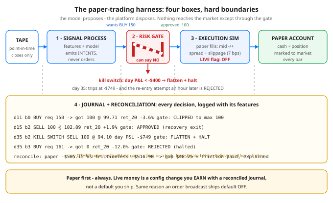

# Day 91 — From Notebook to Bot: The Paper-Trading Harness

**Tonight you'll be able to:** draw the four-box harness that sits between a model and any order — signal, risk gate, execution sim, journal — and run one end-to-end: the gate clips the model, the kill switch flattens a crash day, and the journal reconciles paper against frictionless to the cent.

## The one idea

Days 83–90 built a model and the discipline for believing it: honest features, triple-barrier labels, walk-forward validation, Kelly-capped sizing. A notebook ends there, with a number — an accuracy, a Sharpe. Production starts there. Something has to turn the model's opinions into orders, survive the bad days without human reflexes, and afterwards *prove* what it did and why. That something is a **harness**: an architecture of four boxes with hard boundaries, not a bigger notebook.

**Box 1 — the signal process.** Model plus features, and the features obey Day 69's point-in-time law with no exceptions: at bar `t` it may read closes up to `t`, never beyond. It emits *intents* — "I'd like to be long, sized at 15% of equity" — never orders. Keeping it order-blind is what makes it testable: Days 87–88's walk-forward graded exactly this box, in isolation, and its grade means nothing if it can also touch the account.

**Box 2 — the risk gate.** Dumb, deterministic code that reviews every intent and can **approve, clip, or reject** it: a hard position limit, Day 90's sizing cap, a daily-loss kill switch. The model cannot argue with it, retry around it, or special-case it — the gate owns the boundary, the way admission control owns a service's front door. *Dumb is the feature.* The gate's whole behavior is a small table you can unit-test (Part 1 does exactly that), which is precisely what you want from the last code standing between a model and money.

**Box 3 — the execution simulator.** Paper fills, modeled honestly: you cross the spread and pay slippage on every fill — tonight 5 bps half-spread plus 2 bps slippage, charged in both directions. Fills at mid are fantasy, and fantasies compound (Day 84's ghost, wearing a new costume). The design has a LIVE flag and it ships **OFF**; flipping it is a graduation decision you make with a reconciled journal in hand, not a whim.

**Box 4 — the journal, plus reconciliation.** Every decision is logged *with the features that produced it* — approvals, clips, rejections, kill-switch trips, all of them, because a rejection is a decision too. This is Day 67's experiment tracking and Day 69's lineage pointed at trades: six weeks from now, "why did it buy on day 11?" is answered by a log line (`ret_20 -3.6%`), not by memory. Reconciliation closes the loop: replay the identical decisions with frictionless mid fills and compare P&L. The gap must equal exactly the friction you modeled — tonight, $48.25. Any *other* gap means paper and backtest disagree about reality: a bug or a leak. You investigate before you believe either number.

**Why paper first, always:** each box fails in its own way during its first week — features off by one bar, a limit written in shares where dollars were meant, fills booked on the wrong side of the spread. Paper trading is where those bugs go to be found, and where the kill switch gets rehearsed before it is ever needed. Tonight's tape makes it fire on purpose.

## Analogy

It's the service architecture you already run. The model is a **stateless recommendation service** — smart, and deliberately untrusted with side effects. The risk gate is **admission control plus a circuit breaker** at the gateway: quotas it enforces mechanically, and a breaker that trips when the error budget burns — and cannot be talked out of tripping by the upstream service having a really good feeling. The execution sim is a **staging environment with fault injection**: realistic spread and slippage instead of the happy path. The journal is **structured request logging with the full payload**, and reconciliation is the canary diff review: expected deltas itemized to the cent, anything unexplained blocks promotion. You already operate TheMarketWatcher on this shape — signal engine, trade journal, order broadcast default OFF. Tonight just names the boxes.

## See it



Left to right: the tape feeds the signal process, which emits intents; every intent passes the risk gate (drawn as what it is — a barrier that can stay down); approved size reaches the execution sim; fills land in the paper account. The dashed lines are the journal's taps: nothing flows without being logged, and the band underneath carries three real rows from tonight's run plus the reconciliation verdict.

## Code it (~30 min)

One file, numpy only, seed 91 — the whole harness in miniature. **Part 1** unit-tests the gate like an API: an in-limit order (approved), a 150-share order (clipped to the 100 cap), an order while halted (rejected). **Part 2** runs all four boxes over a synthetic 60-day tape, 4 bars a day, designed so every box has to work: two dips (entries), a recovery (clean exit), a crash day (kill switch), a rejected re-entry an hour later, and a late noise dip still open at the end. The signal is Day 88-flavored mean reversion — want long when `ret_20 < -3%`, exit when it recovers — sized at Day 90's 15%-of-equity intent, which is why the gate clips every single entry: watch `req` vs `got`. **Part 3** reconciles. The strategy itself loses about $565 on this tape — that's fine, and it's the point: the harness never promised profit. It promised that every dollar of the loss is explainable.

```python
"""Day 91 - From Notebook to Bot: The Paper-Trading Harness.

Phase G has built a model (Days 83-90): honest features,
triple-barrier labels, walk-forward validation, Kelly-capped
sizing. A notebook stops there. Production doesn't. Between
the model and any order sits a HARNESS - four boxes with hard
boundaries, each of which can be tested on its own:

  1. Signal process   model + features, point-in-time inputs
                      only. Emits INTENTS, never orders.
  2. Risk gate        dumb, deterministic code between the
                      model and the market: position limits,
                      Day 90 sizing caps, a daily-loss kill
                      switch. It can say NO, and the model
                      cannot argue with it.
  3. Execution sim    paper fills at mid -/+ half-spread and
                      slippage. Never fantasy mid fills. A
                      LIVE flag exists, default OFF; paper is
                      a stage you graduate from, not skip.
  4. Journal +        every decision logged WITH the features
     reconciliation   that produced it (Day 67's tracking,
                      Day 69's lineage, for trades), and the
                      paper result reconciled against the
                      frictionless backtest number. A gap you
                      can't explain is a bug or a leak.

  Part 1  The gate, unit-tested: approve, clip, reject.
  Part 2  The full harness on a synthetic 60-day tape (4 bars
          a day) with a designed dip, a recovery, a second
          dip - and a crash day the kill switch has to catch.
  Part 3  Reconciliation: paper P&L vs the frictionless P&L
          of the identical decisions, and the gate's report.

Runs on the ~/ai-lab venv: numpy only (free), no paid APIs,
no downloads. The tape is synthetic with a stated seed; the
architecture is the lesson, not the alpha.

Expected output:

  Part 1 - the risk gate, unit-tested
    BUY 100 (pos 0, halted False) -> APPROVED         qty 100  within limits
    BUY 150 (pos 0, halted False) -> APPROVED-CLIPPED qty 100  requested 150 > headroom 100
    BUY  50 (pos 0, halted True) -> REJECTED         qty   0  kill switch: halted for the day
  Part 2 - the harness runs: journal of every decision
    day bar event              req  got      mid     fill  ret_20  verdict
     11   0 BUY                150  100    99.64    99.71   -3.6%  APPROVED-CLIPPED
     15   2 SELL               100  100   102.97   102.89   +1.9%  APPROVED
     30   1 BUY                142  100   105.94   106.01   -3.1%  APPROVED-CLIPPED
     35   2 KILL SWITCH SELL   100  100    94.16    94.10  -10.7%  day P&L -749 < -400
     35   3 BUY (no fill)      161    0    92.28    92.28  -12.0%  REJECTED
     36   0 BUY                159  100    93.00    93.07  -10.5%  APPROVED-CLIPPED
     40   2 SELL               100  100    97.02    96.95   +3.0%  APPROVED
     58   3 BUY                154  100    96.62    96.69   -3.6%  APPROVED-CLIPPED
    still holding 100 sh at the end, marked at last mid 95.88
  Part 3 - reconciliation
    decisions journaled: 8 (approved 2, clipped 4, rejected 1, kill-switch trips 1)
    paper P&L (real fills):        $   -565.15
    frictionless P&L (same trades): $   -516.90
    friction paid (spread+slippage): $    48.25
    verdict: the gap above is the ONLY difference between
    the two runs - same signals, same gate, same tape. Any
    other gap in real life is a bug or a leak. Investigate.
"""
import numpy as np

SEED = 91
BARS_PER_DAY = 4
DAYS = 60
START_CASH = 100_000.0
MAX_POS = 100              # hard position limit, shares
TARGET_FRAC = 0.15         # signal wants 15% of equity (Day 90)
KILL_LOSS = 400.0          # daily-loss kill switch, dollars
HALF_SPREAD = 0.0005       # 5 bps paid on every fill
SLIPPAGE = 0.0002          # 2 bps adverse, every fill


# ---------- the tape (synthetic, designed) ----------
def build_tape():
    rng = np.random.default_rng(SEED)
    n = DAYS * BARS_PER_DAY
    rets = rng.normal(0.0001, 0.006, n)
    rets[20:40] = rng.normal(0.0, 0.002, 20)        # calm before dip 1
    rets[40:48] = rng.normal(-0.008, 0.002, 8)      # dip 1
    rets[48:72] = rng.normal(0.0035, 0.002, 24)     # recovery 1
    rets[120:128] = rng.normal(-0.008, 0.002, 8)    # dip 2
    rets[128:140] = rng.normal(0.002, 0.002, 12)    # drift up
    rets[140:144] = [-0.015, -0.030, -0.045, -0.020]  # crash day
    rets[144:170] = rng.normal(0.0025, 0.003, 26)   # partial heal
    closes = 100.0 * np.cumprod(1.0 + rets)
    return closes


# ---------- box 2: the risk gate ----------
class RiskGate:
    """Deterministic admission control. No model in here."""

    def review(self, side, qty, pos, halted):
        if halted:
            return "REJECTED", 0, "kill switch: halted for the day"
        if side == "SELL":
            return "APPROVED", qty, "exit, always allowed"
        headroom = MAX_POS - pos
        if headroom <= 0:
            return "REJECTED", 0, f"max position {MAX_POS} reached"
        if qty > headroom:
            return "APPROVED-CLIPPED", headroom, \
                f"requested {qty} > headroom {headroom}"
        return "APPROVED", qty, "within limits"


# ---------- box 1: the signal process ----------
def signal(closes, t, pos, held):
    """Point-in-time only: features use closes[..t]. Emits an
    intent (side, qty, features) or None."""
    if t < 20:
        return None
    ret20 = closes[t] / closes[t - 20] - 1.0
    feats = {"ret_20": ret20}
    if pos == 0 and ret20 < -0.03:
        return "BUY", feats
    if pos > 0 and (ret20 > 0.01 or held >= 40):
        return "SELL", feats
    return None


# ---------- Parts 1-3 ----------
def main():
    closes = build_tape()
    gate = RiskGate()

    print("Part 1 - the risk gate, unit-tested")
    for side, qty, pos, halted in (("BUY", 100, 0, False),
                                   ("BUY", 150, 0, False),
                                   ("BUY", 50, 0, True)):
        v, q, why = gate.review(side, qty, pos, halted)
        print(f"  {side} {qty:>3} (pos {pos}, halted {halted})"
              f" -> {v:<16} qty {q:>3}  {why}")

    print("Part 2 - the harness runs: journal of every decision")
    print("  day bar event              req  got      mid"
          "     fill  ret_20  verdict")
    cash = free_cash = START_CASH
    pos = 0
    held = 0
    halted_day = -1
    day_start_eq = START_CASH
    journal = []
    counts = {"APPROVED": 0, "APPROVED-CLIPPED": 0, "REJECTED": 0,
              "KILL": 0}

    def log(day, bar, event, req, got, mid, fill, feats, verdict):
        r = feats["ret_20"] if feats else float("nan")
        journal.append((day, bar, event, req, got, mid, fill, r,
                        verdict))
        print(f"  {day:>3} {bar:>3} {event:<18} {req:>3} {got:>4}"
              f" {mid:>8.2f} {fill:>8.2f} {r:>+7.1%}  {verdict}")

    for t, mid in enumerate(closes):
        day, bar = divmod(t, BARS_PER_DAY)
        if bar == 0:
            day_start_eq = cash + pos * mid
        halted = day == halted_day
        sig = signal(closes, t, pos, held)
        if sig is not None:
            side, feats = sig
            equity = cash + pos * mid
            if side == "BUY":
                req = int(TARGET_FRAC * equity / mid)
            else:
                req = pos
            verdict, qty, _ = gate.review(side, req, pos, halted)
            counts[verdict] += 1
            if qty > 0:
                if side == "BUY":
                    fill = mid * (1 + HALF_SPREAD + SLIPPAGE)
                    cash -= qty * fill
                    free_cash -= qty * mid
                    pos += qty
                    held = 0
                else:
                    fill = mid * (1 - HALF_SPREAD - SLIPPAGE)
                    cash += qty * fill
                    free_cash += qty * mid
                    pos -= qty
                log(day, bar, side, req, qty, mid, fill, feats,
                    verdict)
            else:
                log(day, bar, side + " (no fill)", req, 0, mid,
                    mid, feats, verdict)
        if pos > 0:
            held += 1
        # kill switch: mark to market, judge the day
        day_pnl = (cash + pos * mid) - day_start_eq
        if pos > 0 and day_pnl < -KILL_LOSS and day != halted_day:
            fill = mid * (1 - HALF_SPREAD - SLIPPAGE)
            log(day, bar, "KILL SWITCH SELL", pos, pos, mid, fill,
                {"ret_20": closes[t] / closes[t - 20] - 1.0},
                f"day P&L {day_pnl:,.0f} < -{KILL_LOSS:,.0f}")
            cash += pos * fill
            free_cash += pos * mid
            pos = 0
            halted_day = day
            counts["KILL"] += 1

    last = closes[-1]
    if pos > 0:
        print(f"  still holding {pos} sh at the end, "
              f"marked at last mid {last:.2f}")
    paper_eq = cash + pos * last
    free_eq = free_cash + pos * last
    print("Part 3 - reconciliation")
    print(f"  decisions journaled: {len(journal)} "
          f"(approved {counts['APPROVED']}, "
          f"clipped {counts['APPROVED-CLIPPED']}, "
          f"rejected {counts['REJECTED']}, "
          f"kill-switch trips {counts['KILL']})")
    print(f"  paper P&L (real fills):        "
          f"${paper_eq - START_CASH:>10,.2f}")
    print(f"  frictionless P&L (same trades): "
          f"${free_eq - START_CASH:>10,.2f}")
    print(f"  friction paid (spread+slippage):"
          f" ${free_eq - paper_eq:>9,.2f}")
    print("  verdict: the gap above is the ONLY difference between")
    print("  the two runs - same signals, same gate, same tape. Any")
    print("  other gap in real life is a bug or a leak. Investigate.")


if __name__ == "__main__":
    main()
```

**Expected output:**

```
Part 1 - the risk gate, unit-tested
  BUY 100 (pos 0, halted False) -> APPROVED         qty 100  within limits
  BUY 150 (pos 0, halted False) -> APPROVED-CLIPPED qty 100  requested 150 > headroom 100
  BUY  50 (pos 0, halted True) -> REJECTED         qty   0  kill switch: halted for the day
Part 2 - the harness runs: journal of every decision
  day bar event              req  got      mid     fill  ret_20  verdict
   11   0 BUY                150  100    99.64    99.71   -3.6%  APPROVED-CLIPPED
   15   2 SELL               100  100   102.97   102.89   +1.9%  APPROVED
   30   1 BUY                142  100   105.94   106.01   -3.1%  APPROVED-CLIPPED
   35   2 KILL SWITCH SELL   100  100    94.16    94.10  -10.7%  day P&L -749 < -400
   35   3 BUY (no fill)      161    0    92.28    92.28  -12.0%  REJECTED
   36   0 BUY                159  100    93.00    93.07  -10.5%  APPROVED-CLIPPED
   40   2 SELL               100  100    97.02    96.95   +3.0%  APPROVED
   58   3 BUY                154  100    96.62    96.69   -3.6%  APPROVED-CLIPPED
  still holding 100 sh at the end, marked at last mid 95.88
Part 3 - reconciliation
  decisions journaled: 8 (approved 2, clipped 4, rejected 1, kill-switch trips 1)
  paper P&L (real fills):        $   -565.15
  frictionless P&L (same trades): $   -516.90
  friction paid (spread+slippage): $    48.25
  verdict: the gap above is the ONLY difference between
  the two runs - same signals, same gate, same tape. Any
  other gap in real life is a bug or a leak. Investigate.
```

## Today's win

Done when your run shows all three gate interventions and the reconciliation: Part 1's verdicts `APPROVED` / `APPROVED-CLIPPED` / `REJECTED`; the day-35 `KILL SWITCH SELL` at day P&L `-$749` with the bar-3 re-entry `REJECTED` right behind it; and Part 3's gap — paper `-$565.15` vs frictionless `-$516.90`, friction `$48.25`. The keeper test, no notes allowed: pick any journal row and read off what the model wanted, what the gate allowed, what it filled at, and which feature caused it. If you can do that for all eight rows, you own the architecture.

## Short on time? 20-minute version

Read "The one idea" and study the diagram's gate until you can redraw the four boxes from memory. Then run the code and find the three gate interventions in the journal — one CLIPPED row, the KILL row, one REJECTED row. If you can say out loud why the gate must be dumb code the model can't argue with, and why an unexplained reconciliation gap blocks going live, you have the day.

## Tomorrow's teaser

Tomorrow: the whole capstone on one page — data → features → labels → validation → sizing → execution, drawn as a single map.

Streak: 91 day(s) · Never miss twice.
