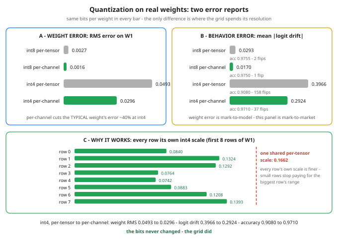

# Day 97 — Deep Dive: Quantization Hands-On

**Tonight you'll be able to:** train a small classifier yourself, quantize its real trained weights four ways — int8 and int4, one shared scale vs one scale per row — and read *both* error reports: what happened to the weights, and what happened to the answers.

## The one idea

Day 65 gave you the mechanism — store a small integer code plus one scale, `w ≈ scale × q` — and priced it on a formula-built matrix. Two things were missing, and both were load-bearing: the weights were fake, and the error bill stopped at the weights. Nobody checked what the rounding did to the model's *answers*. Today you train a real (small) network and quantize *its* weights, four ways.

**Real weights have ranges with opinions.** In Day 65's matrix the outlier was planted by hand. In a trained layer the spread is earned: each row of the first weight matrix is one hidden unit's incoming weights, and different units learn different jobs. Today's data rigs the spread so you can see where it comes from — half the features are *loud* (large scale) and half are *quiet* (10× smaller), and two pairs of classes share the same loud pattern, so the only way to tell class 0 from class 1 is to listen to the quiet features. A unit that listens quietly has to turn its weights up. The trained `W1` comes out with a 3.0× spread between its smallest and largest row ranges — no planting required.

**Two error reports, and they are not the same report.** Day 65's bill — max and RMS error on the matrix — is *weight error*. The new one is *behavior error*: run the same 2,000 test samples through the fp32 model and through a copy whose weights were rounded to the grid and back, then compare the outputs — accuracy, mean **logit drift** (average absolute change in the output scores), and how many predictions *flip*. The two reports routinely disagree, for a reason you already own: a neuron's output is a sum of hundreds of products (Day 12), and independent rounding errors partly cancel in the sum. A confident prediction has margin to burn; only borderline samples flip. Watch Part 3: at int8 the drift is real on both schemes, yet accuracy cannot tell them apart — drift is the finer instrument, which is Day 57's evals discipline applied to serving.

**Per-tensor vs per-channel.** Day 65 used one scale per row. The cheaper scheme — one scale for the *whole matrix* (**per-tensor**) — lets the largest row dictate everyone's step size. A small row's weights then land on a grid built for someone else: with a shared int4 step of 0.1662, a weight of 0.05 is nearer to code 0 than to any other code — it is simply erased. **Per-channel** gives each row (each output channel) its own scale, so every row's grid fits its own range. Note what does *not* improve in Part 2: max error barely moves, because the biggest row sets it under both schemes. The win is in RMS — the *typical* weight's error — and in everything Part 3 measures. The price of the extra scales is Part 4's punchline: 36 extra floats in this model, and on a 4096×4096 layer all 4,096 scales together are 16 KB against 8.39 MB of int4 codes.

**Calibration: choosing the range from data, not from the weight file.** Every scale above came from the weights alone (`max|w| / qmax`). Calibration instead runs a few hundred real inputs through the fp32 model and records the ranges each channel's *activations* actually use, then sets — or deliberately clips — the grids to cover what happens in production rather than what the file's extremes allow; a large weight fed by a near-zero activation is harmless, and activation-aware methods (AWQ is the name to recognize) spend their precision budget exactly there. Two shipping routes, one line each: **PTQ** (post-training quantization) quantizes the finished model with no retraining — everything you do today is PTQ. **QAT** (quantization-aware training) puts fake quantization inside the training loop so gradient descent adapts the weights to the grid — better int4, at the price of a training run.

## Analogy

**Mark-to-model vs mark-to-market.** Weight error is a mark-to-model number: it says how far the internals moved from the reference file. Behavior error is mark-to-market: it says what the model actually *does* differently. Your desk settles accounts on fills, not on how far a pricing model's parameters drifted — and a serving team ships or blocks a quantized model on the same basis. Per-tensor vs per-channel is the same lesson one level down: one shared scale is running the whole book off a single stale reference price; a scale per row is every name quoted on its own tape.

## See it



Left: Day 65's report on real weights — RMS error on the matrix. Right: the report that decides whether the model still works — how far its answers move on 2,000 test samples. Bottom: the mechanism — each row's own int4 scale against the one shared scale (dashed) that small rows would otherwise be stuck with.

## Code it (~30 min)

One file, numpy only, four parts. **Part 1** trains the 20 → 32 → 4 MLP by hand — real gradient descent, so the weights are genuinely learned. **Part 2** reruns Day 65's weight-error bill on the trained `W1`, per-tensor vs per-channel. **Part 3** is the new instrument: both layers swapped for their dequantized versions, same 2,000 test samples, behavior compared against the fp32 reference. **Part 4** counts bytes with the scales included, here and at production layer size. One seeded generator and full-batch training — your run reproduces every digit. Runs in your `~/ai-lab` venv on CPU; numpy only, nothing to download.

```python
"""Day 97 - Deep Dive: Quantization Hands-On.

Day 65 quantized a formula-built matrix and printed an
error bill for the WEIGHTS. Two things were missing: the
weights were fake, and nobody checked what the error did
to the model's ANSWERS. Today both gaps close.

  Part 1  Train a real (small) classifier in numpy: a
          20 -> 32 -> 4 MLP on synthetic 4-class data,
          hand-rolled backprop, full-batch gradient
          descent. The data has a trap built in (below),
          and the trained first layer comes out with a
          3.0x spread in row ranges - rows are not
          interchangeable, because each hidden unit
          learned a different job.
  Part 2  Day 65's weight-error report, rerun on the
          trained W1 - but now per-TENSOR (one scale for
          all 640 weights) vs per-CHANNEL (one scale per
          row, 32 scales), at int8 and int4.
  Part 3  The report Day 65 never printed: BEHAVIOR.
          Swap BOTH layers for their dequantized versions
          (the way a real deployment ships) and re-run the
          test set: accuracy, mean |logit drift| against
          the fp32 model, and how many predictions flip.
          Weight error is mark-to-model; this is
          mark-to-market.
  Part 4  Bytes for the whole model, scales included,
          then the same math on one 4096x4096 layer -
          where the 32 extra scale numbers stop mattering.

The data's trap: features 0-9 are LOUD (centers at scale
2.0, noise 1.0) and features 10-19 are QUIET (scale 0.20,
noise 0.1). Classes 0 and 1 share the SAME loud center,
as do 2 and 3 - so telling 0 from 1 is impossible without
listening to the quiet features, and a hidden unit that
listens quietly has to turn its weights up. That spread
of row ranges is exactly what per-channel scales exploit
and per-tensor scales waste.

Quantization is Day 65's symmetric scheme (one scale,
w ~= scale * q, codes round(w / scale) clipped to
[-qmax, qmax]; numpy rounds half-to-even, same as torch).

Runs in the ~/ai-lab venv: numpy only, no torch needed,
no CUDA, no paid APIs, no downloads. Deterministic:
one seeded generator, full-batch training, no shuffling.

Expected output:

  Part 1 - a real trained model (numpy, hand-rolled backprop)
    architecture 20 -> 32 (relu) -> 4; 200 epochs, full-batch GD
    fp32 test accuracy: 0.9755 on 2000 samples
    W1 is 32x20 = 640 weights (largest layer); W2 is 4x32 = 128; total 768
    W1 row ranges: smallest row max|w| 0.389, largest 1.163 - a 3.0x spread
    (each row is one hidden unit's incoming weights - different
     units, different jobs, different ranges. Remember this spread.)
  Part 2 - weight error on W1: per-tensor vs per-channel
    int8 per-tensor:   max err 0.004573  rms err 0.002659
    int8 per-channel:  max err 0.004540  rms err 0.001633
    int4 per-tensor:   max err 0.082995  rms err 0.049261
    int4 per-channel:  max err 0.082600  rms err 0.029594
    int4 scales, first 8 rows of W1 (per-channel): 0.0840, 0.1324, 0.1292, 0.0764, 0.0742, 0.0883, 0.1208, 0.1393
    the single per-tensor int4 scale for all 640 weights: 0.1662
    read: max error barely moves (the biggest row sets it under
    both schemes) - the win is in RMS, the typical weight's error.
  Part 3 - behavior: both layers dequantized, same 2000 test samples
    fp32 (reference)   acc 0.9755  mean |dlogit| 0.0000  flips 0
    int8 per-tensor:   acc 0.9755  mean |dlogit| 0.0293  flips 2
    int8 per-channel:  acc 0.9750  mean |dlogit| 0.0170  flips 1
    int4 per-tensor:   acc 0.9080  mean |dlogit| 0.3966  flips 158
    int4 per-channel:  acc 0.9710  mean |dlogit| 0.2924  flips 37
    verdict: int8 is free either way. At int4 the shared scale
    costs ~7 accuracy points; one scale per row buys nearly all
    of it back - same 4 bits per weight, spent where rows differ.
  Part 4 - bytes: the whole model, then one production-size layer
    this net (768 weights, biases kept fp32):
      fp32:           3216 B
      int8 + scales:  1056 B
      int4 + scales:  672 B
    one 4096x4096 layer (16.78M weights), per-channel:
      fp32: 67.11 MB | int8: 16.78 MB | int4: 8.39 MB
      all 4096 row scales together: 16384 B - rounding error in the budget, not a line item.
"""
import numpy as np

rng = np.random.default_rng(97)
D_IN, D_HID, D_OUT = 20, 32, 4
HALF = D_IN // 2
N_TR, N_TE = 1200, 2000

# ---------- the data: loud half, quiet half, paired classes ----------
pairA = rng.normal(0.0, 2.0, size=HALF)
pairB = rng.normal(0.0, 2.0, size=HALF)
centers = np.empty((D_OUT, D_IN))
centers[0, :HALF] = pairA
centers[1, :HALF] = pairA          # class 1: same loud center as 0
centers[2, :HALF] = pairB
centers[3, :HALF] = pairB          # class 3: same loud center as 2
centers[:, HALF:] = rng.normal(0.0, 0.20, size=(D_OUT, HALF))
noise = np.concatenate([np.full(HALF, 1.0), np.full(HALF, 0.1)])


def make(n):
    y = rng.integers(0, D_OUT, n)
    X = centers[y] + rng.normal(0.0, 1.0, size=(n, D_IN)) * noise
    return X, y


Xtr, ytr = make(N_TR)
Xte, yte = make(N_TE)

# ---------- Part 1: train a real little model ----------
W1 = rng.normal(0.0, np.sqrt(2.0 / D_IN), size=(D_HID, D_IN))
b1 = np.zeros(D_HID)
W2 = rng.normal(0.0, np.sqrt(2.0 / D_HID), size=(D_OUT, D_HID))
b2 = np.zeros(D_OUT)


def forward(X, w1, w2):
    H = np.maximum(0.0, X @ w1.T + b1)
    return H @ w2.T + b2, H


def softmax(z):
    z = z - z.max(axis=1, keepdims=True)
    e = np.exp(z)
    return e / e.sum(axis=1, keepdims=True)


LR, EPOCHS = 0.05, 200
for _ in range(EPOCHS):
    logits, H = forward(Xtr, W1, W2)
    P = softmax(logits)
    P[np.arange(N_TR), ytr] -= 1.0
    g = P / N_TR                              # d(loss)/d(logits)
    gW2, gb2 = g.T @ H, g.sum(0)
    gH = g @ W2
    gH[H <= 0] = 0.0                          # relu gate
    gW1, gb1 = gH.T @ Xtr, gH.sum(0)
    W1 -= LR * gW1
    b1 -= LR * gb1
    W2 -= LR * gW2
    b2 -= LR * gb2

print("Part 1 - a real trained model (numpy, hand-rolled backprop)")
logits_ref, _ = forward(Xte, W1, W2)
pred_ref = logits_ref.argmax(1)
acc_ref = (pred_ref == yte).mean()
row_max = np.abs(W1).max(axis=1)
print(f"  architecture 20 -> 32 (relu) -> 4; {EPOCHS} epochs, full-batch GD")
print(f"  fp32 test accuracy: {acc_ref:.4f} on {N_TE} samples")
print(f"  W1 is {D_HID}x{D_IN} = {W1.size} weights (largest layer); "
      f"W2 is {D_OUT}x{D_HID} = {W2.size}; total {W1.size + W2.size}")
print(f"  W1 row ranges: smallest row max|w| {row_max.min():.3f}, "
      f"largest {row_max.max():.3f} - a "
      f"{row_max.max() / row_max.min():.1f}x spread")
print("  (each row is one hidden unit's incoming weights - different")
print("   units, different jobs, different ranges. Remember this spread.)")


# ---------- the quantizers (Day 65's scheme, two granularities) ----------
def q_tensor(W, qmax):
    """ONE scale for the whole matrix. Returns (dequantized, scale)."""
    s = np.abs(W).max() / qmax
    codes = np.clip(np.round(W / s), -qmax, qmax)
    return codes * s, s


def q_channel(W, qmax):
    """One scale PER ROW (per output channel). Returns (dequant, scales)."""
    s = np.abs(W).max(axis=1, keepdims=True) / qmax
    codes = np.clip(np.round(W / s), -qmax, qmax)
    return codes * s, s.ravel()


def werr(deq):
    err = deq - W1
    return np.abs(err).max(), np.sqrt((err ** 2).mean())


# ---------- Part 2: the weight-error report, on real weights ----------
print("Part 2 - weight error on W1: per-tensor vs per-channel")
variants = {}
for bits, qmax in ((8, 127), (4, 7)):
    for name, fn in (("per-tensor", q_tensor), ("per-channel", q_channel)):
        deq, _ = fn(W1, qmax)
        variants[(bits, name)] = deq
        mx, rms = werr(deq)
        print(f"  int{bits} {name + ':':<13} max err {mx:.6f}  "
              f"rms err {rms:.6f}")
_, scales4 = q_channel(W1, 7)
_, ts4 = q_tensor(W1, 7)
print("  int4 scales, first 8 rows of W1 (per-channel): "
      + ", ".join(f"{v:.4f}" for v in scales4[:8]))
print(f"  the single per-tensor int4 scale for all 640 weights: {ts4:.4f}")
print("  read: max error barely moves (the biggest row sets it under")
print("  both schemes) - the win is in RMS, the typical weight's error.")

# ---------- Part 3: the behavior report ----------
print("Part 3 - behavior: both layers dequantized, same 2000 test samples")
print(f"  {'fp32 (reference)':<18} acc {acc_ref:.4f}  "
      f"mean |dlogit| 0.0000  flips 0")
for bits, qmax in ((8, 127), (4, 7)):
    for name, fn in (("per-tensor", q_tensor), ("per-channel", q_channel)):
        d1, _ = fn(W1, qmax)
        d2, _ = fn(W2, qmax)
        logits_q, _ = forward(Xte, d1, d2)
        drift = np.abs(logits_q - logits_ref).mean()
        flips = int((logits_q.argmax(1) != pred_ref).sum())
        acc_q = (logits_q.argmax(1) == yte).mean()
        print(f"  int{bits} {name + ':':<13} acc {acc_q:.4f}  "
              f"mean |dlogit| {drift:.4f}  flips {flips}")
print("  verdict: int8 is free either way. At int4 the shared scale")
print("  costs ~7 accuracy points; one scale per row buys nearly all")
print("  of it back - same 4 bits per weight, spent where rows differ.")

# ---------- Part 4: bytes, scales included ----------
print("Part 4 - bytes: the whole model, then one production-size layer")
n_w = W1.size + W2.size
n_scales = D_HID + D_OUT                     # per-channel: rows of W1 + W2
bias_bytes = (b1.size + b2.size) * 4         # biases stay fp32
print(f"  this net ({n_w} weights, biases kept fp32):")
print(f"    fp32:           {n_w * 4 + bias_bytes} B")
print(f"    int8 + scales:  {n_w + n_scales * 4 + bias_bytes} B")
print(f"    int4 + scales:  {n_w // 2 + n_scales * 4 + bias_bytes} B")
big = 4096 * 4096
print(f"  one 4096x4096 layer ({big / 1e6:.2f}M weights), per-channel:")
print(f"    fp32: {big * 4 / 1e6:.2f} MB | int8: {big / 1e6:.2f} MB "
      f"| int4: {big / 2 / 1e6:.2f} MB")
print(f"    all 4096 row scales together: {4096 * 4} B - rounding "
      "error in the budget, not a line item.")
```

**Expected output:**

```
Part 1 - a real trained model (numpy, hand-rolled backprop)
  architecture 20 -> 32 (relu) -> 4; 200 epochs, full-batch GD
  fp32 test accuracy: 0.9755 on 2000 samples
  W1 is 32x20 = 640 weights (largest layer); W2 is 4x32 = 128; total 768
  W1 row ranges: smallest row max|w| 0.389, largest 1.163 - a 3.0x spread
  (each row is one hidden unit's incoming weights - different
   units, different jobs, different ranges. Remember this spread.)
Part 2 - weight error on W1: per-tensor vs per-channel
  int8 per-tensor:   max err 0.004573  rms err 0.002659
  int8 per-channel:  max err 0.004540  rms err 0.001633
  int4 per-tensor:   max err 0.082995  rms err 0.049261
  int4 per-channel:  max err 0.082600  rms err 0.029594
  int4 scales, first 8 rows of W1 (per-channel): 0.0840, 0.1324, 0.1292, 0.0764, 0.0742, 0.0883, 0.1208, 0.1393
  the single per-tensor int4 scale for all 640 weights: 0.1662
  read: max error barely moves (the biggest row sets it under
  both schemes) - the win is in RMS, the typical weight's error.
Part 3 - behavior: both layers dequantized, same 2000 test samples
  fp32 (reference)   acc 0.9755  mean |dlogit| 0.0000  flips 0
  int8 per-tensor:   acc 0.9755  mean |dlogit| 0.0293  flips 2
  int8 per-channel:  acc 0.9750  mean |dlogit| 0.0170  flips 1
  int4 per-tensor:   acc 0.9080  mean |dlogit| 0.3966  flips 158
  int4 per-channel:  acc 0.9710  mean |dlogit| 0.2924  flips 37
  verdict: int8 is free either way. At int4 the shared scale
  costs ~7 accuracy points; one scale per row buys nearly all
  of it back - same 4 bits per weight, spent where rows differ.
Part 4 - bytes: the whole model, then one production-size layer
  this net (768 weights, biases kept fp32):
    fp32:           3216 B
    int8 + scales:  1056 B
    int4 + scales:  672 B
  one 4096x4096 layer (16.78M weights), per-channel:
    fp32: 67.11 MB | int8: 16.78 MB | int4: 8.39 MB
    all 4096 row scales together: 16384 B - rounding error in the budget, not a line item.
```

## Today's win

Done when your run matches the lesson's digits: fp32 accuracy `0.9755`; int4 per-tensor falls to `0.9080` with `158` flipped predictions; int4 per-channel holds `0.9710` with `37` flips — and the first-8-rows scale strip shows every per-channel scale finer than the shared `0.1662`. The keeper test, no notes: given any trained layer, you can say which scale granularity it needs, predict whether the damage will show up in max error, RMS error, or behavior first, and name the two error reports you'd demand before shipping it.

## Short on time? 20-minute version

Read "The one idea", then study panel C of the diagram until you can explain why the dashed line is every small row's problem. Run the code and read only Parts 2 and 3. If you can explain why max weight error barely moved while accuracy swung by seven points — and why drift sees an int8 difference that accuracy can't — you have the day; Part 4 is arithmetic you can redo any time.

## Tomorrow's teaser

Tomorrow: Day 74's all-reduce leaves the whiteboard — real processes passing real gradients around a ring on the machine under your desk. No cluster required.

Streak: 97 day(s) · Never miss twice.
