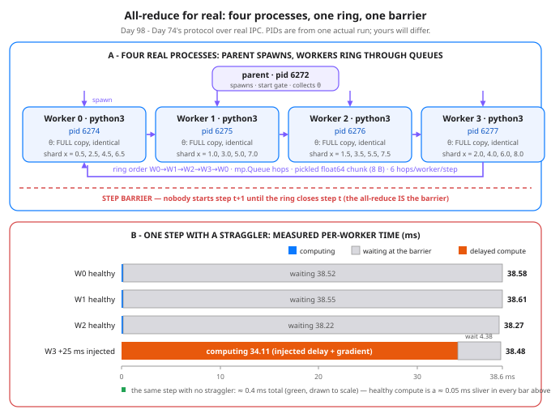

# Day 98 — Data Parallelism for Real: All-Reduce Across Processes

**Tonight you'll be able to:** spawn four real worker processes, run Day 74's ring all-reduce over actual IPC queues for 30 training steps, and prove the replicas still land on the single-machine theta — then measure the two things the simulation hid: what process startup costs, and what one slow worker does to everybody's step.

## The one idea

Day 74's ring was a **simulation**: one process played all four workers, and a "send" was a list copy inside one memory space. It proved the algebra — average of shard gradients = full-batch gradient, exactly — but a simulation cannot serialize anything, cannot be scheduled by an OS, and has nobody to wait for. Tonight the protocol runs for real: same 16 points, same shards, same chunk order, but four separate OS processes (Python `multiprocessing`, `spawn`) exchanging every chunk through `mp.Queue` pipes, for 30 full training steps.

**What survives contact with reality: the math.** After 30 steps the four workers' thetas are *bit-identical to each other*, and the max diff against the single-process reference is **3.886e-16**. Why not Day 74's exact 0.0? Day 74 took one step in dyadic arithmetic, where every sum is exact in any order. Over 30 steps the values leave dyadic-land, and the ring adds the same numbers in a *different order* than the reference's one full-batch sum — float addition is not associative, so the last bits land differently. The IPC itself loses nothing: a pickled float64 arrives bit-exact, which is why the four replicas (which all receive the same chunks) agree *exactly*, and only the differently-ordered reference drifts, by about one part in 10^15. That is the honest tolerance statement: replicas exact, reference to machine epsilon.

**What reality adds, part 1: startup.** Spawn → all four workers ready took **~0.5 s**; the 30 steps of training took ~17–40 ms. Merely *creating* the cluster cost 10–25× the entire toy training run — every worker is a fresh Python interpreter importing numpy. Real clusters pay this once and train for weeks; anything that respawned workers per step would drown in it. There is also a measurement trap the code fixes with a **start gate**: without it, worker 0's first "step" silently includes waiting for workers 1–3 to exist (it made worker 0 look 10× slower than worker 3); the parent collects all four "ready" messages, opens the gate, and only then does anyone time a step.

**What reality adds, part 2: the barrier is real waiting.** A healthy step is ~0.4 ms, of which the gradient compute is 0.02 ms — even at toy scale, ~95% of a step is communication and synchronization, not math (the ratio inverts at real scale, because compute per step grows with shard size while the sync bill is set by model size — Day 74's Part 4). Inject 25 ms of busywork into worker 3 and *every* worker's step becomes ~38 ms on this loaded VM (~26 ms on a quiet machine): the healthy workers' added time shows up entirely as **waiting** (38.5 of their 38.6 ms). A synchronized step costs the *max* over workers, never the mean — and the run still lands on the same theta (diff 2.220e-16 vs the 10-step reference): the straggler cost the cluster time and changed no result.

One more number worth keeping: ~0.4 ms for 12 queue hops is roughly **30 µs per hop** — pickle, pipe write, wakeup, unpickle — for an 8-byte payload. Latency, not bandwidth, is the toy's whole bill, which is precisely why real collectives obsess over message count and fusion.

**Why production clusters don't hand-roll this:** the protocol is identical; the transport is not. Tonight's chunks are pickled Python floats pushed through OS pipes by a queue feeder thread, copied more than once, one syscall-heavy hop per chunk — fine for 48 bytes a step, absurd for the 55.1 GB per worker per step of Day 74's 7B-at-N=64 math. **NCCL** keeps gradient buffers in GPU memory and moves them over NVLink or RDMA without CPU copies, builds topology-aware rings and trees, and `torch.distributed` / DDP wrap it in process groups whose all-reduce is *bucketed and overlapped with `backward()`*, so much of the sync hides behind compute. Hand-rolled queues are how you learn what a collective really costs; nobody ships them.

## Analogy

Day 74 was the **tabletop exercise**: sticky notes passed around a table to rehearse a consensus protocol until everyone could recite it. Today is the same protocol deployed between real services — and every cost that was invisible on paper shows up in production. Process spawn is a **cold start**: ~0.5 s before any useful work, which is why you never cold-start per request. Pickle-plus-pipe is **serialization + RPC overhead** on every single hop, paid even when the payload is 8 bytes. The barrier is a **distributed commit**: the transaction closes when the *slowest* participant answers, so one node with a noisy neighbour sets the latency for the whole fleet.

Trading version, one line: Day 74 was the backtest, tonight is live fills — the strategy's math is identical, but slippage, latency, and the slow counterparty only exist live.

## See it



Top: the real thing — a parent process (pid from an actual run) spawns four worker processes; each holds the full θ and one data shard, and chunks travel the ring as pickled float64 values over mp.Queue pipes. The dashed line is the step barrier: nobody starts step t+1 until the ring closes step t. Bottom: one measured straggler step — 25 ms of injected busywork in worker 3 stretches EVERY worker's step to ~38 ms on a loaded VM, and the healthy workers' bars are almost entirely grey: waiting.

## Code it (~30 min)

numpy + stdlib `multiprocessing` only — no torch, no cluster. **Part 1** trains Day 74's regression 30 steps in this process (lr 0.01: Day 74's 0.05 was sized for its single step and diverges over 30 — the comment in the code shows why). **Part 2** spawns four real workers behind a start gate and runs the identical ring over queues; watch for `bit-identical: True` and the e-16 diff. **Part 3** reruns with worker 3 spinning 25 ms per step and prints both timing tables. **Part 4** counts the messages and bytes. PIDs and milliseconds will differ on your machine — every theta, loss, and diff line must not.

```python
"""Day 98 - Deep Dive: Data Parallelism for Real.

Day 74 ran the ring all-reduce as a SIMULATION: one process
played all four workers, and a "send" was a list copy inside
one memory space. It proved the algebra - average of the shard
gradients = the full-batch gradient, diff exactly 0.0 - but a
simulation cannot be slow, cannot serialize anything, and has
nobody to wait for. Tonight the same protocol runs for real:
four separate OS processes, real IPC, a real barrier.

  Part 1  The single-process reference: Day 7's regression
          (Day 74's 4-wide features) trained 30 steps on all
          16 points in THIS process. The number to beat.
  Part 2  Four real worker processes (multiprocessing, spawn).
          Each holds all of theta and one 4-point shard, and
          runs Day 74's ring all-reduce over mp.Queue pipes:
          every chunk is a pickled float64 that physically
          crosses a process boundary. After 30 steps, compare
          every worker's theta against Part 1.
  Part 3  The straggler, measured: rerun with worker 3 given
          25 ms of injected busywork per step. The step is a
          barrier, so EVERY worker's step time should grow to
          match the slowest - watch the fast workers' waiting
          time, not just the slow worker's compute time.
  Part 4  The systems bill: process startup cost, bytes and
          messages per step, and why production clusters run
          this protocol in NCCL / torch.distributed instead of
          hand-rolled queues (short version in the lesson).

Determinism: fixed formula data, float64 everywhere, no RNG,
no timing-dependent math - the thetas and diffs print the
same on every run. PIDs and millisecond timings are from the
machine you run on and WILL differ; they are labelled.

One honest change from Day 74: it took ONE step at lr 0.05.
Over 30 steps that rate diverges on this feature scaling
(the x^3/64 column has a much larger gradient scale), so
tonight lr = 0.01 and the loss actually descends.

numpy + Python stdlib multiprocessing only. No torch, no
downloads, no paid APIs. Mac-safe: spawn start method and
the __main__ guard below are what macOS requires. Runs in
the ~/ai-lab venv on a MacBook.

Expected output (theta, loss and diff lines exact;
PIDs and millisecond figures are from ONE run on a
shared 4-core VM - yours will differ, and on a busy
machine the straggler step can overshoot 25 ms by a
lot; the shape - everyone's step ~= the slowest
worker's step - is the claim):

  Part 1 - single-process reference (30 steps, all 16 points)
    loss: step 0 = 78.980469, step 10 = 1.461741, step 20 = 0.802430, step 30 = 0.465431
    reference theta = 0.968484, 1.579751, 0.463296, 0.068607
  Part 2 - four REAL processes, ring all-reduce over queues
    parent pid = 6272
    spawn -> all 4 workers ready: 498 ms (machine-dependent)
      worker 0: pid 6274, shard x = 0.5, 2.5, 4.5, 6.5
      worker 1: pid 6275, shard x = 1.0, 3.0, 5.0, 7.0
      worker 2: pid 6276, shard x = 1.5, 3.5, 5.5, 7.5
      worker 3: pid 6277, shard x = 2.0, 4.0, 6.0, 8.0
    30 steps done in 17 ms wall (machine-dependent)
    all four workers' thetas bit-identical: True
    max |worker theta - reference theta| = 3.886e-16
    verdict: real processes, real IPC - same theta as one machine
  Part 3 - straggler: worker 3 gets +25 ms busywork per step
    baseline (Part 2):        compute/step    step total     waiting
      worker 0 (healthy)          0.02 ms        0.45 ms        0.43 ms
      worker 1 (healthy)          0.02 ms        0.35 ms        0.33 ms
      worker 2 (healthy)          0.02 ms        0.35 ms        0.34 ms
      worker 3 (healthy)          0.02 ms        0.36 ms        0.34 ms
    straggler run (10 steps): compute/step    step total     waiting
      worker 0 (healthy)          0.05 ms       38.58 ms       38.52 ms
      worker 1 (healthy)          0.07 ms       38.61 ms       38.55 ms
      worker 2 (healthy)          0.06 ms       38.27 ms       38.22 ms
      worker 3 (delayed)         34.11 ms       38.48 ms        4.38 ms
    verdict: the step is a barrier - its length is set by the
    slowest worker, and the healthy workers pay for it as waiting
    sanity: straggler thetas bit-identical: True, max diff vs the 10-step reference = 2.220e-16
    the delay changed the timing, not the math - a slow worker
    costs the whole cluster time and changes no result
  Part 4 - what the hand-rolled version costs
    messages per worker per step: 2(N-1) = 6 sends + 6 receives
    bytes per worker per step: 6 chunks x 8 B = 48 B (this toy)
    at 7B params, N=64 (Day 74): 55.1 GB/worker/step - moved by
    NCCL over NVLink/RDMA from GPU memory, never pickled through
    a CPU queue; that gap is the whole lesson of Part 4
"""

import multiprocessing as mp
import os
import time

import numpy as np


def features(x):
    """Day 74's 4-wide feature vector: phi = [1, x, x^2/8, x^3/64].

    Four features make the gradient a 4-vector, so the ring has
    one chunk per worker - exactly as in Day 74.
    """
    return [1.0, x, x * x / 8.0, x * x * x / 64.0]


def build_points():
    """The same deterministic 16 points as Day 74 (formula, no RNG).

    x runs 0.5..8.0, the true line is y = 1 + 2x, noise is a
    small sawtooth. Every value is a dyadic fraction.
    """
    points = []
    for i in range(1, 17):
        x = 0.5 * i
        noise = ((i * 7) % 5 - 2) * 0.25
        points.append((x, 1.0 + 2.0 * x + noise))
    return points


def gradient(theta, points):
    """Full-batch MSE gradient over a list of (x, y) points.

    The ONE gradient function used by the reference run and by
    every worker - same code path, float64 throughout:
    dL/dtheta = (2/n) * Phi^T (Phi theta - y).
    """
    phi = np.array([features(x) for x, _ in points], dtype=np.float64)
    y = np.array([yy for _, yy in points], dtype=np.float64)
    err = phi @ theta - y
    return (2.0 / len(points)) * (phi.T @ err)


def loss(theta, points):
    phi = np.array([features(x) for x, _ in points], dtype=np.float64)
    y = np.array([yy for _, yy in points], dtype=np.float64)
    err = phi @ theta - y
    return float(err @ err / len(points))


def fmt(vec):
    return ", ".join(f"{v:.6f}" for v in vec)


THETA0 = np.array([0.5, 0.25, 0.0, 0.0], dtype=np.float64)
LR = 0.01  # Day 74's 0.05 was for ONE step; over 30 it diverges.
N_WORKERS = 4
STEPS = 30
STRAGGLER_STEPS = 10
STRAGGLER_MS = 25.0
STRAGGLER_RANK = 3


def spin(seconds):
    """Busy-wait: the injected straggler delay (a slow node sim)."""
    end = time.perf_counter() + seconds
    x = 0.0
    while time.perf_counter() < end:
        x += 1.0
    return x


def worker_main(rank, n, inbox, inboxes, result_q, go, cfg):
    """One real worker process: shard gradient + ring all-reduce.

    The ring is Day 74's, unchanged - scatter-reduce (receiver
    adds) then all-gather (receiver overwrites), one scalar
    chunk per hop. What changed is the transport: each chunk is
    pickled into the next worker's mp.Queue and physically
    crosses a process boundary. Queues are FIFO per sender and
    each inbox has exactly one sender (the left neighbour), so
    tagged messages arrive in ring order. The all-reduce IS
    the barrier: nobody can finish step t until every worker's
    step-t chunk has come around.
    """
    theta = THETA0.copy()
    shard = cfg["shards"][rank]
    delay = (cfg["delay_ms"] / 1000.0
             if rank == cfg["delay_rank"] else 0.0)
    result_q.put(("ready", rank, os.getpid()))
    go.wait()  # start gate: nobody times a step until all 4 exist
    compute_ms, step_ms = [], []
    for step in range(cfg["steps"]):
        t0 = time.perf_counter()
        if delay:
            spin(delay)
        work = gradient(theta, shard)  # local gradient, 4-vector
        t1 = time.perf_counter()
        # Scatter-reduce: N-1 hops, receiver adds.
        for s in range(n - 1):
            send_chunk = (rank - s) % n
            recv_chunk = (rank - s - 1) % n
            inboxes[(rank + 1) % n].put(
                ("sr", step, s, send_chunk, float(work[send_chunk])))
            tag, st, ss, cidx, val = inbox.get()
            assert (tag, st, ss, cidx) == ("sr", step, s, recv_chunk)
            work[recv_chunk] += val
        # All-gather: N-1 hops, receiver overwrites.
        for s in range(n - 1):
            send_chunk = (rank - s + 1) % n
            recv_chunk = (rank - s) % n
            inboxes[(rank + 1) % n].put(
                ("ag", step, s, send_chunk, float(work[send_chunk])))
            tag, st, ss, cidx, val = inbox.get()
            assert (tag, st, ss, cidx) == ("ag", step, s, recv_chunk)
            work[recv_chunk] = val
        theta = theta - LR * (work / n)  # same averaged grad, same step
        compute_ms.append((t1 - t0) * 1000.0)
        step_ms.append((time.perf_counter() - t0) * 1000.0)
    result_q.put(("final", rank, theta.tolist(),
                  sum(compute_ms) / len(compute_ms),
                  sum(step_ms) / len(step_ms)))


def run_cluster(ctx, points, steps, delay_rank=-1, delay_ms=0.0):
    """Spawn N_WORKERS real processes and train. Returns
    (finals, ready_ms, wall_ms): finals maps rank -> report."""
    shards = [points[i::N_WORKERS] for i in range(N_WORKERS)]
    cfg = {"shards": shards, "steps": steps,
           "delay_rank": delay_rank, "delay_ms": delay_ms}
    inboxes = [ctx.Queue() for _ in range(N_WORKERS)]
    result_q = ctx.Queue()
    go = ctx.Event()
    procs = [ctx.Process(target=worker_main,
                         args=(r, N_WORKERS, inboxes[r], inboxes,
                               result_q, go, cfg))
             for r in range(N_WORKERS)]
    t0 = time.perf_counter()
    for p in procs:
        p.start()
    pids = {}
    for _ in range(N_WORKERS):
        _, rank, pid = result_q.get()
        pids[rank] = pid
    ready_ms = (time.perf_counter() - t0) * 1000.0
    go.set()
    t_go = time.perf_counter()
    finals = {}
    for _ in range(N_WORKERS):
        _, rank, theta, c_ms, s_ms = result_q.get()
        finals[rank] = {"pid": pids[rank], "theta": theta,
                        "compute_ms": c_ms, "step_ms": s_ms}
    wall_ms = (time.perf_counter() - t_go) * 1000.0
    for p in procs:
        p.join(timeout=30)
        assert p.exitcode == 0, f"worker died: exitcode {p.exitcode}"
    return finals, ready_ms, wall_ms


def main():
    points = build_points()
    ctx = mp.get_context("spawn")  # spawn = the macOS default too

    # ---------- Part 1: the single-process reference ----------
    print("Part 1 - single-process reference (30 steps, all 16 points)")
    theta = THETA0.copy()
    marks = {0: loss(theta, points)}
    theta_ref10 = None
    for step in range(1, STEPS + 1):
        theta = theta - LR * gradient(theta, points)
        if step in (10, 20, STEPS):
            marks[step] = loss(theta, points)
        if step == STRAGGLER_STEPS:
            theta_ref10 = theta.copy()
    theta_ref = theta
    print("  loss: " + ", ".join(f"step {s} = {marks[s]:.6f}"
                                 for s in (0, 10, 20, STEPS)))
    print(f"  reference theta = {fmt(theta_ref)}")

    # ---------- Part 2: four real processes, ring over queues ----------
    print("Part 2 - four REAL processes, ring all-reduce over queues")
    print(f"  parent pid = {os.getpid()}")
    finals, ready_ms, wall_ms = run_cluster(ctx, points, STEPS)
    print(f"  spawn -> all 4 workers ready: {ready_ms:.0f} ms "
          f"(machine-dependent)")
    shards = [points[i::N_WORKERS] for i in range(N_WORKERS)]
    for r in range(N_WORKERS):
        xs = ", ".join(f"{x:.1f}" for x, _ in shards[r])
        print(f"    worker {r}: pid {finals[r]['pid']}, shard x = {xs}")
    print(f"  30 steps done in {wall_ms:.0f} ms wall "
          f"(machine-dependent)")
    thetas = [np.array(finals[r]["theta"]) for r in range(N_WORKERS)]
    identical = all(np.array_equal(t, thetas[0]) for t in thetas)
    print(f"  all four workers' thetas bit-identical: {identical}")
    max_diff = max(float(np.max(np.abs(t - theta_ref))) for t in thetas)
    print(f"  max |worker theta - reference theta| = {max_diff:.3e}")
    print("  verdict: real processes, real IPC - same theta as one machine")

    # ---------- Part 3: the straggler, measured ----------
    print(f"Part 3 - straggler: worker {STRAGGLER_RANK} gets "
          f"+{STRAGGLER_MS:.0f} ms busywork per step")
    s_finals, _, _ = run_cluster(ctx, points, STRAGGLER_STEPS,
                                 delay_rank=STRAGGLER_RANK,
                                 delay_ms=STRAGGLER_MS)
    print("  baseline (Part 2):        compute/step    step total"
          "     waiting")
    for r in range(N_WORKERS):
        f = finals[r]
        print(f"    worker {r} (healthy)      "
              f"{f['compute_ms']:8.2f} ms    {f['step_ms']:8.2f} ms"
              f"    {f['step_ms'] - f['compute_ms']:8.2f} ms")
    print(f"  straggler run ({STRAGGLER_STEPS} steps): "
          f"compute/step    step total     waiting")
    for r in range(N_WORKERS):
        f = s_finals[r]
        label = "delayed" if r == STRAGGLER_RANK \
            else "healthy"
        print(f"    worker {r} ({label})      "
              f"{f['compute_ms']:8.2f} ms    {f['step_ms']:8.2f} ms"
              f"    {f['step_ms'] - f['compute_ms']:8.2f} ms")
    print("  verdict: the step is a barrier - its length is set by the")
    print("  slowest worker, and the healthy workers pay for it as waiting")
    s_thetas = [np.array(s_finals[r]["theta"]) for r in range(N_WORKERS)]
    s_ident = all(np.array_equal(t, s_thetas[0]) for t in s_thetas)
    s_diff = max(float(np.max(np.abs(t - theta_ref10))) for t in s_thetas)
    print(f"  sanity: straggler thetas bit-identical: {s_ident}, "
          f"max diff vs the 10-step reference = {s_diff:.3e}")
    print("  the delay changed the timing, not the math - a slow worker")
    print("  costs the whole cluster time and changes no result")

    # ---------- Part 4: what the hand-rolled version costs ----------
    print("Part 4 - what the hand-rolled version costs")
    print(f"  messages per worker per step: 2(N-1) = "
          f"{2 * (N_WORKERS - 1)} sends + {2 * (N_WORKERS - 1)} receives")
    print(f"  bytes per worker per step: {2 * (N_WORKERS - 1)} chunks "
          f"x 8 B = {2 * (N_WORKERS - 1) * 8} B (this toy)")
    print("  at 7B params, N=64 (Day 74): 55.1 GB/worker/step - moved by")
    print("  NCCL over NVLink/RDMA from GPU memory, never pickled through")
    print("  a CPU queue; that gap is the whole lesson of Part 4")


if __name__ == "__main__":
    main()
```

**Expected output:**

```
Part 1 - single-process reference (30 steps, all 16 points)
  loss: step 0 = 78.980469, step 10 = 1.461741, step 20 = 0.802430, step 30 = 0.465431
  reference theta = 0.968484, 1.579751, 0.463296, 0.068607
Part 2 - four REAL processes, ring all-reduce over queues
  parent pid = 6272
  spawn -> all 4 workers ready: 498 ms (machine-dependent)
    worker 0: pid 6274, shard x = 0.5, 2.5, 4.5, 6.5
    worker 1: pid 6275, shard x = 1.0, 3.0, 5.0, 7.0
    worker 2: pid 6276, shard x = 1.5, 3.5, 5.5, 7.5
    worker 3: pid 6277, shard x = 2.0, 4.0, 6.0, 8.0
  30 steps done in 17 ms wall (machine-dependent)
  all four workers' thetas bit-identical: True
  max |worker theta - reference theta| = 3.886e-16
  verdict: real processes, real IPC - same theta as one machine
Part 3 - straggler: worker 3 gets +25 ms busywork per step
  baseline (Part 2):        compute/step    step total     waiting
    worker 0 (healthy)          0.02 ms        0.45 ms        0.43 ms
    worker 1 (healthy)          0.02 ms        0.35 ms        0.33 ms
    worker 2 (healthy)          0.02 ms        0.35 ms        0.34 ms
    worker 3 (healthy)          0.02 ms        0.36 ms        0.34 ms
  straggler run (10 steps): compute/step    step total     waiting
    worker 0 (healthy)          0.05 ms       38.58 ms       38.52 ms
    worker 1 (healthy)          0.07 ms       38.61 ms       38.55 ms
    worker 2 (healthy)          0.06 ms       38.27 ms       38.22 ms
    worker 3 (delayed)         34.11 ms       38.48 ms        4.38 ms
  verdict: the step is a barrier - its length is set by the
  slowest worker, and the healthy workers pay for it as waiting
  sanity: straggler thetas bit-identical: True, max diff vs the 10-step reference = 2.220e-16
  the delay changed the timing, not the math - a slow worker
  costs the whole cluster time and changes no result
Part 4 - what the hand-rolled version costs
  messages per worker per step: 2(N-1) = 6 sends + 6 receives
  bytes per worker per step: 6 chunks x 8 B = 48 B (this toy)
  at 7B params, N=64 (Day 74): 55.1 GB/worker/step - moved by
  NCCL over NVLink/RDMA from GPU memory, never pickled through
  a CPU queue; that gap is the whole lesson of Part 4
```

## Today's win

Done when your run prints `all four workers' thetas bit-identical: True`, a max diff at e-16 scale (ours: 3.886e-16), and a straggler table where every healthy worker's step sits within a whisker of the delayed worker's — paid for as waiting. The keeper test, no notes allowed: someone says "just add more workers, it averages out" and you answer "the step is a **max**, not a mean — I measured a 25 ms delay turn a 0.4 ms step into a ~26–38 ms step for all four processes, and spawn cost more than the training." 

## Short on time? 20-minute version

Read "The one idea", then study panel B of the diagram until you can explain where the healthy workers' ~38 ms actually went. Run the code and read only Part 2's two proof lines and Part 3's two tables. The rest is confirmation.

## Tomorrow's teaser

Tomorrow: the capstone assembles — the finance-ML pieces from the last two weeks become one end-to-end system on a single page.

Streak: 98 day(s) · Never miss twice.
