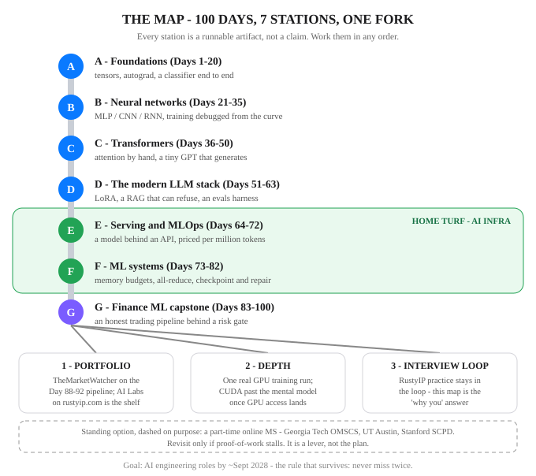

# Day 100 — The AI Engineer Map: What You Have, What's Next

**Tonight you'll be able to:** read the whole 100 days as one map — what each phase put on the shelf, where your edge actually is, and the sequenced next moves toward an AI engineering seat by ~Sept 2028.

## The one idea

Today teaches nothing new — deliberately. Day 100 is the **inventory**: what the 100 days put on the shelf, where the edge actually is, and what happens next, in order. Every phase below is a set of *verbs backed by runnable code* — the lessons are artifacts, not claims, and this page is the index card for all of them.

**The shelf, phase by phase.**
**A · Foundations (1–20):** tensors, autograd, training loops — learning as differentiable programming.
**B · Neural networks (21–35):** MLP/CNN/RNN models you can assemble and debug from the loss curve.
**C · Transformers (36–50):** attention computed by hand, and a tiny GPT that generates text.
**D · The modern LLM stack (51–63):** pretraining, SFT, LoRA, RAG, agents, evals — the whole post-training story.
**E · Serving & MLOps (64–72):** a model behind an API with metrics, batching and quantization tradeoffs, cost per million tokens.
**F · ML systems (73–82):** the memory wall, parallelism, checkpointing and repair, the GPU — distributed training as a systems problem.
**G · Finance ML capstone (83–100):** features, labels, walk-forward honesty, sizing, and a paper-trading harness behind a risk gate.

**Where the edge is.** Day 82 drew this map for Phase F; the finale promotes it to the career thesis. The scarcest seats in AI are not at the modeling layer — they are where training data flows, checkpoints stay durable, caches stay hot, and fleets stay alive. That layer is Phases E and F, and it is the layer your record already speaks: Staff SWE on Conveyor, Tesla's exabyte-scale Rust object store for AI training, and author of its Data Reliability Service; before that, AWS S3 core and DynamoDB team lead, where you led the Tiered Storage launch; since August 2026, traffic shaping. You are not entering AI from outside. You are translating a decade of systems work into its vocabulary — and the map says exactly which rows are translation and which are genuinely new ground (CUDA depth, a real GPU training run).

**What's next, in order.**
**1. Portfolio:** point TheMarketWatcher at the Day 88–92 pipeline — the capstone stops being an exercise and becomes a system; the 100 lessons themselves live in the AI Labs section of rustyip.com as the public shelf.
**2. Depth:** one real GPU training run, and CUDA past the mental model, once GPU access is in place.
**3. Interview loop:** RustyIP practice stays in the loop — this map is the "why you, for AI?" answer, rehearsed.
**4. The standing option:** a part-time online MS (Georgia Tech OMSCS, UT Austin, Stanford SCPD were the named candidates) stays on the table as a lever — revisit it only if proof-of-work stalls, not before.

**The pace is yours now.** The daily cadence stopped on 2026-10-30, at your call, and the full set was published to AI Labs to be worked through at your own pace — any order, any depth, revisited whenever a project pulls you back to a station. The map doesn't expire. Neither does the rule at the bottom of every page.

## Analogy

It's the **capacity plan you'd write for a system you operate**: inventory what's deployed, name the headroom honestly, sequence the roadmap. You've written that document for storage systems for a decade — tonight it's pointed at the operator. And like any good capacity plan, it separates what's already running (the shelf) from what's merely provisioned on paper (nothing — if it isn't runnable, it isn't on this map).

## See it



The road through the 100 days: seven stations, each one a runnable artifact. The E–F stretch is highlighted — serving and ML systems are home turf, where your storage-and-reliability decade is the scarcest input. Past the capstone, the road forks into the three next moves; the online MS stays dashed, a lever you pull only if proof-of-work stalls.

## Code it (~30 min)

One file, three views of the map, in pure stdlib — tonight the artifact *is* the career plan. **Part 1** prints the inventory: 7 phases, Days 1–100, and the can-do verbs each phase put on the shelf. **Part 2** prints the skills checklist — capability, the days that built it, the artifact that proves it. **Part 3** places the phases on a depth-vs-proof 2×2 and prints the stated next move for each, then asserts the map's shape: 7 phases, Days 1–100 contiguous, no gaps, no overlaps.

```python
"""Day 100 - The AI Engineer Map: What You Have,
What's Next.

The finale teaches nothing new - deliberately. It
draws the map the 100 days add up to, and makes the
map executable:

  Part 1  The inventory: 7 phases, Days 1-100, and
          the can-do verbs each phase put on the
          shelf. Every verb names a runnable artifact
          from its phase - attention computed by hand,
          a tiny GPT, LoRA adapters, a RAG that can
          refuse, a model behind an API, all-reduce
          across real processes, an honest trading
          pipeline. The lessons exist as code you can
          run; the map just indexes them.
  Part 2  A skills checklist: capability, the days
          that built it, the artifact that proves it.
          Proof standard: if it isn't runnable, it
          isn't on the list.
  Part 3  Depth vs proof: a 2x2 placement of the
          seven phases, and the stated next move for
          each - the sequenced plan toward AI
          engineering roles by ~Sept 2028. Depth is
          how far the understanding goes; proof is
          the artifact a stranger can run. Phases E
          and F sit top-right - that is the
          AI-infrastructure edge from Day 82's map:
          the storage-and-reliability layer of AI,
          where a decade of systems work is the
          scarcest input.

Pure stdlib, deterministic - no RNG, no torch, no
APIs, no downloads. Runs as-is in the ~/ai-lab venv
on the MacBook.

Expected output:

  Part 1 - the inventory: 7 phases, Days 1-100
    A  PyTorch & ML foundations           Days   1-20  (20 days, 4 can-do verbs)
         - build tensors and trace gradients with autograd
         - train a regression from scratch, no framework
         - fit a line to real market data
         - ship a tiny classifier end to end
    B  Neural networks                    Days  21-35  (15 days, 3 can-do verbs)
         - assemble MLP, CNN and RNN models in nn.Module
         - debug a training run from its loss curve
         - regularize a net that is memorizing
    C  Attention & transformers           Days  36-50  (15 days, 3 can-do verbs)
         - compute scaled dot-product attention by hand
         - build and train a tiny GPT that generates text
         - put numbers on KV cache and context cost
    D  The modern LLM stack               Days  51-63  (13 days, 4 can-do verbs)
         - fine-tune with LoRA instead of retraining
         - build a RAG that can refuse to answer
         - wire tool calls into an agent loop
         - grade a model with a runnable evals harness
    E  Inference serving & MLOps          Days  64-72  ( 9 days, 4 can-do verbs)
         - serve a model behind an API with metrics
         - pick a batching and quantization operating point
         - price inference per million tokens
         - watch a live model for drift
    F  ML systems / distributed training  Days  73-82  (10 days, 4 can-do verbs)
         - budget a training run against the memory wall
         - all-reduce gradients across real processes
         - checkpoint a run and restore it
         - translate ML systems into infra language
    G  Finance ML capstone                Days  83-100 (18 days, 4 can-do verbs)
         - build features and labels without leakage
         - run a walk-forward test that can say 'no edge'
         - size positions with Kelly and vol targeting
         - run a paper-trading harness behind a risk gate
    total: 100 days, 26 can-do verbs - every verb backed by
    runnable code in its phase
  Part 2 - skills checklist: capability / built / artifact
    attention, computed by hand          Day 38       scaled dot-product attention in torch
    a language model, built + trained    Day 42       tiny GPT that generates text
    parameter-efficient fine-tuning      Days 53, 94  LoRA adapters - merged, equivalence-checked
    retrieval that can refuse            Days 58-59   tiny RAG over your own docs, with a gate
    tool use + the agent loop            Days 60-61   tools as schemas; plan, act, observe
    evals you can run in CI              Days 57, 96  harness with slices and a regression gate
    a model behind an API                Day 71       stdlib server: /predict /health /metrics
    gradients across processes           Days 74, 98  ring all-reduce over real OS processes
    quantization, measured on outputs    Days 65, 97  int8/int4 error counted in flipped predictions
    a backtest that can say no           Days 87-88   walk-forward pipeline, costs included
    sizing as a formula                  Day 90       Kelly + vol targeting, simulated honestly
    checkpoint, checksum, resume         Day 78       checkpoint + verify-on-load + resume
    proof standard: if it isn't runnable, it isn't on this list
  Part 3 - depth vs proof, and the next move
                     PROOF working    PROOF high
    DEPTH high       A, B             C, E, F
    DEPTH working    -                D, G
    depth = how far the understanding goes; proof = the
    artifact a stranger can run. E and F sit top-right:
    that is the AI-infrastructure edge (Day 82's map).
    A next: Reference shelf - revisit only a named gap.
    B next: No separate move - load-bearing in every later build.
    C next: Keep the tiny GPT runnable - the transformer demo.
    D next: Aim the RAG and the evals harness at TheMarketWatcher.
    E next: Keep the serving API as the inference portfolio piece.
    F next: One real GPU training run; CUDA past the mental model.
    G next: Wire TheMarketWatcher to the Day 88-92 pipeline.
    checks: 7 phases, Days 1-100 contiguous, no gaps, no overlaps
  the rule that survives the series: never miss twice.
"""

# The shelf: letter, phase, day range, can-do verbs,
# depth, proof, and the stated next move.
PHASES = [
    ("A", "PyTorch & ML foundations", 1, 20,
     ["build tensors and trace gradients with autograd",
      "train a regression from scratch, no framework",
      "fit a line to real market data",
      "ship a tiny classifier end to end"],
     "high", "working",
     "Reference shelf - revisit only a named gap."),
    ("B", "Neural networks", 21, 35,
     ["assemble MLP, CNN and RNN models in nn.Module",
      "debug a training run from its loss curve",
      "regularize a net that is memorizing"],
     "high", "working",
     "No separate move - load-bearing in every later build."),
    ("C", "Attention & transformers", 36, 50,
     ["compute scaled dot-product attention by hand",
      "build and train a tiny GPT that generates text",
      "put numbers on KV cache and context cost"],
     "high", "high",
     "Keep the tiny GPT runnable - the transformer demo."),
    ("D", "The modern LLM stack", 51, 63,
     ["fine-tune with LoRA instead of retraining",
      "build a RAG that can refuse to answer",
      "wire tool calls into an agent loop",
      "grade a model with a runnable evals harness"],
     "working", "high",
     "Aim the RAG and the evals harness at TheMarketWatcher."),
    ("E", "Inference serving & MLOps", 64, 72,
     ["serve a model behind an API with metrics",
      "pick a batching and quantization operating point",
      "price inference per million tokens",
      "watch a live model for drift"],
     "high", "high",
     "Keep the serving API as the inference portfolio piece."),
    ("F", "ML systems / distributed training", 73, 82,
     ["budget a training run against the memory wall",
      "all-reduce gradients across real processes",
      "checkpoint a run and restore it",
      "translate ML systems into infra language"],
     "high", "high",
     "One real GPU training run; CUDA past the mental model."),
    ("G", "Finance ML capstone", 83, 100,
     ["build features and labels without leakage",
      "run a walk-forward test that can say 'no edge'",
      "size positions with Kelly and vol targeting",
      "run a paper-trading harness behind a risk gate"],
     "working", "high",
     "Wire TheMarketWatcher to the Day 88-92 pipeline."),
]

# The checklist: capability, the days that built it,
# the artifact that proves it.
CHECKLIST = [
    ("attention, computed by hand", "Day 38",
     "scaled dot-product attention in torch"),
    ("a language model, built + trained", "Day 42",
     "tiny GPT that generates text"),
    ("parameter-efficient fine-tuning", "Days 53, 94",
     "LoRA adapters - merged, equivalence-checked"),
    ("retrieval that can refuse", "Days 58-59",
     "tiny RAG over your own docs, with a gate"),
    ("tool use + the agent loop", "Days 60-61",
     "tools as schemas; plan, act, observe"),
    ("evals you can run in CI", "Days 57, 96",
     "harness with slices and a regression gate"),
    ("a model behind an API", "Day 71",
     "stdlib server: /predict /health /metrics"),
    ("gradients across processes", "Days 74, 98",
     "ring all-reduce over real OS processes"),
    ("quantization, measured on outputs", "Days 65, 97",
     "int8/int4 error counted in flipped predictions"),
    ("a backtest that can say no", "Days 87-88",
     "walk-forward pipeline, costs included"),
    ("sizing as a formula", "Day 90",
     "Kelly + vol targeting, simulated honestly"),
    ("checkpoint, checksum, resume", "Day 78",
     "checkpoint + verify-on-load + resume"),
]

# ---------- Part 1: the inventory ----------
print("Part 1 - the inventory: 7 phases, Days 1-100")
total_days = 0
total_verbs = 0
for letter, name, first, last, verbs, *_ in PHASES:
    days = last - first + 1
    total_days += days
    total_verbs += len(verbs)
    print(f"  {letter}  {name:<34} Days {first:>3}-{last:<3} "
          f"({days:>2} days, {len(verbs)} can-do verbs)")
    for v in verbs:
        print(f"       - {v}")
print(f"  total: {total_days} days, {total_verbs} can-do verbs - "
      "every verb backed by")
print("  runnable code in its phase")

# ---------- Part 2: the checklist ----------
print("Part 2 - skills checklist: capability / built / artifact")
for cap, built, artifact in CHECKLIST:
    print(f"  {cap:<36} {built:<12} {artifact}")
print("  proof standard: if it isn't runnable, it isn't on this list")

# ---------- Part 3: depth vs proof + next moves ----------
print("Part 3 - depth vs proof, and the next move")


def cell(depth, proof):
    hits = [l for l, _, _, _, _, d, p, _ in PHASES
            if d == depth and p == proof]
    return ", ".join(hits) if hits else "-"


print(f"  {'':<16} {'PROOF working':<16} PROOF high")
print(f"  {'DEPTH high':<16} {cell('high', 'working'):<16} "
      f"{cell('high', 'high')}")
print(f"  {'DEPTH working':<16} {cell('working', 'working'):<16} "
      f"{cell('working', 'high')}")
print("  depth = how far the understanding goes; proof = the")
print("  artifact a stranger can run. E and F sit top-right:")
print("  that is the AI-infrastructure edge (Day 82's map).")
for letter, name, first, last, verbs, depth, proof, move in PHASES:
    print(f"  {letter} next: {move}")
ranges = [(f, l) for _, _, f, l, *_ in PHASES]
assert ranges[0][0] == 1 and ranges[-1][1] == 100
assert all(ranges[i][1] + 1 == ranges[i + 1][0]
           for i in range(len(ranges) - 1))
assert total_days == 100 and len(PHASES) == 7
print("  checks: 7 phases, Days 1-100 contiguous, "
      "no gaps, no overlaps")
print("the rule that survives the series: never miss twice.")
```

**Expected output:**

```
Part 1 - the inventory: 7 phases, Days 1-100
  A  PyTorch & ML foundations           Days   1-20  (20 days, 4 can-do verbs)
       - build tensors and trace gradients with autograd
       - train a regression from scratch, no framework
       - fit a line to real market data
       - ship a tiny classifier end to end
  B  Neural networks                    Days  21-35  (15 days, 3 can-do verbs)
       - assemble MLP, CNN and RNN models in nn.Module
       - debug a training run from its loss curve
       - regularize a net that is memorizing
  C  Attention & transformers           Days  36-50  (15 days, 3 can-do verbs)
       - compute scaled dot-product attention by hand
       - build and train a tiny GPT that generates text
       - put numbers on KV cache and context cost
  D  The modern LLM stack               Days  51-63  (13 days, 4 can-do verbs)
       - fine-tune with LoRA instead of retraining
       - build a RAG that can refuse to answer
       - wire tool calls into an agent loop
       - grade a model with a runnable evals harness
  E  Inference serving & MLOps          Days  64-72  ( 9 days, 4 can-do verbs)
       - serve a model behind an API with metrics
       - pick a batching and quantization operating point
       - price inference per million tokens
       - watch a live model for drift
  F  ML systems / distributed training  Days  73-82  (10 days, 4 can-do verbs)
       - budget a training run against the memory wall
       - all-reduce gradients across real processes
       - checkpoint a run and restore it
       - translate ML systems into infra language
  G  Finance ML capstone                Days  83-100 (18 days, 4 can-do verbs)
       - build features and labels without leakage
       - run a walk-forward test that can say 'no edge'
       - size positions with Kelly and vol targeting
       - run a paper-trading harness behind a risk gate
  total: 100 days, 26 can-do verbs - every verb backed by
  runnable code in its phase
Part 2 - skills checklist: capability / built / artifact
  attention, computed by hand          Day 38       scaled dot-product attention in torch
  a language model, built + trained    Day 42       tiny GPT that generates text
  parameter-efficient fine-tuning      Days 53, 94  LoRA adapters - merged, equivalence-checked
  retrieval that can refuse            Days 58-59   tiny RAG over your own docs, with a gate
  tool use + the agent loop            Days 60-61   tools as schemas; plan, act, observe
  evals you can run in CI              Days 57, 96  harness with slices and a regression gate
  a model behind an API                Day 71       stdlib server: /predict /health /metrics
  gradients across processes           Days 74, 98  ring all-reduce over real OS processes
  quantization, measured on outputs    Days 65, 97  int8/int4 error counted in flipped predictions
  a backtest that can say no           Days 87-88   walk-forward pipeline, costs included
  sizing as a formula                  Day 90       Kelly + vol targeting, simulated honestly
  checkpoint, checksum, resume         Day 78       checkpoint + verify-on-load + resume
  proof standard: if it isn't runnable, it isn't on this list
Part 3 - depth vs proof, and the next move
                   PROOF working    PROOF high
  DEPTH high       A, B             C, E, F
  DEPTH working    -                D, G
  depth = how far the understanding goes; proof = the
  artifact a stranger can run. E and F sit top-right:
  that is the AI-infrastructure edge (Day 82's map).
  A next: Reference shelf - revisit only a named gap.
  B next: No separate move - load-bearing in every later build.
  C next: Keep the tiny GPT runnable - the transformer demo.
  D next: Aim the RAG and the evals harness at TheMarketWatcher.
  E next: Keep the serving API as the inference portfolio piece.
  F next: One real GPU training run; CUDA past the mental model.
  G next: Wire TheMarketWatcher to the Day 88-92 pipeline.
  checks: 7 phases, Days 1-100 contiguous, no gaps, no overlaps
the rule that survives the series: never miss twice.
```

## Today's win

Done when you can say, without notes: the seven phases, the artifact each one left you, why E and F are home turf, and the next three moves in order. And the shelf itself is closed out: all 100 lessons live in the AI Labs section of rustyip.com, with this page as their index card. One hundred days, one map — the map is the win.

## Short on time? 20-minute version

Read "See it" until you can redraw the road from memory, then run the code and read only Part 3 — the 2×2 and the next moves. That's the map; everything else is the legend.

## Day 101 is yours

There's no Day 101 lesson. There's the fork in the diagram: point TheMarketWatcher at the capstone pipeline, get one real GPU run under your belt, keep RustyIP warm. Pick one — then never miss twice.

*Day 100 of 100 · Never miss twice.*
